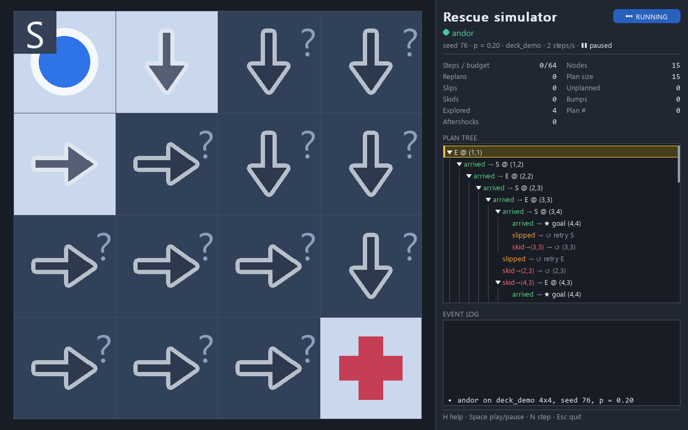
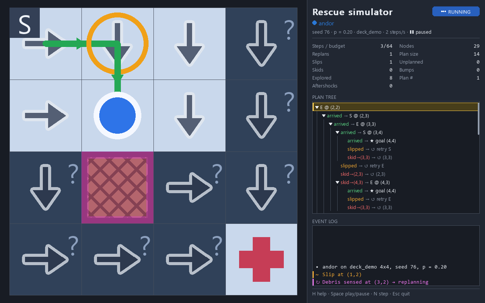
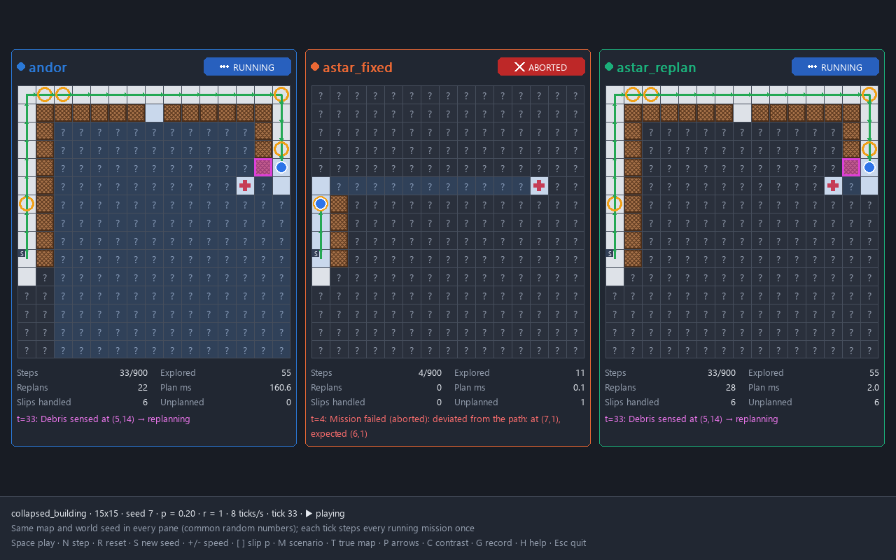
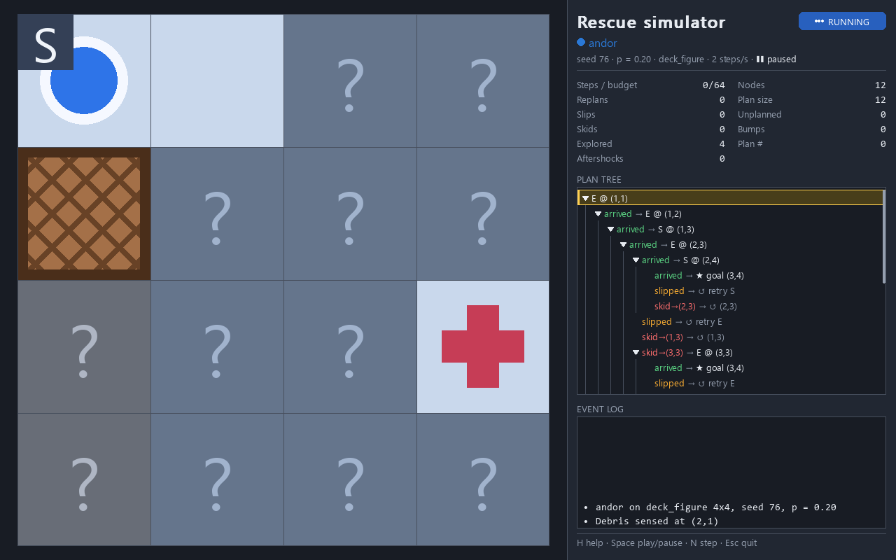
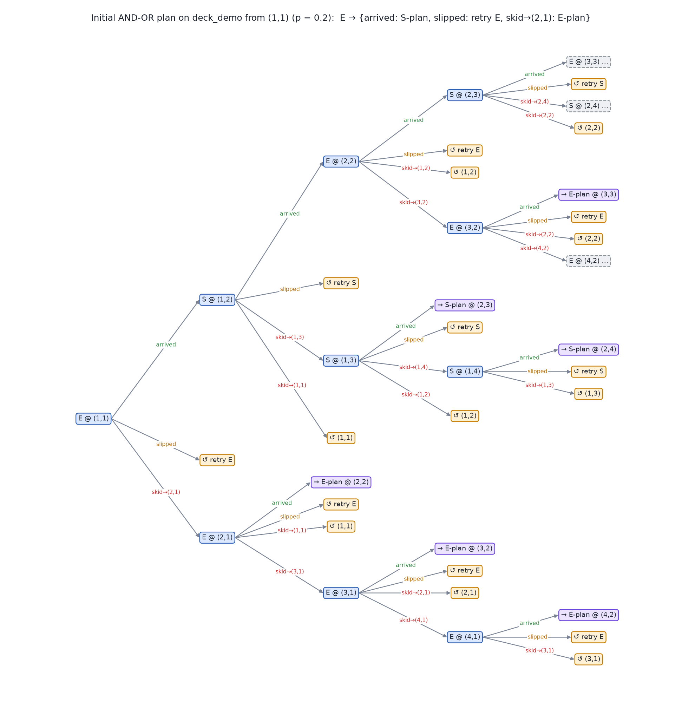
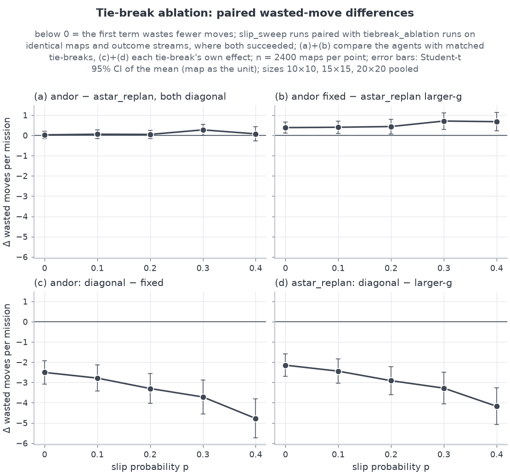

# Rescue Robot Navigation System

A rescue robot has to reach a survivor in a disaster-zone grid, but its wheels slip and skid
and it can only see the cells next to it. Instead of following a single path that breaks the
first time something goes wrong, the robot plans with **AND-OR graph search** (Russell & Norvig,
*AIMA* §4.3). The result is a **cyclic contingency plan** with an action for every possible
outcome, where a repeated slip simply becomes "retry". The planner runs inside a
**plan → act → observe → update belief → replan** loop. A simulation suite (Pygame simulator,
head-to-head comparison, scenario library, stress tests and a Monte Carlo harness) measures how
the agent compares with A\*-based baselines, and the report states plainly which of the
proposal's claims held up and which did not.



*`python -m rescue.sim --map maps/deck_demo.txt`: the contingency agent slips, senses hidden
debris, replans and rescues the survivor. The arrows show the current plan's policy.*

**Course:** CS23533 Foundations of Artificial Intelligence, Rajalakshmi Engineering College,
Chennai. **Team:** Srithan Saravanan (240701532), Subash R (240701538).

---

## Contents

- [What it does](#what-it-does)
- [Quick start](#quick-start)
- [Commands](#commands)
- [Screenshots](#screenshots)
- [Results](#results)
- [How the algorithm works](#how-the-algorithm-works)
- [Repository layout](#repository-layout)
- [Testing](#testing)
- [Design decisions](#design-decisions)
- [Known limitations](#known-limitations)
- [Contributing](#contributing)
- [Team, course and license](#team-course-and-license)

---

## What it does

**The problem.** The robot moves on an `R × C` grid with actions `N`, `E`, `S` and `W`. It knows
where the survivor is but not where the debris is. Every cell is *open*, *debris* or *unknown*
until the robot's sensor (Manhattan radius `r`, default 1, including its own cell) reveals it.

**Nondeterministic moves.** With slip parameter `p` (0 to 0.4), a move arrives with probability
`1 − p`, slips and stays put with `0.75·p`, and skids sideways with `0.25·p` (split equally left
and right). At `p = 0.2` that is 0.80 / 0.15 / 0.025 / 0.025. A move into debris or off the
grid leaves the robot where it is. High-slip terrain (`~`, water or mud) can override `p` per
cell.

**The agent.** `andor` builds a strong-cyclic contingency plan with AND-OR graph search and
follows the branch that matches each observed outcome. It replans only when the sensor
contradicts its map (*eager* mode, the default) or only when the contradiction touches the
current plan (*lazy* mode).

**Agents to compare.** All agents share the same sensor, belief update, "unknown means open"
assumption and step budget (`4·R·C`).

| ID | Agent | Behaviour |
|---|---|---|
| `andor` | Contingency agent | AND-OR cyclic plan; follows the branch matching the outcome; replans only on map contradictions. |
| `astar_fixed` | Fixed A\* | Plans once and aborts the first time the robot is not where it expected to be, or when the next cell turns out to be debris. |
| `astar_replan` | A\* + replan | Replans whenever the outcome deviates from the path or the map is contradicted. |
| `dstar_lite` (stretch) | D\* Lite | Incremental replanning (Koenig & Likhachev 2002), same triggers as `astar_replan`. |
| `vi_expected` (stretch) | Expected-steps optimal | Value iteration with the true outcome probabilities, same triggers as `andor`. |

**The simulation suite.**

- **Interactive simulator** (`rescue.sim`): fog of war, true-map overlay, policy arrows, executed
  trace coloured by outcome, collapsible plan tree, live metrics, event log, map editor and
  GIF/MP4 recording.
- **Head-to-head comparison** (`rescue.compare`): two to five agents on the same map with the
  same outcome stream (common random numbers), advancing in lock-step.
- **Scenario library** (`rescue.mapgen`): `random_rubble`, `collapsed_building`, `flooded_zone`
  and `maze_corridors` generators, each guaranteeing a reachable survivor, plus the
  `deck_demo` and `deck_figure` maps from the proposal slides.
- **Stress simulations**: aftershocks that drop new debris outside the robot's view,
  terrain-dependent slip, sensor radius 1 vs 2, slip sweeps.
- **Replay** (`rescue.replay`): scrub through a saved mission step by step.
- **Monte Carlo harness** (`rescue.experiments`): agents × scenarios × slip p × grid sizes, in
  parallel, with paired statistics, plots and an automatic verdict for every hypothesis.

Everything is deterministic given a seed: the same seed gives the same map and the same trace.

---

## Quick start

You need **Python 3.11 or newer** and git. The simulator opens a Pygame window (pygame-ce);
everything else also runs without a display.

### Windows (PowerShell)

```powershell
git clone https://github.com/SUBASH-R-007/Rescue-Robot.git
cd Rescue-Robot
python -m venv .venv                 # or: py -3.11 -m venv .venv
.venv\Scripts\Activate.ps1
python -m pip install --upgrade pip
pip install -e ".[dev]"
pytest -q
```

If PowerShell refuses to run `Activate.ps1`, skip activation and call the venv's interpreter
directly, for example `.venv\Scripts\python.exe -m pytest -q`.

### Linux, macOS or Git Bash

```bash
git clone https://github.com/SUBASH-R-007/Rescue-Robot.git
cd Rescue-Robot
python3 -m venv .venv                # Git Bash on Windows: python -m venv .venv
source .venv/bin/activate            # Git Bash on Windows: source .venv/Scripts/activate
python -m pip install --upgrade pip
pip install -e ".[dev]"
pytest -q
```

Then try the demo:

```bash
python -m rescue.demo
```

**Optional extras.** `pip install -e ".[dev,video]"` adds `imageio-ffmpeg` for MP4 recording
(GIF recording works without it).

**Tip for synced folders.** If the repository lives in OneDrive, Dropbox or similar, create the
virtual environment *outside* the synced folder (for example `~/.venvs/rescue-robot`) so the
sync client does not upload a few hundred megabytes of packages.

---

## Commands

All commands run from the repository root with the virtual environment active. Every
command-line tool prints its full option list with `--help`. The package also installs short
aliases: `rescue-demo`, `rescue-sim`, `rescue-compare`, `rescue-replay` and
`rescue-experiments`.

### Demo: the proposal's sample output

```bash
python -m rescue.demo
```

Runs one mission on [`maps/deck_demo.txt`](maps/deck_demo.txt) with a fixed, recorded seed and
prints the map, the initial root plan, the execution trace and the summary:

```text
Rescue Robot — AND-OR contingency plan demo (map deck_demo, seed 76, p = 0.2)

   1 2 3 4
1  S . . .
2  . . . .
3  . # . .
4  . . # P

Initial plan from (1,1): E → {arrived: S-plan, slipped: retry E, skid→(2,1): E-plan}

Execution trace:
(1,1) E ok → (1,2) S slip → (1,2) S ok → (2,2) [debris at (3,2), replanned] E ok → (2,3) S slip → (2,3) S ok → (3,3) [debris at (4,3), replanned] E slip → (3,3) E ok → (3,4) S ok → (4,4)

Cells explored: 12   Replans: 2   Slips handled: 3   Collisions: 0
Rescue successful
```

Coordinates shown to people are 1-indexed `(row, col)`. The slide's root plan says
`skid→(2,1): N-plan`; a distance-ordered planner produces `E-plan` there, and
[`docs/plan.md`](docs/plan.md) (decision D14) explains why. Useful options: `--seed`, `--p`,
`--agent astar_replan`, `--lazy`, and `--save [PATH]` to write a run file for the replay
viewer.

### Interactive simulator

```bash
python -m rescue.sim --map maps/deck_demo.txt
python -m rescue.sim --scenario collapsed_building --rows 20 --cols 20 --seed 7
python -m rescue.sim --scenario flooded_zone --p 0.3 --radius 2 --aftershock-q 0.1
```

Without `--map` or `--scenario` it opens `maps/deck_demo.txt`. Other options: `--agent`,
`--lazy`, `--aftershock-k`, `--high-contrast`, `--record PATH` (record from the start),
`--save-run` (write `runs/<timestamp>_<agent>_<seed>.json` when a mission ends) and
`--headless --frames N --screenshot recordings/out.png` (no window; `recordings/` is
git-ignored).

| Key | Action |
|---|---|
| `Space` | play / pause |
| `N` | single step |
| `R` | reset (same seed) |
| `S` | new seed (seed + 1) |
| `+` / `-` | faster / slower |
| `[` / `]` | slip p down / up by 0.05 |
| `1` `2` `3` | agent: `andor` / `astar_fixed` / `astar_replan` |
| `M` | next scenario (map files in `maps/`, then the generators) |
| `E` | map editor (pauses): click toggles debris, `Shift`+click sets the start, `Ctrl`+click sets the survivor |
| `Ctrl`+`S` | save the map (the edited one, else the mission's initial map) to `maps/edited_<timestamp>.txt` |
| `T` | true-map overlay |
| `P` | policy arrows |
| `C` | high-contrast palette |
| `G` | start / stop recording a GIF (MP4 with `--mp4`) |
| `H` | help overlay |
| `Esc` | quit |
| Mouse | click a plan-tree row's ▸/▾ to fold / unfold it; the wheel scrolls the plan tree and event log |

Colour is never the only cue: unknown cells show `?`, debris is cross-hatched, `~` terrain has
wave lines, slips are amber rings and skids red arrows.

### Head-to-head comparison

```bash
python -m rescue.compare --scenario collapsed_building --seed 7
python -m rescue.compare --map maps/building_01.txt --agents andor,astar_replan
python -m rescue.compare --agents andor,astar_replan,dstar_lite,vi_expected --p 0.3
```

Each pane runs its own mission on the same true map with the same world seed, so every pane
draws the same outcome random numbers, and all missions advance one step per tick. Status
badges show RUNNING / RESCUED / ABORTED / BUDGET / UNREACHABLE. The default panes are `andor`,
`astar_fixed` and `astar_replan`. Keys: `Space`, `N` (one lock-step tick), `R`, `S`, `+/-`,
`[ ]`, `M`, `T`, `P`, `C`, `G`, `H`, `Esc`, as in the simulator. With `--headless` it prints
one status line per pane.

### Replay a saved mission

```bash
python -m rescue.demo --save                      # writes runs/<timestamp>_andor_<seed>.json
python -m rescue.replay runs/<file>.json
```

Run files come from `rescue.demo --save`, `rescue.sim --save-run` or `rescue.runs.save_run`.

| Key | Action |
|---|---|
| `←` / `→` | one step back / forward |
| `Shift`+`←` / `→` | ten steps |
| `Home` / `End` | first / last step |
| `Space` | play / pause |
| `+` / `-` | speed |
| click on the bar | jump to that step |
| `T`, `P`, `C`, `G`, `H`, `Esc` | as in the simulator |

### Generate scenario maps

```bash
python -m rescue.mapgen maze_corridors --rows 15 --cols 15 --seed 1
python -m rescue.mapgen random_rubble --rows 20 --cols 20 --seed 3 --param density=0.3
python -m rescue.mapgen collapsed_building --rows 15 --cols 20 --seed 0 --out maps/my_building.txt
```

Prints the map in the ASCII format (`.` open, `#` debris, `S` start, `P` survivor, `~` open
high-slip terrain). `--out` also writes it with a header that records the exact command, so
every sample map in [`maps/`](maps/) regenerates byte for byte. Scenarios: `random_rubble`,
`collapsed_building`, `flooded_zone`, `maze_corridors`, `deck_demo`, `deck_figure`.

### Monte Carlo experiments

```bash
python -m rescue.experiments --quick                            # small smoke run, writes results/quick/
python -m rescue.experiments --config experiments/main.yaml     # full run, writes results/
```

- [`experiments/quick.yaml`](experiments/quick.yaml) has the same blocks as the full run with
  fewer maps and one grid size (10×10; the `scaling` block keeps 10 and 15 with 5 maps). It runs
  1,130 tasks / 4,280 missions and finishes well under the 60 s limit.
  Its output goes to `results/quick/`, which is not committed.
- [`experiments/main.yaml`](experiments/main.yaml) is the full run: 27,450 tasks and 99,400
  missions, which took 873.9 s with 18 worker processes. It overwrites the committed files in
  `results/`.

Each run writes `raw.csv` (one row per mission), `summary.csv` (means with 95 % CIs, Wilson
intervals for success rates), `HYPOTHESES.md` (verdicts and paired tests), `run_meta.json` and
`plots/*.png`. Options: `--workers N` (1 = in-process), `--out DIR`, `--no-plots`,
`--max-tasks N` (an evenly spaced sample) and `--quiet`.

### Regenerate the figures

```bash
python scripts/make_figures.py                  # simulator figures into docs/figures/
python scripts/make_figures.py --only gif tree  # gif, replan, figure, tree
python scripts/make_figures.py --out some/dir
python -m rescue.compare --headless --frames 250 --screenshot docs/figures/compare_collapsed_building.png
```

`make_figures.py` renders the simulator figures (the GIF, the two simulator screenshots and the
plan-tree PNG) headlessly and deterministically. The comparison screenshot comes from the
compare CLI; its "Plan ms" column is wall-clock time, so it differs slightly between runs. The
experiment plots in `results/plots/` come from `rescue.experiments`.

### Running without a display

The `--headless` flags select SDL's dummy drivers themselves. For anything else that imports
pygame (tests, scripts, CI), set them first:

```bash
export SDL_VIDEODRIVER=dummy SDL_AUDIODRIVER=dummy              # bash
```

```powershell
$env:SDL_VIDEODRIVER = "dummy"; $env:SDL_AUDIODRIVER = "dummy"  # PowerShell
```

---

## Screenshots

| | |
|---|---|
|  |  |
| **Simulator** on `deck_demo` right after the first replan: debris sensed at (3,2), new policy arrows, plan tree and event log on the right. | **Comparison** on `collapsed_building`, seed 7: `astar_fixed` has already aborted after its first deviation; `andor` and `astar_replan` are still running. |
|  |  |
| **The title-slide map** (`maps/deck_figure.txt`) at the start, under fog of war. | **The initial contingency plan** on `deck_demo`: `slipped` branches loop back as "retry", skids get their own sub-plans. |

---

## Results

The full Monte Carlo run ([`experiments/main.yaml`](experiments/main.yaml), base seed 2026)
simulated **99,400 missions** of the five agents on 27,450 tasks: four scenarios, slip
`p ∈ {0, 0.1, 0.2, 0.3, 0.4}`, grid sizes from 10×10 up to 30×30, aftershocks, sensor radius
1 vs 2, eager vs lazy replanning and a tie-break ablation. Every agent saw the same maps and the
same outcome stream, so comparisons are paired, with the map as the unit of analysis. The
verdict rules for H1–H6 come from the proposal deck; H7 and its ±0.5-move equivalence margin
were added after an earlier full run (see [Known limitations](#known-limitations)). No experiment
was tuned toward a verdict.

| # | Claim | Verdict | Headline number |
|---|---|---|---|
| H1 | `andor` rescues the survivor in ≥ 95 % of missions at p = 0.3 | **supported** | 100.0% [99.8%, 100.0%] (2400/2400) |
| H2 | `andor` never reaches an unplanned state (and never bumps into debris) | **supported** | Σ unplanned states = 0, Σ bumps = 0 over 27450 `andor` runs (26100 unique missions) |
| H3 | `andor` wastes fewer moves than `astar_replan` | **supported** (but see H7) | −3.09 moves [−3.81, −2.37] over 2400 maps |
| H4 | `astar_fixed` fails the first time an action misbehaves | **supported** | success 4.6% at p = 0 vs 0.6% at p ≥ 0.1; 6141/6141 runs with a slip or skid failed |
| H5 | `andor` replans less often than `astar_replan` | **supported** | −14.14 replans [−14.73, −13.56] over 2400 maps |
| H6 | `vi_expected` (expected-steps optimal) needs fewer steps than `andor` | **refuted** | +1.31 steps [+0.59, +2.04] over 2400 maps |
| H7 | `andor`'s wasted-move advantage survives matched tie-breaking | **refuted** | matched diagonal +0.11 [−0.12, +0.35]; matched plain +0.56 [+0.20, +0.91] |

Brackets are 95 % confidence intervals. H3, H5, H6 and H7 are paired differences (first agent
minus second) pooled over p > 0. The full table with p-values and per-p, per-scenario and
per-size breakdowns is in
[`results/HYPOTHESES.md`](results/HYPOTHESES.md).

**What the numbers mean** (from [`docs/results.md`](docs/results.md)):

1. **Reliability does not separate the agents.** `andor` rescued the survivor every time, but so
   did every other replanning agent. Only the never-replanning `astar_fixed` fails (171 of
   14,400 runs succeeded).
2. **Zero unplanned states (H2) and fewer replans (H5) are one design property, not two
   benefits.** The contingency plan already covers every slip and skid, while A\* + replan
   replans after each one by definition: about 94 % of the replan gap is exactly those
   deviations. Lazy replanning shrinks the gap by 68–77 %.
3. **The "fewer wasted moves" result (H3) does not come from contingency planning.** It comes
   from how ties between equally short routes are broken. With matched tie-breaking the
   advantage disappears (H7).
4. **AND-OR costs far more planning time:** about 62 times as much per mission as A\* + replan
   in the slip sweep, and 39× (10×10) to 268× (30×30) as much per planning call.
5. **The expected-steps planner does not beat the default `andor`** (H6), but that comparison is
   confounded with tie-breaking.



The full write-up, with every plot, the statistical methods and the threats to validity, is
[`docs/results.md`](docs/results.md). Raw and summarised data: [`results/raw.csv`](results/raw.csv),
[`results/summary.csv`](results/summary.csv), [`results/run_meta.json`](results/run_meta.json),
[`results/plots/`](results/plots/).

---

## How the algorithm works

1. During a planning call the belief map is frozen, so a planning state is just the robot's
   position. Unknown cells are assumed open.
2. `Results(s, a)` is the **set** of cells the robot may end up in (`arrived`, `slipped`,
   `skid-L`, `skid-R`); blocked outcomes collapse to `s`, and outcomes on the same cell merge.
3. At an **OR node** the robot picks an action (ordered by BFS distance of the intended cell,
   then a diagonal tie-break, then `N, E, S, W`); at an **AND node** nature picks the outcome,
   and every outcome needs a sub-plan.
4. A state already on the current path becomes a **`Loop`** ("retry") instead of a failure, and a
   global solved table turns tree search into graph search (**`Ref`** nodes).
5. A semantic **`HAS_PROGRESS`** check accepts an action only if the goal (or a state proven to
   reach it, or a proper ancestor) stays reachable, and a transactional solved table rolls back
   failed attempts. Together they reject wall-bump loops and mutual loops.
6. The result is a **strong-cyclic** plan: under fair nondeterminism the robot reaches the
   survivor with probability 1. Property tests check it against a fixpoint reference planner
   (Cimatti et al. 2003), which is also a fallback that the full run never needed.
7. The executor follows the branch that matches each outcome, senses, updates the belief and
   replans only on map contradictions. With sensor radius r ≥ 1 every possible outcome cell is
   sensed before acting, so 0 unplanned states and 0 bumps hold by construction.

Pseudocode, the correctness argument, counterexamples for simpler acceptance rules, the
completeness proof and measured planning times are in
[`docs/algorithm.md`](docs/algorithm.md).

---

## Repository layout

```text
Rescue-Robot/
├── src/rescue/
│   ├── config.py           constants and frozen config dataclasses (no magic numbers elsewhere)
│   ├── grid.py             positions, cell types, TrueGrid, ASCII map I/O, fmt_pos
│   ├── belief.py           BeliefMap: sensing updates, contradiction detection
│   ├── model.py            actions, slip/skid transition models, ProblemModel.results()
│   ├── world.py            the true world: seeded outcome draws, sensor, aftershocks
│   ├── plan.py             plan nodes (Goal, Loop, Ref, Act), policy, pretty-print, tree, stats
│   ├── planners/           andor, bfs, astar, validate, strong_cyclic_fixpoint,
│   │                       dstar_lite, value_iteration
│   ├── agents/             contingency (andor), astar_fixed, astar_replan, dstar_lite, vi_expected
│   ├── runner.py           mission loop, StepEvent, metrics, trace and summary formatting
│   ├── runs.py             run files (JSON) for replay
│   ├── mapgen.py           scenario generators and their CLI
│   ├── demo.py, sim.py, compare.py, replay.py, cli_utils.py   command-line entry points
│   ├── viz/                Pygame UI: renders StepEvents, contains no planning logic
│   └── experiments/        Monte Carlo harness: run, stats, hypotheses, plots
├── tests/                  unit, property, invariant, statistical and headless UI tests
├── maps/                   deck_demo, deck_figure and sample generated maps (ASCII)
├── experiments/            main.yaml (full run), quick.yaml (smoke run)
├── results/                raw.csv, summary.csv, HYPOTHESES.md, run_meta.json, plots/
├── docs/
│   ├── brief.md            original project specification
│   ├── plan.md             interface contract and design decisions
│   ├── architecture.md     module map, data flow, determinism, extension points
│   ├── algorithm.md        the planning algorithm and its correctness
│   ├── results.md          results chapter
│   └── figures/            GIF and screenshots
├── scripts/make_figures.py regenerates the simulator figures in docs/figures/
├── CLAUDE.md               contributor conventions and commands
├── pyproject.toml          package metadata, dependencies, pytest / ruff / coverage settings
└── LICENSE
```

---

## Testing

```bash
pytest -q                                      # everything
pytest -q -m "not slow"                        # skip the 30x30 planning-time tests (@pytest.mark.slow)
pytest -q -n auto                              # in parallel (pytest-xdist)
pytest --cov=rescue --cov-report=term-missing  # coverage (viz/ is excluded)
ruff check .                                   # lint, must be clean
```

What the suite checks:

- **Unit tests** for every module: ASCII map round trips and parse errors, sensor footprints,
  belief updates and contradiction cases, plan pretty-printing and trees, BFS / A\* / D\* Lite
  path lengths, value-iteration closed forms, trace and summary formats.
- **Statistical tests**: a χ² test over 100k samples checks the slip/skid distribution at
  p = 0.2; terrain-slip frequencies are checked the same way.
- **Property tests** (Hypothesis) on hundreds of random
  maps up to 8×8 with random slip: AND-OR finds a plan exactly when the fixpoint reference
  planner does, every AND-OR plan passes the `is_strong_cyclic` validator, the plan tree is well
  formed, and the default ordering never backtracks. A second property runs adversarial action
  orderings, where rollback and `HAS_PROGRESS` are exercised, and checks that every returned plan
  is still sound.
- **Regression tests** for the classic failure modes: the wall-bump "plan", states that only
  loop into each other, dead-end alcoves, and rollback after a rejected action.
- **Invariants over 1,000 seeded missions**: for `andor`, every mission is rescued with
  0 unplanned states, 0 bumps and 0 planner fallbacks across slip p, sensor radius, replan mode,
  aftershocks and high-slip terrain; `astar_fixed` aborts at its first deviation; the same seed
  gives an identical trace; with r = 0 the safety net really fires.
- **Scenario and stress tests**: every generator yields a reachable survivor over many seeds,
  sample maps regenerate byte for byte, and aftershocks never cut the survivor off.
- **Experiment harness**: an end-to-end run on a tiny config, the CSV schema, Wilson intervals,
  hypothesis rendering, and identical results with 1 and 2 worker processes.
- **Headless UI tests**: the simulator, replay viewer and comparison app run under SDL's dummy
  drivers and are driven through their public API: render frames, exercise the controls, save
  screenshots and recordings, round-trip run files, and check lock-step and common random
  numbers across panes.

Coverage is measured on `src/rescue` with `viz/` excluded (the UI is covered by the headless
smoke tests instead); the project target is 85 %.

---

## Design decisions

[`docs/plan.md`](docs/plan.md) is the source of truth: the file tree, every module's interface
contract and the numbered decisions (D1–D21) that resolve the ambiguities of the original
specification ([`docs/brief.md`](docs/brief.md)). A few that shape everything else:

- **Slip depends on the cell the robot stands on** (D4); blocked outcomes stay in place.
- **The planner uses only the support** of the outcome distribution, not the probabilities (D5).
- **One outcome random number per step** for every agent, which gives common random numbers
  across agents and conditions (D3).
- **A bump is entering debris the agent did not know about**; moves into known debris or walls
  are anticipated "blocked" outcomes (D6).
- **Action ordering** by BFS distance, then a diagonal tie-break, then `N, E, S, W` (D13); the
  tie-break ablation (D21, H7) measures what that choice alone is worth.
- **The deck's root plan is reproduced with one letter changed** (`E-plan` instead of `N-plan`),
  documented rather than hard-coded (D14).

---

## Known limitations

From [`docs/results.md`](docs/results.md) §5 and the project scope:

- **The optimistic "unknown means open" assumption drives the step results.** Which equally short
  route an agent picks matters more for wasted moves than contingency planning does (H7). A debris
  prior or frontier-aware costs could change the ranking; neither was tested.
- **AND-OR ignores how likely each outcome is.** It cannot prefer firm ground over mud; value
  iteration can. That is a property of strong-cyclic planning, not a bug.
- **Planning is expensive.** AND-OR's guarantee costs 39× (10×10) to 268× (30×30) as much
  planning time per call as A\* + replan, and about 62 times as much per mission; its lower
  replan count does not pay for it.
- **Success rates do not discriminate.** The `4·R·C` step budget never bound and every survivor
  was reachable, so all replanning agents succeeded every time. Strong-cyclic plans reach the goal
  only with probability 1 in the limit, so a budget failure is possible in principle (D15), though
  none occurred.
- **Synthetic maps.** The results describe the four generators, not real disaster sites; only
  `flooded_zone` has terrain-dependent slip.
- **Timings** are wall-clock measurements of a pure-Python implementation on one Windows 11
  machine with 18 worker processes; ratios between agents are more reliable than absolute values.
- **Statistics:** no multiplicity correction; several analyses are post hoc, and H7 was added
  after an earlier full run had shown H3's gap at p = 0.
- **Not implemented:** noisy sensing, an unknown survivor location, multiple survivors, LAO\* or
  terrain-aware AND-OR costs, maps larger than 30×30 in the experiments, and the optional
  browser build with `pygbag`. The harness does not record AND-OR rollbacks.

---

## Contributing

Read [`CLAUDE.md`](CLAUDE.md) (conventions and commands) and [`docs/plan.md`](docs/plan.md)
before changing a public interface; if code and plan disagree, fix one of them in the same
change. [`docs/architecture.md`](docs/architecture.md) maps the modules, the data flow and the
extension points. In short:

- Python ≥ 3.11, `from __future__ import annotations`, type hints and docstrings on public
  functions, frozen dataclasses where possible, small modules.
- No magic numbers in logic: constants live in [`src/rescue/config.py`](src/rescue/config.py)
  (UI constants in `src/rescue/viz/theme.py`).
- Internal positions are 0-indexed `(row, col)`; anything a person sees is 1-indexed via
  `grid.fmt_pos`.
- Every random draw comes from a seeded `numpy.random.Generator`; never use `random` or unseeded
  numpy. Same seed, same trace.
- The UI only renders `runner.StepEvent`s and forwards key presses; behaviour belongs in the core.
- `pytest -q` and `ruff check .` must be green before a commit.
- Report results honestly: never tune an experiment so the proposed agent wins.

---

## Team, course and license

- **Team:** Srithan Saravanan (240701532) and Subash R (240701538)
- **Course:** CS23533 Foundations of Artificial Intelligence, Rajalakshmi Engineering College,
  Chennai
- **License:** MIT, see [`LICENSE`](LICENSE)

**References.** S. Russell and P. Norvig, *Artificial Intelligence: A Modern Approach*, §4.3
(AND-OR search, cyclic plans). A. Cimatti, M. Pistore, M. Roveri and P. Traverso (2003),
strong-cyclic planning (the fixpoint reference planner). S. Koenig and M. Likhachev (2002),
D\* Lite. E. Hansen and S. Zilberstein (2001), LAO\*: solutions with loops. Full list in
[`docs/algorithm.md`](docs/algorithm.md) §8.
