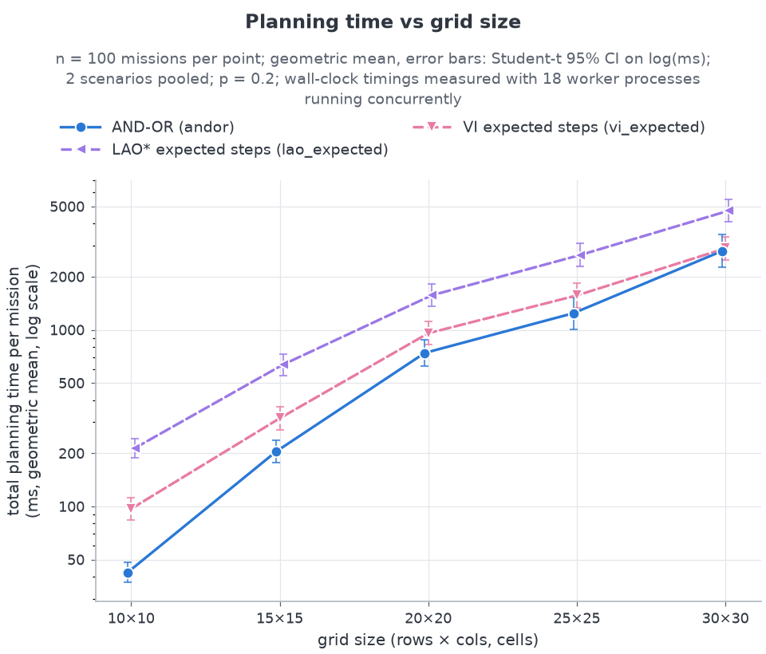

# The planning algorithm: AND-OR graph search with cyclic plans

This chapter of the project report describes how the rescue robot plans, and argues that its
plans are correct. It covers the planner in `src/rescue/planners/andor.py`, the plan structures
in `src/rescue/plan.py` and the model in `src/rescue/model.py`. §8 adds the LAO\* stretch
planner of round 2 (`src/rescue/planners/lao_star.py`) and its measured result. Design decisions
are cited by their numbers in `docs/plan.md` (D1 to D21), and the original specification is
`docs/brief.md`.

**Conventions.** Coordinates are written 1-indexed as `(row, col)`, the same way the program
prints them (internally the code is 0-indexed). Maths uses plain notation:

| Symbol | Meaning |
|---|---|
| `R`, `C` | number of grid rows and columns |
| `g` | the goal: the survivor's cell |
| `n` | number of cells the planner treats as free; `n ≤ R·C` |
| `d(s)` | breadth-first-search (BFS) distance from `s` to `g` on the belief map (`∞` if there is no path) |
| `p(s)` | slip parameter at cell `s` (0 ≤ p ≤ 0.4) |
| `Results(s, a)` | set of possible next cells when action `a` is executed at `s` |
| `π` | a policy: a partial map from states to actions |

---

## 1. Problem formulation

### 1.1 World

The disaster zone is an `R × C` grid. On the true map every cell is `OPEN`, `DEBRIS` or
`SURVIVOR` (D1). Some open cells are high-slip terrain (`~`, water or mud). Terrain changes
how the robot moves but not whether a cell can be entered (D2). The robot knows where the
survivor is but does not know where the debris is. It has four actions, `N`, `E`, `S` and `W`.
Every action is always available, and a move that is blocked leaves the robot where it is.

### 1.2 Nondeterministic moves (the slip model)

When the robot executes action `a` while standing on cell `s`, one of four outcomes happens. The
slip parameter `p = p(s)` belongs to the cell the robot stands on (D4).

| Outcome label | Where the robot ends up | Probability | at p = 0.2 |
|---|---|---|---|
| `arrived` | one cell in direction `a` | `1 − p` | 0.80 |
| `slipped` | stays on `s` | `0.75·p` | 0.15 |
| `skid-L` | one cell to the left of the heading | `0.125·p` | 0.025 |
| `skid-R` | one cell to the right of the heading | `0.125·p` | 0.025 |

Left and right are relative to the heading: `N` → (`W`, `E`), `E` → (`N`, `S`), `S` → (`E`,
`W`), `W` → (`S`, `N`). If the cell an outcome would enter is off the grid or debris, the robot
stays on `s`. The constants 0.75 and 0.25 are `SLIP_STAY_FRACTION` and `SKID_FRACTION` in
`config.py`.

### 1.3 The planner's model: `Results(s, a)` is a set

The planner never uses these probabilities. It uses only the **support**, meaning the outcomes
whose probability is above `PROB_EPS = 1e-12` (D5). `ProblemModel.results(s, a)` is computed
in four steps:

1. For each outcome kind in the support, the target is the cell that outcome would enter, or
   `s` itself for `slipped`.
2. If the target is not free on the planning map (off the grid, or believed to be debris), the
   target becomes `s`. The robot is blocked and stays.
3. Outcomes that land on the same cell are **merged** into one outcome. That outcome keeps all
   of their labels, in the fixed order `arrived, slipped, skid-L, skid-R`.
4. The outcomes are ordered by their first label. As a result, `arrived` always comes first.

So `Results(s, a)` is a set of between one and four distinct cells, and each cell is tagged
with the labels that lead to it. Example: on the deck map at `(1,1)` with `p = 0.2`, action `E`
gives

```
Results((1,1), E) = { (1,2): [arrived],
                      (1,1): [slipped, skid-L],    <- the north skid hits the wall and merges
                      (2,1): [skid-R] }
```

Three properties of this model are used repeatedly below:

* **(R1) Locality.** Every `s' ∈ Results(s, a)` is either `s` or a free 4-neighbour of `s`.
* **(R2) Only `p > 0` matters.** If `p(s) > 0`, all four outcome kinds are in the support. A
  plan therefore depends on the slip parameter only through whether it is zero or not. When
  `p(s) = 0`, each `Results(s, a)` has exactly one element and AND-OR search reduces to
  ordinary deterministic search.
* **(R3) `arrived` is always possible.** Its probability is `1 − p ≥ 0.6`, because `p ≤
  MAX_SLIP_P = 0.4`.

**State, goal, and why the map is not part of the state.** During one planning call the belief
map is frozen, so the planning state is just the robot's position. The state space is the set
of free cells, so `n ≤ R·C`. The goal state `g` is the survivor's cell, and the mission ends
there. The principled alternative would be to plan over *belief states*: the position together
with everything the robot might learn about the map. That is a partially observable problem
(a POMDP; Kaelbling, Littman & Cassandra 1998), and it has exponentially many states. We
deliberately trade that generality for tractability. Map uncertainty is handled by an
optimistic assumption plus replanning (§1.4–1.5), and motion uncertainty is handled exactly by
the contingency plan.

### 1.4 Belief, sensing and the optimistic assumption

The belief map stores `UNKNOWN`, `OPEN`, `DEBRIS` or `SURVIVOR` for each cell. At the start
every cell is `UNKNOWN` except the survivor's cell. The sensor reads the true contents of every
cell within Manhattan distance `r` of the robot, including its own cell (D7). It reads them at
`t = 0` and after every step. The default is `r = 1`, which covers the 4-neighbours plus the
robot's cell.

For planning, an `UNKNOWN` cell is **assumed open**. This is the optimistic "free-space
assumption", and D\* Lite (Koenig & Likhachev 2002) uses the same one. A **contradiction** is
a sensed `DEBRIS` in a cell that the belief held as `UNKNOWN` (the optimism was wrong) or as
`OPEN` (an aftershock changed it) (D8). An `UNKNOWN` cell that turns out to be `OPEN` is not a
contradiction, because the plan already assumed it was open.

### 1.5 The plan → act → observe → update → replan loop

```
belief ← all UNKNOWN, survivor cell known
observe the footprint at the start; plan ← AND_OR_SEARCH(model(belief), start)
while robot ≠ survivor and steps < budget (4·R·C):
    if plan = FAIL: stop, "unreachable"
    a  ← policy(plan)[pos]
    pos' ← world.step(a)                       -- nature picks the outcome
    contradictions ← belief.update(sense(pos'))
    unplanned ← pos' ∉ Results_plan(pos, a)    -- safety net (never true for r ≥ 1, §4.4)
    if pos' ≠ survivor and (unplanned or pos' has no policy entry
                            or (contradictions and (eager or a contradicted cell is in the
                                                    plan's envelope))):
        plan ← AND_OR_SEARCH(model(belief), pos');  replans ← replans + 1
    pos ← pos'
```

`eager` (the default) replans on every contradiction. `lazy` replans only when a contradicted
cell appears somewhere in the current plan. `Results_plan` means the model snapshot that the
current plan was computed on (D10).

---

## 2. AND-OR search

### 2.1 Recap: AND-OR search in the textbook (AIMA Fig. 4.11)

With nondeterministic actions the agent cannot commit to a fixed sequence of moves. It needs a
**conditional plan** that says what to do after each possible outcome. AIMA (§4.3) finds such
plans by searching an AND-OR tree:

* At an **OR node** (a state) the *agent* chooses. One action whose plan works is enough.
* At an **AND node** (the outcome set of an action) *nature* chooses. Every outcome needs a
  plan.

In outline (paraphrasing the textbook):

```
OR-SEARCH(s, path):
    if s is a goal:   return the empty plan
    if s is on path:  return failure                    -- a repeated state
    for each action a:
        plans ← AND-SEARCH(Results(s, a), [s] + path)
        if plans ≠ failure: return "do a, then plans"
    return failure

AND-SEARCH(states, path):
    for each s_i in states:
        plan_i ← OR-SEARCH(s_i, path)
        if plan_i = failure: return failure
    return "if the state is s_1 then plan_1 ... else if it is s_k then plan_k"
```

### 2.2 Cyclic plans: `Loop` labels mean "retry"

On our grid the textbook search fails almost everywhere. With `p > 0`, every action has the
outcome `slipped`, which leads back to `s`, and `s` is on the path. So *every* action at
*every* non-goal state fails, and no acyclic ("strong") plan exists. AIMA §4.3.3 fixes this
with **cyclic plans**: a repeated state becomes a labelled jump back to the plan of that
state, instead of a failure. In our code, `OR` returns `Loop(s)` when `s` is on the current
path. A `Loop` to the parent state reads as "retry". A `Loop` to an older ancestor reads as
"go back to that ancestor's plan". Hansen & Zilberstein (2001) study the same kind of
solution with loops in probabilistic (MDP) settings.

Loops create a new danger: a plan that loops forever is still a tree with no `failure`
leaves. Banging into a wall over and over (§5.2) is the classic example. AIMA therefore
requires that from every point of a cyclic plan a goal leaf can still be reached. Our
`HAS_PROGRESS` test (§2.4) checks this condition incrementally, while the plan is being built.

### 2.3 From tree search to graph search: the solved table and `Ref`

The textbook search is a tree search. A cell that can be reached along two different branches
is planned twice, and on a grid the plan can grow exponentially. We keep a global table
`solved: state → action`. When `OR` reaches a cell that is already solved, it returns
`Ref(t)`, meaning "continue with `t`'s plan, which appears elsewhere". Each state then has at
most one `Act` node, and the plan is a graph with at most `n` decisions. Caching has a catch
of its own: a state may have been solved under an assumption that later turns out false. §2.5
explains why the table must therefore be *transactional*.

### 2.4 The algorithm as implemented

The pseudocode follows `AndOrSearch` in `andor.py` line by line. The search keeps four pieces
of state: `solved`, `grounded`, `journal` and `path`. It also counts `or_nodes`, `and_nodes`,
`expanded` and `rollbacks`.

```
AND_OR_SEARCH(model, start):
    dist     ← BFS distances to g on the planning map         -- ∞ where g is unreachable
    solved   ← {}          -- state → action (the policy being built)
    grounded ← {g}         -- states proven to reach the goal
    journal  ← []          -- undo log of insertions into solved / grounded
    path     ← []          -- states whose OR node is currently open
    return OR(start, 0)

OR(s, depth):
    if s = g:              return Goal(s)
    if s ∈ solved:         return Ref(s)
    if s ∈ path:           return Loop(s)
    if depth > depth_limit or dist(s) = ∞:
                           return FAIL                        -- dead-state pruning
    push s onto path
    for a in ORDERED_ACTIONS(s):
        mark ← length(journal)
        branches ← AND(Results(s, a), depth + 1)
        if branches ≠ FAIL:
            solved[s] ← a;  journal.append(solved s)          -- tentative
            if HAS_PROGRESS(s):
                pop s;  return Act(s, a, branches)            -- accepted
        ROLLBACK(mark)                                        -- rejected: undo the attempt
    pop s;  return FAIL

AND(outcomes, depth):                     -- outcomes in label order, `arrived` first
    branches ← []
    for each outcome o:
        node ← OR(o.state, depth)
        if node = FAIL: return FAIL
        branches.append(Branch(o.state, o.labels, node))
    return branches

HAS_PROGRESS(s):            -- BFS over the provisional policy graph
    frontier ← [s];  seen ← {s};  pending ← false
    while frontier is not empty:
        x ← pop the front of frontier
        if x ∉ solved:  pending ← true;  continue        -- x is a proper ancestor of s
        for y in Results(x, solved[x]):
            if y ∈ grounded:
                add s to grounded;  journal.append(grounded s)
                return true
            if y ∉ seen:  add y to seen;  push y onto frontier
    return pending

ROLLBACK(mark):
    while length(journal) > mark:
        undo the last journal entry (delete solved[x], or remove x from grounded)

ORDERED_ACTIONS(s):
    for a in (N, E, S, W):  t_a ← the cell one step from s in direction a,
                             or s itself if that cell is not free
    sort the actions by the key (dist(t_a), diag(t_a), index of a in (N, E, S, W))
    where diag(t) = | |g.row − t.row| − |g.col − t.col| |
```

`AndOrPlanner.plan` wraps this function with optional validation and a fallback planner
(§6.4).

### 2.5 The design choices

**(a) Action ordering (D13).** Actions are ordered first by the BFS distance of the *intended*
target cell. A blocked target counts as `s` itself, so bumping into a wall is ranked as making
no progress. Ties are broken by `diag`, which prefers targets whose remaining row and column
offsets to the goal are balanced. This produces "staircase" paths, much like A\*'s
cross-product tie-break. Any remaining ties go to the fixed order `N, E, S, W`. The ordering
is a heuristic, but it is more than a speed-up: §6.2 proves that with it the search never
backtracks. Setting `tie_break = "fixed"` drops the `diag` key, and the result in §6.2 still
holds.

**(b) Dead-state pruning.** If `d(s) = ∞`, then by (R1) no sequence of outcomes leads from `s`
to `g`. In a strong cyclic plan every reachable state must be able to reach the goal (§4.1),
so `s` cannot appear in any solution. Returning `FAIL` at once is therefore exact and loses
nothing. It also removes the worst case of a plain DFS: exhaustively searching a region that
is cut off from the goal, which can take exponential time. The depth limit defaults to
`R·C` (D15). It never cuts anything off, because the states on `path` are all distinct, so the
depth is at most `n − 1`.

**(c) Transactional solved table.** Each insertion into `solved` or `grounded` is written to
`journal`. When an attempt at `s` is rejected (its AND failed, or `HAS_PROGRESS` said no),
`ROLLBACK(mark)` undoes every insertion made since the attempt began. That includes states
solved deep inside the attempt. Accepted entries stay. They become part of the parent's
attempt and are undone if *that* attempt is rolled back, so attempts nest like database
transactions. Without rollback the cache can keep a state that was solved under a false
assumption. Here is a minimal abstract example:

```
s0 :  a1 → {s0, u}      a2 → {goal, v}
u  :  b  → {v}
v  :  c  → {u, v}
```

Without rollback the search goes wrong as follows:

1. `s0` tries `a1`, which leads to `u`.
2. `u` tries `b`, which leads to `v`.
3. `v`'s only action `c` leads to `u` (an ancestor) and to `v` itself. `v` is accepted as
   *pending* on `u` and is cached.
4. `u`'s own test fails: from `u` the only reachable states are `v` and `u`. So `a1` fails.
5. `s0` then tries `a2`. Its outcome `v` is still in the cache, so the search returns
   `Ref(v)`, and `s0` is accepted because `a2` can reach the goal directly.

The resulting policy `{s0: a2, v: c}` is broken. `v`'s outcome `u` has no action, and from
`v` the goal cannot be reached at all. With rollback, `v`'s entry is erased together with the
failed attempt. `v` is then re-examined under `a2` and fails, and the search correctly
reports `FAIL`, because no strong cyclic plan exists from `s0`.

**(d) Semantic `HAS_PROGRESS`.** An action is accepted at `s` only if, in the provisional
policy graph, `s` can reach one of the following:

* the goal, or a state already proven to reach it (a *grounded* state), or
* a **proper ancestor**, meaning a state on `path` other than `s`.

The provisional policy graph is the graph of `solved` with `s`'s tentative entry included. In
the second case `s` is accepted as *pending*: its fate depends on that ancestor, whose own
test runs later on a larger graph. If the ancestor fails, rollback removes `s` as well.
`solved[s]` is recorded *before* the test. Because of that, `s` counts as solved and its own
edges are followed, so finding a way back to `s` itself never counts as progress. §5 shows why
this matters. Lemma 4.2 shows that any unsolved state found by the BFS really is a proper
ancestor.

**(e) Grounded cache.** When the BFS finds a grounded state, `s` is added to `grounded`. Later
tests stop as soon as they reach `s`. Grounded marks are journaled too, so a rollback cannot
leave behind a mark that rested on deleted entries.

---

## 3. Plans and policies

### 3.1 Node types

`plan.py` defines four node types. A `Plan` holds the root node, the start and the goal.

| Node | Meaning |
|---|---|
| `Act(state, action, branches)` | Do `action` here. One `Branch(state, labels, node)` per outcome in `Results(state, action)`. |
| `Goal(state)` | The survivor has been reached. |
| `Loop(state)` | Back-edge to an ancestor on the path. Printed as "retry a" when it points to the parent. |
| `Ref(state)` | The plan for `state` is an `Act` node elsewhere in this plan (a cross-edge). |

### 3.2 Policy extraction and execution

`Plan.to_policy()` walks the tree and maps every `Act` node's state to its action. While a
state is open it can only be returned as `Loop`, and once it is solved it can only be returned
as `Ref`. So each state has at most one `Act` node, and the policy is a well-defined function.
In fact, it equals the final `solved` table:

* Each table entry is created together with its `Act` node.
* If the caller's attempt is rejected, the node is discarded and the entry is rolled back
  together.
* If the attempt is accepted, both survive into the caller's node.

The tests check this equality directly (`search.solved == plan.to_policy()`). Execution
therefore needs no "program counter" inside the tree. The agent looks up `policy[pos]` at
every step. `Loop` and `Ref` leaves need no special handling: they simply name a state whose
action is already in the policy. The **envelope** is the set of every state that appears
anywhere in the plan.

### 3.3 The deck one-liner

`Plan.pretty()` prints the root node in the format used in the project slides:
`{a} → {{label}: {target}, ...}`.

* **Branch labels** (`branch_label`):
  * a branch that stays on the parent prints `slipped`, or `blocked` if it has no `slipped`
    label;
  * otherwise, a branch containing `arrived` prints `arrived`;
  * otherwise it prints `skid→(r,c)` with the 1-indexed target.
* **Targets:**
  * `Goal` prints `goal`;
  * a `Loop` to the parent prints `retry {a}`, and a `Loop` to another ancestor prints
    `↺(r,c)`;
  * `Act` prints `{b}-plan`;
  * `Ref(t)` prints `{policy[t]}-plan`.

### 3.4 Worked example: `maps/deck_demo.txt`

```
true map                    belief at t = 0 (r = 1)       BFS distances d at t = 0
      1 2 3 4                     1 2 3 4                        1 2 3 4
  1   S . . .                 1   S . ? ?                    1   6 5 4 3
  2   . . . .                 2   . ? ? ?                    2   5 4 3 2
  3   . # . .                 3   ? ? ? ?                    3   4 3 2 1
  4   . . # P                 4   ? ? ? P                    4   3 2 1 0
```

At `t = 0` the robot has sensed only `(1,1)`, `(1,2)` and `(2,1)`. Every unknown cell is
assumed open, so the planning map has no debris and `d(r, c) = (4 − r) + (4 − c)`.

* **Root `(1,1)`.**
  * `N` and `W` are blocked, so their target is `(1,1)` with `d = 6`.
  * `E` targets `(1,2)` with `d = 5`, `diag = |3 − 2| = 1`.
  * `S` targets `(2,1)` with `d = 5`, `diag = |2 − 3| = 1`.
  * `E` and `S` tie on `(5, 1)`, and the fixed order puts `E` first.
  * `Results((1,1), E)` = {`(1,2)` arrived, `(1,1)` slipped + skid-L, `(2,1)` skid-R}.
* **Arrived branch, `(1,2)`.** `S` targets `(2,2)` with `d = 4`, `diag 0`. `E` targets `(1,3)`
  with `d = 4`, `diag 2`. So the branch prints **S-plan**.
* **Slipped branch, `(1,1)`.** This cell is on the path, so the branch is a `Loop` to the
  parent: **retry E**.
* **Skid branch, `(2,1)`.** `E` targets `(2,2)` with `d = 4`, `diag 0`. `S` targets `(3,1)`
  with `d = 4`, `diag 2`. `N` targets `(1,1)` with `d = 6`. So the branch prints **E-plan**.

The planner prints

```
E → {arrived: S-plan, slipped: retry E, skid→(2,1): E-plan}
```

The full root plan has 15 `Act` nodes, one for every non-goal cell, because the optimistic
map makes every cell relevant. The search needs no rollbacks. During execution, the `slipped`
branches are what turn a slip into a simple retry. The demo (`python -m rescue.demo`) is seeded
so that its trace begins `(1,1) E ok → (1,2) S slip → (1,2) S ok → (2,2) [debris at (3,2),
replanned]`. At `(2,2)` the sensor finds debris at `(3,2)`, where the belief said `UNKNOWN`.
That contradiction triggers a replan.

### 3.5 Why the deck's `skid→(2,1): N-plan` is not produced (D14)

The slide prints `E → {arrived: S-plan, slipped: retry E, skid→(2,1): N-plan}`. Our planner
prints `E-plan` in the last position, and we report this deviation openly instead of hiding it.

A distance-ordered planner cannot prefer `N` at `(2,1)`, for the following reason:

* `N` from `(2,1)` targets `(1,1)`, and `E` targets `(2,2)`.
* The corner `(1,1)` has only two neighbours, so `d(1,1) = 1 + min(d(1,2), d(2,1))`.
* `(2,2)` is adjacent to both of those neighbours. So whenever `(2,2)` is believed passable,
  `d(2,2) ≤ 1 + min(d(1,2), d(2,1)) = d(1,1)`.

So `N` is never *strictly* closer than `E`. At `t = 0`, when the root plan is made, `d(2,2) =
4 < d(1,1) = 6`. `E` is therefore tried first, `E` works, and AND-OR search never looks at an
action after the first one that works.

The deck's `N` choice would also be a valid strong cyclic plan: it loops back to the start,
which has a plan. So the slide is not wrong. It just does not come out of this ordering. We
could get the slide's exact text only by special-casing the ordering for one map. That would
mean tuning the algorithm to match a slide, and we rejected that.

---

## 4. Correctness

This section proves facts about one planning call on a frozen model. §4.4–4.5 then connect
them to the real, changing world.

### 4.1 Definitions

A planning problem is `P = (S, g, A, Results)`:

* `S` is the finite set of free cells;
* `A = {N, E, S, W}`;
* each `Results(s, a)` is a non-empty subset of `S`.

A **policy** `π` is a partial map from `S \ {g}` to `A`.

* The **execution graph** `G_π` has an edge `s → t` for every `s` in the domain of `π` and
  every `t ∈ Results(s, π(s))`. The goal is absorbing: it has no outgoing edges.
* `Reach_π(s0)` is the set of states reachable from `s0` in `G_π`, including `s0` itself.
* **Closed.** `π` is closed from `s0` if every state of `Reach_π(s0)` other than `g` has an
  action.
* **Strong cyclic** (Cimatti, Pistore, Roveri & Traverso 2003). `π` is strong cyclic from
  `s0` if it is closed and every state of `Reach_π(s0)` has a path to `g` in `G_π`.
  `validate.is_strong_cyclic` checks exactly this definition.

Cimatti et al. distinguish three kinds of solution:

* a *weak* plan needs only *some* path to the goal;
* a *strong* plan must reach the goal on *every* path within a bounded number of steps;
* *strong cyclic* plans lie between the two.

With `p > 0` strong plans do not exist on our grid. An adversarial nature could choose
`slipped` forever.

**Fairness.** An infinite execution is *fair* if, for every state-action pair it executes
infinitely often, every outcome of that pair also occurs infinitely often. Under a policy the
action at a state is fixed. So fairness simply says: every outcome of every state visited
infinitely often happens infinitely often.

### 4.2 Search invariants

A *configuration* is the triple (`solved`, `grounded`, `path`). The policy graph of `solved`
has an edge `x → y` for each `x ∈ solved` and each `y ∈ Results(x, solved[x])`.

**Lemma 4.1 (side effects of OR and ROLLBACK).**

* (a) `ROLLBACK(mark)` restores `solved` and `grounded` exactly to their contents at the
  moment `mark` was taken.
* (b) An `OR` call that returns `FAIL` leaves the configuration exactly as it found it.
* (c) An `OR` call never removes an entry that existed when it was called.

*Proof.*

* (a) Every change to `solved` and `grounded` is an insertion of a new key, and every
  insertion is journaled. It is a new key because `OR(s)` expands `s` only when `s ∉ solved`,
  and a nested `OR(s)` returns `Loop` while `s` is on the path. Undoing a suffix of the
  journal in reverse order restores the earlier contents.
* (b) The early returns (`Goal`, `Ref`, `Loop`, pruning) change nothing. Otherwise each
  attempt ends with a rollback to a mark taken at the start of that attempt. By induction
  over the attempts, every such mark sees the configuration `OR(s)` was entered with (plus `s`
  on the path). Popping `s` then restores the rest.
* (c) Every rollback inside the call goes back to a mark taken inside the call. ∎

**Lemma 4.2 (invariant).** Whenever no acceptance test is in progress, the configuration
satisfies three properties.

* **(I1) Closure.** For every `x ∈ solved` and every `y ∈ Results(x, solved[x])`, either `y =
  g`, or `y ∈ solved`, or `y ∈ path`.
* **(I2) Grounded states reach the goal.** Every `x ∈ grounded` has a path to `g` in the
  policy graph of `solved`.
* **(I3) Progress.** Every `x ∈ solved` has a path, in the policy graph of `solved`, to `g` or
  to a state on `path`.

*Proof.* The proof is by induction over the operations that change the configuration.

* **Push `s`.** The path only grows, which can only make (I1) and (I3) easier to satisfy.
* **Accept `s` (record `solved[s]`, test passes).**
  * *(I1) for `s`.* Each branch of `s` came from an `OR` call that returned one of four
    things. `Goal` means `y = g`. `Ref` or `Act` means `y ∈ solved`, and by Lemma 4.1(c)
    the later sibling calls did not remove it. `Loop` means `y` was on the path, and the path
    during the AND is the same as now. So (I1) holds for `s`.
  * *(I3) for `s`.* `HAS_PROGRESS(s)` is true, so the BFS reached either a grounded state or
    an unsolved state. A grounded state reaches `g` by (I2). By (I1), an unsolved state
    reached through solved states lies on the path. It is not `s`, because `s` is
    tentatively solved, so it is a proper ancestor.
  * *(I2) for `s`.* `s` is grounded only if the BFS reached a grounded state, and then `s`
    reaches `g`.
  * *Other states.* Edges were only added and the path did not change, so nothing else
    breaks.
* **Pop `s` after it was accepted.** States that relied on "`s ∈ path`" now rely on "`s ∈
  solved`" for (I1). For (I3), a state that could reach `s` can follow `s`'s own progress
  path to `g` or to a proper ancestor, which is still on the path.
* **Rollback, or pop `s` after `FAIL`.** By Lemma 4.1 (a) and (b), the configuration is
  identical to an earlier one that satisfied the invariant. (The path is unchanged within the
  frame.) In other words, rollback keeps the invariant because it time-travels back to a
  valid configuration. ∎

**Lemma 4.3 (closure of the final plan).** When `AND_OR_SEARCH` returns a plan, every outcome
of every policy state is either in the policy or is the goal.

*Proof.* At the end the path is empty. Apply (I1), and use `to_policy() = solved` from
§3.2. ∎

**Lemma 4.4 (every accepted state reaches the goal).** When `AND_OR_SEARCH` returns a plan,
every state in the policy has a path to `g` in `G_π`.

*Proof.* At the end the path is empty, so (I3) says that every solved state reaches `g`. It
may get there through a grounded state, which reaches `g` by (I2). During the search a state
may still be *pending*, which means it reaches only a proper ancestor. Once the path is
empty, every such ancestor has either been accepted (and then has its own path onward) or
rolled back together with all its pending dependants. ∎

**Theorem 4.5 (soundness).** If `AND_OR_SEARCH(model, start)` returns a plan, then its policy
`π` is strong cyclic from `start`.

*Proof.*

* If `start = g`, the plan is `Goal` and there is nothing to prove.
* Otherwise `start ∈ solved`. By Lemma 4.3 every edge of `G_π` from a policy state stays
  inside `solved ∪ {g}`. So `Reach_π(start) ⊆ solved ∪ {g}`, and `π` is closed.
* By Lemma 4.4 every state of `Reach_π(start)` has a path to `g`. ∎

None of Lemmas 4.1–4.4 depends on the action ordering, so the theorem holds for **every**
ordering. The test suite checks it under deliberately hostile orderings
(`test_hostile_orderings_are_sound`).

### 4.3 Reaching the goal: fairness and probability one

**Corollary 4.6 (fair executions).** Every fair execution of a strong cyclic `π` from `start`
reaches `g`.

*Proof.* Suppose a fair execution never reaches `g`.

1. Let `I` be the set of states it visits infinitely often. `I` is non-empty because `S` is
   finite.
2. By fairness, `I` is closed under the edges of `G_π`.
3. Take any `s ∈ I`. Strong cyclicity gives a path from `s` to `g` in `G_π`. By closure,
   every state on that path is in `I`, so `g ∈ I`. That contradicts the assumption that `g` is
   never reached. ∎

**Corollary 4.7 (probability one).** Execute `π` in the stochastic model of §1.2. Then the
robot reaches `g` with probability 1, and the expected number of steps is finite.

*Proof.*

1. Restricted to `Reach_π(start)`, the execution is a finite Markov chain whose only
   absorbing state is `g`. The probability of an edge `s → t` is the sum of the probabilities
   of the labels merged into `t`.
2. Let `q > 0` be the smallest positive edge probability (0.025 at `p = 0.2`), and let `m =
   |Reach_π(start)| − 1`.
3. From every state there is a path to `g` of at most `m` edges, so `g` is hit within `m`
   steps with probability at least `ε = q^m > 0`.
4. Therefore `P(T > k·m) ≤ (1 − ε)^k → 0`, where `T` is the hitting time of `g`. It follows
   that `P(T < ∞) = 1` and `E[T] ≤ m / ε`. ∎

The bound `m / ε` is extremely loose. It only shows that the expectation is finite. The
expected mission lengths that are actually observed are measured in `docs/results.md`.

### 4.4 Execution invariants: no bumps, no unplanned states (r ≥ 1)

**Proposition 4.8.** With sensor radius `r ≥ 1`, the `andor` agent never bumps into
unexpected debris (`bumps = 0`, D6). Every outcome it experiences is one its current plan
anticipated (`unplanned_states = 0`, D10).

*Proof.* Let `s` be the robot's position when it chooses `a = π(s)`.

1. By (R1), every cell that an outcome of `a` could enter is `s` or one of its 4-neighbours.
   All of these lie in `footprint(s, r)` when `r ≥ 1`.
2. That footprint was sensed when the robot arrived at `s`, or at `t = 0`. In `World.step`
   the sensing happens *after* that step's aftershock, and aftershocks never hit the
   footprint anyway (D9). Nothing changes between sensing and the next move. So when the robot
   acts, its belief is exact on every cell an outcome could enter.
3. Now compare the plan's model with the truth on the cells `π(s)` can target. Cells the
   model marks as debris really are debris, because debris never disappears. Suppose some
   cell `c` was free in the model but is actually debris. When `c` was sensed (at the latest,
   when the robot arrived at `s`), that was a contradiction (D8):
   * In `eager` mode the robot replanned at that moment, so the current plan already treats
     `c` as debris.
   * In `lazy` mode it replanned if `c` was in the plan's envelope.
   * If `c` is not in the envelope, then no outcome of `π(s)` targets `c`. Because `c` was
     free in the model, any outcome targeting it would have landed on `c`, and `c` would then
     be in `Results(s, π(s))`, which is inside the envelope.
4. So the plan's model is correct on every cell that `π(s)` can target, and the true outcome
   set equals `Results_plan(s, a)`. The landing cell is anticipated. The robot never enters
   debris that its belief does not already mark as `DEBRIS`, so every blocked move is an
   anticipated "blocked", not a bump. ∎

With `r = 0` step 1 fails, because outcome cells are not sensed before acting. Bumps and
unplanned states then really occur. The test plan uses this case to show that the counters
are meaningful.

### 4.5 Mission-level consequence

**Corollary 4.9.** Assume `r ≥ 1`, that the survivor is reachable from the start on the true
map, and that aftershocks never disconnect the robot from the survivor (D9). With an
*unlimited* step budget, the `andor` agent reaches the survivor with probability 1.

*Proof sketch.*

* **Every replan succeeds.** Debris never disappears, and the belief marks `DEBRIS` only for
  sensed debris. So the cells the belief treats as passable always include the truly
  passable ones. The robot is therefore always in the goal's component of the planning map,
  and by §6.2 every planning call succeeds.
* **There are at most `R·C` replans.** By Proposition 4.8 and Lemma 4.3, unplanned outcomes
  and missing policy entries never trigger a replan. So every replan after the first is caused
  by a contradiction, and each contradiction turns a belief cell into `DEBRIS` for good.
* **Each plan reaches the goal with probability 1.** While one plan is in force and no
  contradiction occurs, the robot moves exactly like the Markov chain of Corollary 4.7. So the
  probability that any single plan stays in force for `k` steps without reaching the goal
  tends to 0 as `k` grows.
* There are finitely many plans, so the goal is reached with probability 1. ∎

The real budget is finite (`4·R·C` steps, D15), so success is *not* guaranteed: a long run
of slips can exhaust it. The measured success rates are reported in `docs/results.md`.

---

## 5. Why HAS_PROGRESS must be semantic

### 5.1 Three candidate acceptance rules

| Rule | Accept action `a` at `s` if … |
|---|---|
| **L** (the brief's literal rule) | at least one branch is `Goal`, `Ref` or `Act`; that is, not every branch is a `Loop` |
| **R** (relaxed syntactic rule) | at least one branch is not a retry of `s` itself; a `Loop` to an ancestor counts |
| **H** (`HAS_PROGRESS`) | in the provisional policy graph, `s` reaches the goal, a grounded state or a proper ancestor |

Rule R is the smallest syntactic change that makes rule L accept the alcove in §5.4. The
three small examples below separate the rules. Each one was checked by running `andor.py`
with the corresponding rule substituted into `has_progress`.

### 5.2 Counterexample 1: wall bump (all three rules correctly reject)

The map is a 4 × 1 corridor: one column, with the grid edge as the wall. The robot starts at
the top.

```
  +---+
  | x |   <- robot. Action N: arrived (off grid), slipped, skid-L (W, off grid)
  | . |      and skid-R (E, off grid) all stay on x.
  | . |      Results(x, N) = { x }
  | P |
  +---+     plan "N → {slipped: retry N}"  (repeats forever, never moves)
```

The only branch is a `Loop` to `x` itself.

* Rule L rejects it, because every branch is a `Loop`.
* Rule R rejects it, because the only branch is a self-retry.
* Rule H rejects it, because the BFS from `x` sees nothing but `x`.

Plain cyclic AND-OR search with *no* progress test would accept it. That is why some test is
needed at all (`test_wall_bump_rejected_p0`).

### 5.3 Counterexample 2: mutual loop (rule R wrongly accepts, so it is unsound)

The map is the same 4 × 1 corridor. Search it with the textbook order `N, E, S, W` and no
distance key:

```
  +---+
  | x |   x --E--> { x (arrived/slipped/skid-L, all blocked), y (skid-R = south) }
  | y |   y --N--> { x (arrived), y (slipped and both skids, blocked) }
  | . |
  | P |   policy graph:   x  <--arrived--  y
  +---+                   x  --skid-R-->   y     (no edge leaves {x, y})
```

The search proceeds as follows:

1. At `x`, `N` is rejected (§5.2), so the search tries `E`.
2. `E` reaches `y` only by a skid. At `y`, the first action `N` leads back to the ancestor `x`
   or stays put.
3. **Rule R** accepts `y: N`, because its branch `Loop(x)` is not a self-retry. It then
   accepts `x: E`, because its branch `Act(y)` is not a loop. The resulting plan, `E →
   {slipped: retry E, skid→(2,1): N-plan}`, shuttles between `(1,1)` and `(2,1)` forever and
   never reaches `P`. Rule R is **unsound**.
4. **Rule H** also accepts `y: N`, but only as *pending* on `x`. This is correct at that
   moment: whether `y` is fine depends on `x`.
5. Then `x`'s own BFS explores `x → {x, y}` and `y → {x, y}`. It finds no grounded state, and
   no unsolved state other than `x` itself, which is tentatively solved. So `x: E` is
   rejected, and the rollback erases `y: N` as well.

Rule L rejects `y: N`, because all of its branches are `Loop`s. That is the right answer here.

*Remark: rule L is sound.* When an `Act(y)` or `Ref(y)` branch is accepted at `x`, `y` was
solved strictly before `x`. Its journal entry is older, and the transactional table removes
`x` whenever it removes `y`. So following non-`Loop` branches visits states in strictly
decreasing solve order, and the chain must end at a `Goal`. Together with (I1), which does not
depend on the acceptance rule, every plan accepted under rule L is strong cyclic. Rule L's
defect is the opposite one: it is incomplete (§5.4).

Stated precisely, this example defeats the relaxed rule R. The literal rule L is sound but
incomplete (§5.4).

### 5.4 Counterexample 3: dead-end alcoves (rule L wrongly rejects, so it is incomplete)

```
      1 2 3 4
  1   # A # #        A = (1,2), B = (3,2): dead-end alcoves whose only free
  2   # X . P        neighbour is X = (2,2), the start.
  3   # B # #
```

Assume `p > 0`. Every action at `X` can end in an alcove:

* `E` and `W` can skid north into `A` or south into `B`;
* `N` and `S` arrive in `A` or `B`.

Every action at `A` has outcomes inside `{A, X}`. Its branches are therefore only `Loop(X)`,
where `X` is `A`'s parent on the path, and "retry". The same holds for `B`.

* **Rule L** rejects every action at `A` and at `B`. Every action at `X` then fails, and the
  search returns `FAIL`, even with the default ordering. Yet `{X: E, (2,3): E,
  A: S, B: N}` is strong cyclic.
* **Rule H** accepts `A: S` and `B: N` as pending on their proper ancestor `X`. `X`'s BFS then
  finds `(2,3) → P`. The planner returns `E → {arrived: E-plan, slipped: retry E,
  skid→(1,2): S-plan, skid→(3,2): N-plan}` with no rollbacks.

The test map in `test_alcove_is_planned` has only one alcove. With a single alcove, rule L can
still escape by a valid but absurd plan: bump into the outer wall and wait for a sideways skid.
With alcoves on *both* sides, as here, no such escape exists.

### 5.5 What the examples show

| | wall bump | mutual loop | alcove |
|---|---|---|---|
| L (literal) | rejects, correct | rejects, correct | rejects, **wrong** (incomplete) |
| R (relaxed) | rejects, correct | accepts, **wrong** (unsound) | accepts, correct |
| H (semantic) | rejects, correct | rejects, correct | accepts, correct |

Compare `y` in §5.3 with `A` in §5.4. Locally they look *identical*: one action whose
branches are "`Loop` to the parent" and "retry". Whether accepting that action is right depends
on whether the parent eventually finds a way out, and that is a non-local fact. So any rule
that looks only at the branches of the current node must either reject both cases (and be
incomplete, like rule L) or accept both (and be unsound, like rule R).

`HAS_PROGRESS` avoids this dilemma by *deferring* the decision. It accepts `y` and `A` as
pending, and it checks the combined subgraph when the ancestor's own test runs. The
transactional table is what makes deferral safe: if the ancestor fails, every state pending on
it is rolled back.

---

## 6. Completeness

### 6.1 The winning region on grid maps

The **winning region** is the set of states from which a strong cyclic policy exists.

**Lemma 6.1 (domain lemma).** On the planning model of §1.3, the winning region equals the
goal's connected component of the planning map, `W = { s : d(s) < ∞ }`. Moreover, the greedy
policy `π_BFS` is strong cyclic from every `s ∈ W`. Here `π_BFS(s)` is any action whose
intended target `t` is free with `d(t) = d(s) − 1`.

*Proof sketch.*

* **The winning region is inside `W`.** A strong cyclic policy from `s` contains a path from
  `s` to `g` in its execution graph. By (R1) that path is a 4-connected walk through free
  cells, so `d(s) < ∞`.
* **Every state of `W` is winning.**
  * For `s ∈ W \ {g}`, BFS guarantees a free neighbour `t` with `d(t) = d(s) − 1`, so
    `π_BFS(s)` exists.
  * By (R1), every outcome of `π_BFS(s)` is `s` or a free neighbour of `s`. Both have finite
    `d`, so they stay in `W`, where `π_BFS` is defined. So `π_BFS` is closed.
  * By (R3), the `arrived` outcome is always in the support, and it lands exactly on `t`
    because `t` is free. Following `arrived` edges decreases `d` by one at each step, so the
    goal is reached within `d(s)` edges. ∎

This lemma is specific to the domain. In general nondeterministic problems, a state can be
connected to the goal yet lose: think of an action that might drop the robot into a trap. On
our grid there are no traps. No outcome leaves the component, and progress is always possible.
This also shows that dead-state pruning (§2.5 b) removes exactly the losing states.

### 6.2 With the distance ordering the search never backtracks

**Proposition 6.2.** Use `ORDERED_ACTIONS` (with either tie-break) and the default depth limit.

* If `start ∈ W`, `AND_OR_SEARCH` accepts the *first* action at every state it expands. It
  performs **no rollbacks** and returns a plan.
* If `start ∉ W`, it returns `FAIL` immediately.

So `and_or_search` is complete on grid models.

*Proof sketch.*

1. **No call is pruned or cut off.** Every `OR` call is made on a state in `W`, because by
   (R1) outcomes never leave `W`. So dead-state pruning never fires. The depth cut-off never
   fires either, because `depth ≤ n − 1 < R·C`.
2. **The first action makes progress.** Some neighbour has distance `d(s) − 1`. A blocked
   target counts as `s`, with distance `d(s)`. So the first action in the ordering has an
   intended target `t` with `d(t) = d(s) − 1`.
3. **Induction.** Take the acceptances in time order, and assume every earlier one was a first
   action. Expanding `s` with its first action `a1`:
   * Every `OR` on an outcome of `a1` returns `Goal`, `Ref` or `Loop`, or is an expansion,
     which succeeds by induction over the recursion. So the AND succeeds.
   * In the policy graph, start at `t` and repeatedly follow the `arrived` edge of each
     solved state. By the induction hypothesis, each of these edges goes one step closer
     to `g`.
   * This walk strictly decreases `d`, so it can never come back to `s`, because `d(s) >
     d(t)`. It ends at an unsolved state: either `g` or a state on the path other than `s`.
   * The BFS of `HAS_PROGRESS(s)` explores everything this walk visits, so it returns true.
   * So `a1` is accepted and nothing is rolled back.
4. **If `start ∉ W`,** then `d(start) = ∞` and the root is pruned at once. ∎

This is why the planner prints greedy, shortest-path-like plans with contingency branches.
It also explains why the test is cheap in practice (§7.1).

### 6.3 With arbitrary orderings, DFS AND-OR can be incomplete

Soundness holds for every ordering (Theorem 4.5), but completeness does not. Here is the
smallest counterexample, with two non-goal states:

```
z :  a  → {w, z}                  (z's only action)
w :  b1 → {z}      b2 → {goal}    (b1 is tried first)
```

The search goes as follows:

1. `OR(z)` tries `a`. The AND visits `w` first.
2. `w`'s first action `b1` leads back to the ancestor `z`, so `w: b1` is accepted as pending.
3. `z`'s own outcome `z` is a retry.
4. `HAS_PROGRESS(z)` explores `z → {w, z}` and `w → {z}`. It finds no grounded state and no
   unsolved ancestor, so `a` is rejected and `w: b1` is rolled back.
5. `z` has no other action, so the search returns `FAIL`.

Yet `{z: a, w: b2}` is strong cyclic. The cause is *chronological backtracking*. The wrong
choice was made at `w`, but the failure is detected at `z`. DFS then revisits only `z`'s
choices, and `z`'s attempt has already been undone, so `w` never gets to try `b2`. Revisiting
`w`'s choice in the context of `z`'s test would amount to a global fixpoint computation, and
that is exactly what the Cimatti et al. algorithm does.

The corridor of §5.3 is this pattern embedded in a grid:

* `x = (1,1)` plays the role of `z`. Every action at `x` has outcomes inside `{x, y}`.
* `y = (2,1)` plays the role of `w`. Its first action under `N, E, S, W` is `N`, back to `x`.

With the pure `N, E, S, W` order, `HAS_PROGRESS` search returns `FAIL` on that 4 × 1 corridor
after four rollbacks. Moving south everywhere would obviously work. With `ORDERED_ACTIONS`,
`y`'s first action is `S`, and Proposition 6.2 applies.

Rule L also fails to be complete for arbitrary orderings. It happens to solve this particular
instance, because it rejects `b1`, whose branches are all `Loop`s. But it fails the alcove
under every ordering.

### 6.4 The safety net: fixpoint fallback and property tests

`AndOrPlanner` (in `andor.py`) runs `and_or_search`. If `PlannerConfig.validate` is set, it
then checks the plan with `is_strong_cyclic`. If the search fails, or the plan is invalid, it
can fall back to the reference planner `strong_cyclic_policy`. It does so only if
`fallback_to_reference` is set and the start is not provably unreachable (`d(start) <
∞`). If the reference planner finds a policy, the planner returns
`plan_from_policy(reference)` with `fallback_used = True`, and the agent counts it in
`planner_fallbacks`.

The reference is the explicit-state version of the fixpoint algorithm of Cimatti et al.
(2003). It starts from all state-action pairs and alternates two prunes until nothing changes:

* *PruneOutgoing* drops every pair with an outcome outside the surviving states or the goal.
* *PruneUnconnected* keeps only pairs from which the goal can be reached through the surviving
  pairs.

What survives, plus the goal, is exactly the winning region. A policy is then read off by
distance layers from the goal: each state takes an action with an outcome in a lower layer,
preferring one whose intended (`arrived`) outcome is the progress, so the fallback plan is not
a valid-but-useless wall bump that only progresses through a rare skid. With validation on, the
fallback plan is checked too. This algorithm is complete for any problem, and it runs in
polynomial time (§7.2).

The fallback exists for the case §6.3 describes, which never arises with the default ordering:

* By Proposition 6.2, `planner_fallbacks` should be 0 with the default configuration. The
  experiment harness reports it, so a non-zero value would show a bug or a flaw in the proof.
* `tests/test_properties.py` (Hypothesis, 500 random maps up to 8 × 8 with start ≠ goal,
  random debris density and `p`, uniform and terrain slip) checks both directions against the
  reference. AND-OR succeeds exactly when the reference succeeds, which tests completeness
  (§6.2). Every AND-OR plan is strong cyclic and structurally well formed, which tests
  Theorem 4.5. The search never rolls back and expands each cell at most once (Proposition
  6.2), and the validated planner never needs the fallback.
* With the default ordering the search never backtracks, so those maps never exercise
  `HAS_PROGRESS` rejections or the rollback journal. A second property
  (`test_hostile_orderings_stay_sound`, 300 maps) and `test_hostile_orderings_are_sound` check
  Theorem 4.5 under adversarial orderings that do backtrack, where incompleteness is allowed
  and soundness is not. `tests/test_fixpoint.py` also uses a domain with a "pit" outcome,
  where the strong-cyclic region is smaller than the weakly solvable one, so the reference is
  not just tested against BFS connectivity.

---

## 7. Complexity

Let `n ≤ R·C` be the number of free cells on the planning map.

### 7.1 With the default ordering

| Part | Cost |
|---|---|
| BFS distance map (`bfs_distances`) | `O(R·C)`, once per call |
| `Results(s, a)` | `O(1)`, cached per pair: at most `4n` entries with at most 4 outcomes each |
| `ORDERED_ACTIONS(s)` | `O(1)` (sorting four keys) |
| Expansions | at most `n − 1`: no rollbacks (§6.2), so a solved state is only ever met again as `Ref`, and an open state as `Loop` |
| OR / AND nodes | AND = expansions; OR ≤ 1 + 4·expansions. With no rollbacks, every OR call is exactly one node of the plan, so `or_nodes = PlanStats.nodes` (54 for the deck root) |
| `HAS_PROGRESS` | `O(n)` per call in the worst case (BFS over at most `n` states with at most 4 edges each); usually a handful of states (see below) |
| Memory | `O(n)` for `solved`, `grounded`, `journal` and the cache. The recursion depth is at most `n` OR levels, so the code temporarily raises Python's recursion limit (`FRAMES_PER_LEVEL`, `RECURSION_SLACK`). Plan traversals in `plan.py` are iterative. |
| Plan size | at most `n − 1` `Act` nodes and at most `4n` leaves. Without `Ref` (tree search) the same plan could be exponentially large. |

The worst case for one planning call is therefore `O(n²)`, and that cost comes entirely from
`HAS_PROGRESS`. In practice the test usually stops after a few states. AND visits the
`arrived` outcome first, so the first descent follows the distance gradient down to the goal.
As the recursion unwinds, each state's `arrived` successor has *just* been grounded, and the
BFS stops at its first edge. Only states reached by skids, which may be pending on ancestors,
need a longer search.

A mission makes at most `1 + R·C` planning calls (Corollary 4.9). Real missions make far
fewer.

### 7.2 Worst case

With an adversarial ordering, the search can take **exponential** time in `n`. Rollback
deliberately forgets subplans built under a rejected hypothesis. So the same state can be
solved again under each different path prefix, and a grid has exponentially many simple
paths.

The default configuration avoids this in two ways. The distance ordering prevents
backtracking (§6.2), and dead-state pruning prevents an exhaustive search of regions cut off
from the goal.

The fixpoint fallback runs in polynomial time. Each pass of its outer loop costs `O(n)` and
removes at least one of at most `4n` state-action pairs, so the total is `O(n²)`. It runs only
after AND-OR has failed. Its cost therefore adds to whatever AND-OR has already spent; it does
not cap it.

### 7.3 Measured planning time

Source: the `scaling` block of the full run (`experiments/main.yaml`; `results/raw.csv`,
`experiment == scaling`): `random_rubble`, p = 0.2, r = 1, eager replanning, 50 seeded maps
per size, every agent on the same map and outcome stream. All 1,000 missions succeeded. The
timings are wall-clock times measured with 18 worker processes running at once on one
Windows 11 machine (`results/run_meta.json`), so they are comparable *between* agents of the
same run but are not benchmarks. Every value is a mean over the 50 missions ± the half-width
of a Student-t 95 % CI. Definitions:

* **calls per mission** = `plans_made` (the initial plan plus every replan);
* **time per call** = the per-mission mean `planning_ms / plans_made`, averaged over missions;
  **time per mission** = total `planning_ms` (equal to `planning_ms_mean` in
  `results/summary.csv`);
* **nodes per call** = `nodes_expanded / plans_made`. These units differ between planners
  (D19): AND-OR expansions, A\* pops, D\* Lite vertex expansions, VI Bellman backups;
* **plan size** = `plan_size` of the **last** plan of the mission (the harness records only the
  most recent plan): states with an action for AND-OR and VI, remaining path length for A\*
  and D\* Lite. It is not a per-call average.

<!-- One-liner that prints every row below (agent, size, n, then (mean, CI half-width) for calls, ms/call, ms/mission, nodes/call, plan size, then Σ fallbacks), run from the repository root:
python -c "import csv,statistics as s;from scipy.stats import t;R=[r for r in csv.DictReader(open('results/raw.csv')) if r['experiment']=='scaling'];ci=lambda x:(round(s.mean(x),3),round(t.ppf(.975,len(x)-1)*s.stdev(x)/len(x)**.5,3));[print(a,n,len(X),ci([int(r['plans_made']) for r in X]),ci([float(r['planning_ms'])/int(r['plans_made']) for r in X]),ci([float(r['planning_ms']) for r in X]),ci([int(r['nodes_expanded'])/int(r['plans_made']) for r in X]),ci([int(r['plan_size']) for r in X]),sum(int(r['planner_fallbacks']) for r in X)) for a in ('andor','astar_replan','dstar_lite','vi_expected') for n in ('10','15','20','25','30') for X in [[r for r in R if r['agent']==a and r['rows']==n]]]"
-->

**AND-OR (`andor`).**

| Grid | Missions | Planning calls per mission | Time per call (ms) | Time per mission (ms) | Nodes expanded per call | Last plan size (states with an action) | Rollbacks (total) | Fallbacks (total) |
|---|---|---|---|---|---|---|---|---|
| 10×10 | 50 | 6.90 ± 0.70 | 3.76 ± 0.43 | 24.9 ± 3.3 | 63.9 ± 4.5 | 39.4 ± 8.9 | not recorded | 0 |
| 15×15 | 50 | 10.06 ± 1.27 | 10.8 ± 1.7 | 104.7 ± 20.8 | 139.6 ± 11.5 | 89.7 ± 22.3 | not recorded | 0 |
| 20×20 | 50 | 13.36 ± 1.24 | 25.3 ± 4.3 | 323.7 ± 56.7 | 250.2 ± 20.4 | 168.9 ± 40.4 | not recorded | 0 |
| 25×25 | 50 | 18.86 ± 1.79 | 41.5 ± 9.9 | 817.8 ± 226.5 | 347.3 ± 31.3 | 172.9 ± 49.3 | not recorded | 0 |
| 30×30 | 50 | 20.24 ± 1.52 | 81.9 ± 22.7 | 1564.1 ± 426.1 | 505.0 ± 44.6 | 311.4 ± 78.7 | not recorded | 0 |

**The other agents (same missions).** Time per call (ms) / time per mission (ms) / nodes per call; calls per mission in brackets.

| Grid | `astar_replan` | `dstar_lite` | `vi_expected` |
|---|---|---|---|
| 10×10 | 0.093 ± 0.006 / 1.04 ± 0.14 / 6.96 [11.28 calls] | 0.216 ± 0.021 / 2.24 ± 0.22 / 5.46 [11.34] | 8.00 ± 0.34 / 57.6 ± 6.7 / 4,760 [7.22] |
| 15×15 | 0.114 ± 0.006 / 2.04 ± 0.34 / 10.20 [17.54] | 0.243 ± 0.015 / 4.09 ± 0.36 / 6.80 [17.66] | 15.0 ± 0.6 / 149.8 ± 18.9 / 14,093 [9.94] |
| 20×20 | 0.148 ± 0.008 / 3.54 ± 0.51 / 12.86 [23.32] | 0.315 ± 0.017 / 7.16 ± 0.66 / 8.49 [23.44] | 26.3 ± 0.8 / 388.3 ± 42.7 / 30,190 [14.68] |
| 25×25 | 0.203 ± 0.013 / 6.49 ± 0.87 / 16.29 [31.48] | 0.419 ± 0.023 / 12.82 ± 1.11 / 10.57 [31.90] | 46.3 ± 2.0 / 869.6 ± 88.0 / 55,363 [18.72] |
| 30×30 | 0.230 ± 0.016 / 8.26 ± 0.72 / 18.76 [36.28] | 0.494 ± 0.026 / 17.47 ± 1.09 / 11.23 [36.26] | 66.9 ± 2.3 / 1446.7 ± 112.3 / 91,106 [21.80] |

<!-- Paired ratio andor / astar_replan per map (geometric mean; per mission, then per call):
python -c "import csv,math,statistics as s;R=[r for r in csv.DictReader(open('results/raw.csv')) if r['experiment']=='scaling'];d={};[d.setdefault((r['rows'],r['seed']),{}).__setitem__(r['agent'],r) for r in R];g=lambda f,n:round(math.exp(s.mean(math.log(f(v['andor'])/f(v['astar_replan'])) for k,v in d.items() if k[0]==n)),1);[print(n,g(lambda r:float(r['planning_ms']),n),g(lambda r:float(r['planning_ms'])/int(r['plans_made']),n)) for n in ('10','15','20','25','30')]"
Growth exponent of andor time per call: python -c "import math;print(math.log(81.87/3.762)/math.log(9))"  (1.40)
-->

What the table shows:

* **Fallbacks are 0**, as Proposition 6.2 predicts, here and over all 27,450 `andor` missions of
  the full run (`docs/results.md` §4). **Rollbacks are not measured by the harness**:
  `PlannerStats.rollbacks` exists but is not exported to `raw.csv`. The no-rollback half of
  Proposition 6.2 is therefore checked only by the property tests (§6.4), not by this run.
* **Nodes expanded per call** grow about in proportion to the grid area: 63.9 at 10×10 and
  505.0 at 30×30, a factor of 7.9 for 9 times as many cells. The harness does not record `n`
  (the number of states on the planning map), so the run cannot be checked against the
  `n − 1` bound of §7.1 directly. Since `n ≤ R·C`, the mean is at least below the looser bound
  `R·C − 1` (899 at 30×30).
* **Time per call** grows faster than the expansions: from 3.76 ms to 81.9 ms, a factor of
  about 22 for 9 times as many cells, or roughly `cells^1.4`. That lies between linear and the
  `O(n²)` worst case of §7.1. The likely extra cost is the `HAS_PROGRESS` searches and the BFS
  distance map, but this run does not measure them separately. The 95 % CIs at 25×25 and
  30×30 are wide (±24 % and ±28 % of the mean) because a few missions have expensive plans.
* **Compared with A\* + replan**, one AND-OR call costs 39× (10×10) to 268× (30×30) as much
  (geometric mean of the per-map ratios). Per mission the factor is 25× to 149×, smaller
  because AND-OR replans less often. `vi_expected` costs about as much as AND-OR. It is slower
  per call at 10×10 and 15×15 (8.00 vs 3.76 ms and 15.0 vs 10.8 ms), and from 20×20 on the
  two unpaired CIs overlap. Paired by map, VI's time per mission is still higher at every size:
  the geometric mean of the per-map ratio VI / AND-OR is 2.33 at 10×10, 1.57, 1.31 and 1.36 at
  15×15 to 25×25, and 1.18 [0.95, 1.47] at 30×30, where the CI includes 1 (one-liner in
  `docs/results.md` §3.9). D\* Lite's node count per call (11.2 vertex expansions at 30×30) and
  A\*'s (18.8 pops) are in different units (D19) and cannot be compared. Time per call can: in
  this pure-Python implementation D\* Lite takes about twice as long per call.

---

## 8. LAO\* (brief §8.1)

Brief §8.1 suggests LAO\* or value iteration as an alternative to set-based AND-OR search. The
core already has value iteration in the stretch agent `vi_expected`: it computes the
expected-steps optimal policy by sweeping every free cell. Round 2 adds **LAO\*** (Hansen &
Zilberstein 2001), which solves the same problem by heuristic search from the robot's cell, as
the stretch agent `lao_expected` (`planners/lao_star.py`, `agents/lao_expected.py`;
`docs/plan.md` §3.15.1). The agent uses the same replanning triggers and the same D10
anticipation as `andor` and `vi_expected`. It is not in `AGENT_NAMES` (D19).

### 8.1 The problem

LAO\* and value iteration solve one **stochastic shortest path** problem on the frozen belief
snapshot, with unknown cells assumed open, unit step costs and the *true* outcome probabilities
of §1.2 (per cell where terrain changes `p`):

```
V(g) = 0
V(s) = min over a of [ 1 + Σ_{s'} P(s' | s, a) · V(s') ]
```

`V*(s)` is the minimum expected number of steps from `s` to the survivor. Unlike AND-OR, which
uses only the support of each outcome distribution (§1.3) and accepts any strong-cyclic plan,
this formulation uses the probabilities and asks for the *cheapest* policy. A greedy policy of
`V*` reaches the goal with probability 1, so it is strong cyclic as well.

### 8.2 The algorithm as implemented

The implementation is the original LAO\* of the paper, with **all** tips expanded in each round.
A *best partial solution graph* is the set of states reachable from the start when every
expanded state follows its greedy action, i.e. the first action in `N, E, S, W` order whose
backed-up value is within `VI_TIE_TOLERANCE` of the minimum (value iteration's rule). A *tip*
is a non-goal state of that graph that has not been expanded yet.

```
LAO_STAR(model, start):
    tabulate P(s' | s, a) for every free cell          -- once, vectorised (≈ one VI sweep)
    V ← h;  expanded ← ∅
    loop:
        G ← best partial solution graph from start      -- BFS over greedy-action outcomes
        T ← tips of G
        if T ≠ ∅:                                       -- expansion round
            expanded ← expanded ∪ T
            Z ← non-goal states of G                    -- ⊇ ancestors of T, ⊆ expanded
            value-iterate (Jacobi) on Z until residual < LAO_EXPANSION_TOLERANCE (0.5 steps)
            continue
        -- convergence test: G is closed (no tips)
        value-iterate on G until residual < VI_TOLERANCE
        G' ← best partial solution graph from start
        if G' has a tip:              continue          -- back to expansion
        if states(G') ≠ states(G):    G ← G'; repeat the test
        else: return V, greedy policy on G
```

Implementation notes:

* **Expansion** adds a state's outcomes under every action to the explicit graph. Their values
  stay at `h` until they are backed up. Building `G` uses `scipy.sparse.csgraph`'s
  breadth-first order. scipy is imported lazily (the browser build has none) and warmed up
  when the planner is constructed, so the import never lands in a plan's measured time.
* **`LAO_EXPANSION_TOLERANCE` steers only which states are expanded**, never the result: the
  final convergence test always uses `VI_TOLERANCE`. Its value 0.5 was chosen for speed, after
  timing 0.01, 0.1, 0.5, 2 and ∞ on recorded planning calls (`config.py`). That is a choice
  made with data in view, in LAO\*'s favour. It did not make LAO\* faster than VI (§8.5).
* **Caps.** `LAO_MAX_ITERATIONS` (expansion rounds) and `LAO_MAX_CONVERGENCE_TESTS` are
  separate bug guards. Each expansion round adds at least one new state, so any grid finishes
  long before the cap. If a cap is hit, `converged` is False and a warning is logged.
* **Interface.** `LaoStarPlanner` has the interface of `ValueIterationPlanner` and
  `AndOrPlanner`: a start with `h = ∞` gives no policy, `PlannerConfig.validate` checks the
  policy with `is_strong_cyclic`, and `fallback_to_reference` can fall back to the fixpoint
  planner (§6.4). `nodes_expanded` reports expanded states. That is a different unit from
  AND-OR expansions and VI backups (D19).

### 8.3 The heuristic

`h(s) = d(s)`, the BFS distance to the goal on the planning map. By (R1) every outcome moves the
robot at most one cell, so no policy can reach the goal in fewer than `d(s)` steps, whatever
nature does:

* **Admissible:** `h(s) ≤ V*(s)`.
* **Consistent:** `h(s) ≤ 1 + Σ P(s' | s, a)·h(s')` for every action, because every successor
  has `h(s') ≥ h(s) − 1`. Backed-up values therefore only rise towards `V*`.

At termination the best solution graph is closed: every outcome of every policy state is a
policy state or the goal. Its values satisfy the Bellman equation within the tolerance, and they
are lower bounds. So they equal the optimal values on that graph, the start value equals value
iteration's optimum, and the greedy policy is proper.

The heuristic is exact at `p = 0`. With `p > 0` it is loose. A move makes progress only when
the robot arrives (probability `1 − p`), and slips and skids make none, so on open ground `V*`
exceeds `d` by up to roughly a factor `1/(1 − p)` (1.25 at `p = 0.2`). §8.5 shows why this
matters.

### 8.4 Correctness evidence

`tests/test_lao.py`:

* **Optimality against value iteration** on 210 seeded random maps (3 to 15 cells a side,
  `p` uniform in [0, 0.4], every third map with high-slip terrain): the LAO\* start value and
  the value of *every* state of its solution graph equal VI's within 1e-6. The exact expected
  cost of the LAO\* policy, from a linear solve of its absorbing Markov chain on the closed
  envelope, also equals VI's optimum within 1e-6. Each policy is closed and passes
  `is_strong_cyclic`.
* **Heuristic:** `h ≤ V*` wherever finite; at `p = 0` the value is the BFS distance; a 1×N
  corridor matches its closed form.
* **Edge cases and limits:** unreachable start, start = goal, start on debris, both caps, and
  invalid tolerances (`ValueError`). Expanded states never exceed the free states reachable from
  the start, and on true (fully known) 20×20 maps (open grid and random_rubble) LAO\* leaves
  some free state unexpanded on at least 15 of 20 maps.
* **Agent:** `lao_expected` missions have 0 bumps, 0 unplanned states and 0 fallbacks. Its
  expected steps equal `vi_expected`'s on the first plan, and its missions are deterministic.

### 8.5 Measured: the same plans as value iteration, but slower

Source: `results/lao/LAO.md`, a separate run of `experiments/lao.yaml` with the core harness
(`results/lao/run_meta.json`: code commit `cfb50a2`, 500 tasks, 1,500 missions, 18 worker
processes, 179.6 s). The run covers random_rubble and maze_corridors at 10×10 to 30×30,
`p = 0.2`, r = 1, eager replanning and 50 maps per scenario and size, with `andor`,
`vi_expected` and `lao_expected` on the same maps and outcome streams. The analysis is
descriptive: no claim depends on it.

**Plan quality.** All three agents rescued the survivor in 500 of 500 missions. `lao_expected`
and `vi_expected` played **identical missions on all 500 tasks** (every metric except timing
and `nodes_expanded`), so the paired step difference is 0.000 [0.000, 0.000]. This is an
observation, not a guarantee: the two compute the same optimum, but they could break an exact
tie between equally good actions differently. Against `andor`, LAO\* took +1.394 steps
[−0.713, +3.501] (293 of 500 maps differ). That is the core H6 result again: the
expected-steps optimal plan does not beat the first strong-cyclic plan here
(`docs/results.md` §2.7).

**Planning time per plan** (ms, means with 95 % CIs, both scenarios pooled; wall-clock with 18
worker processes running at once):

| Grid | `andor` | `vi_expected` | `lao_expected` | LAO\* / VI (ratio of means) | LAO\* / VI (mean paired ratio) |
|---|---|---|---|---|---|
| 10×10 | 4.9 [4.3, 5.6] | 9.9 [9.3, 10.6] | 21.9 [20.4, 23.3] | 2.21 | 2.27 [2.16, 2.37] |
| 15×15 | 15.4 [13.4, 17.3] | 20.5 [19.5, 21.5] | 41.9 [39.5, 44.2] | 2.04 | 2.06 [1.98, 2.15] |
| 20×20 | 36.9 [31.2, 42.6] | 38.9 [36.4, 41.4] | 64.9 [60.1, 69.7] | 1.67 | 1.70 [1.61, 1.80] |
| 25×25 | 47.1 [39.9, 54.2] | 48.0 [46.1, 49.8] | 82.8 [78.4, 87.1] | 1.72 | 1.73 [1.66, 1.80] |
| 30×30 | 93.9 [77.6, 110.2] | 72.1 [69.4, 74.7] | 119.9 [113.7, 126.1] | 1.66 | 1.66 [1.60, 1.72] |

LAO\* was **slower than value iteration in every scenario and size**: 1.6 to 2.4 times per plan
(ratio of means 1.59–2.38 per scenario and size, mean paired ratio 1.58–2.40; `LAO.md` §2). It
was also slower than `andor` everywhere.

**States expanded.** Per plan, LAO\* expanded 98.8 % to 104.7 % as many states as the **true
map** has free cells (pooled per size; 93.8 % to 114.4 % per scenario and size, `LAO.md` §3).
That is the wrong yardstick for pruning. LAO\* plans on the optimistic belief map, where unknown
cells, including undiscovered debris, count as open, so that map has more free cells than the
true one (which is why the share can exceed 100 %). Measured against the map it actually
searches, LAO\* expanded only about 50–65 % (maze_corridors) and 70–85 % (random_rubble) of the
free cells per plan. That is a development measurement inside missions (`docs/plan.md`
§3.15.1), not a column of the committed run, which records only the true map's free cells.
**LAO\* does prune**: it skips roughly 15–50 % of the planning map's states, all of which value
iteration sweeps. The pruning is not enough to pay for its per-round overhead (below).



*Total planning time per mission (geometric mean, log scale), 100 missions per point, both
scenarios pooled, wall-clock with 18 worker processes. LAO\* lies above value iteration at every
size. AND-OR is the cheapest of the three at 10×10 and close to VI at 30×30. The missions of
LAO\* and VI are identical, so the gap is pure planning overhead.*

**Why LAO\* does not pay off here.** Heuristic search wins when the heuristic lets it ignore
most of the state space. On these maps it ignores only a minority of it, for two reasons, and
the third reason is why that saving does not cover its extra costs:

1. **The planning map is nearly open.** The belief treats unknown cells as open (§1.4). Early
   in a mission almost every cell is unknown, so LAO\* plans on something close to an open grid
   with a few known obstacles. Between two cells of an open grid there are very many equally
   short routes.
2. **The heuristic is too optimistic to choose between them.** `h = d` underestimates `V*` by up
   to about `1/(1 − p)` (§8.3). Once a route has been expanded and backed up, its values rise
   above `d`. An unexpanded cell on a parallel, equally short route still shows its optimistic
   `h = d`, so it looks cheaper. The best partial graph switches to it, and the pattern repeats
   until most of the planning map's cells have been expanded.
3. **Value iteration is cheap at this size.** VI is a few vectorised numpy sweeps over at most
   900 states (30×30). LAO\* does the same tabulation as one VI sweep, then adds per-round work
   that VI does not have: rebuilding the best partial graph, value iteration on `Z` after each
   expansion round, and convergence tests. With most states expanded anyway, the sweeps it
   saves on the unexpanded states cost less than this bookkeeping.

The ratio falls from about 2.2 at 10×10 to about 1.7 from 20×20 on. A plausible reading is that
the fixed per-call costs weigh less on larger maps; the run does not measure it. LAO\* would be
expected to pay off on much larger state spaces, on maps whose known structure leaves few
routes, or with a tighter heuristic. One tighter consistent heuristic is noted in
`docs/plan.md` §3.15.1: `d(s) / (1 − 0.75·p_min)`, because every step slips in place with
probability at least `0.75·p_min`. It would shrink the expansions without changing the
optimum. It was not implemented, and the plan expects it to narrow the gap rather than reverse
it; this run does not measure it.

---

## 9. References

1. S. Russell and P. Norvig. *Artificial Intelligence: A Modern Approach*, 4th edition.
   Pearson, 2020. §4.3 "Search with Nondeterministic Actions": Fig. 4.11 (AND-OR search) and
   §4.3.3 (cyclic solutions).
2. A. Cimatti, M. Pistore, M. Roveri and P. Traverso. "Weak, strong, and strong cyclic
   planning via symbolic model checking." *Artificial Intelligence* 147(1–2):35–84, 2003.
3. E. A. Hansen and S. Zilberstein. "LAO\*: A heuristic search algorithm that finds solutions
   with loops." *Artificial Intelligence* 129(1–2):35–62, 2001.
4. S. Koenig and M. Likhachev. "D\* Lite." In *Proceedings of the Eighteenth National
   Conference on Artificial Intelligence (AAAI-02)*, pp. 476–483, 2002.
5. L. P. Kaelbling, M. L. Littman and A. R. Cassandra. "Planning and acting in partially
   observable stochastic domains." *Artificial Intelligence* 101(1–2):99–134, 1998.
