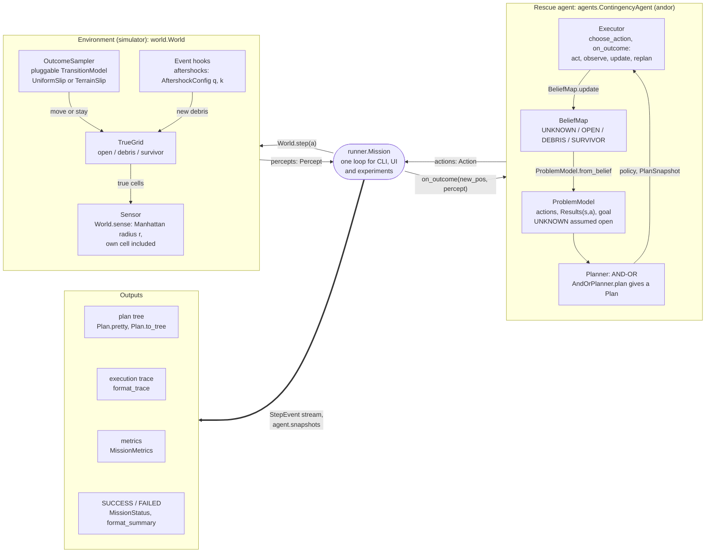
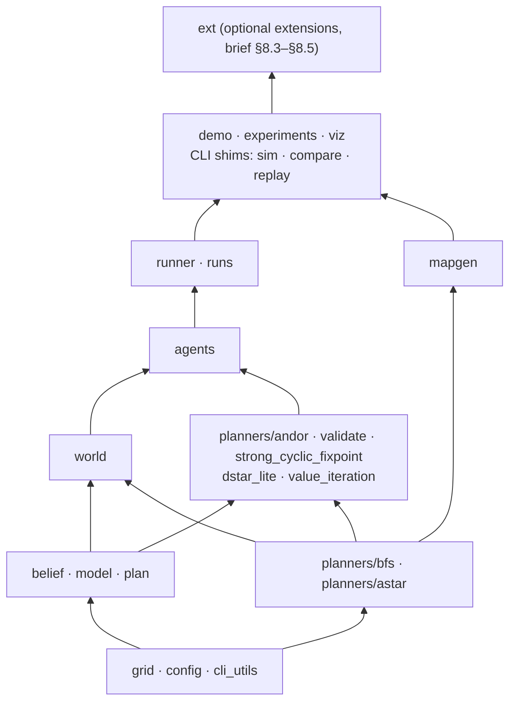
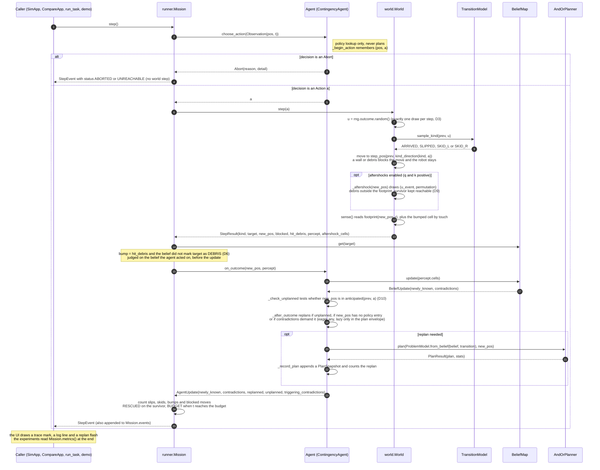

# Architecture

This chapter describes how the code is organised. It covers:

1. the system diagram of the deck's System Architecture slide (`docs/brief.md` §4), and which
   code implements each box;
2. the module map and the dependency rule;
3. one mission step, end to end;
4. the data contracts between the layers;
5. determinism and common random numbers;
6. the rule that the UI contains no logic;
7. the extension points.

The interface contract and the design decisions (D1 to D21) are in `docs/plan.md`. The
planning algorithm and its proofs are in `docs/algorithm.md`, and the measured results are in
`docs/results.md`. Inside the code, positions are 0-indexed `(row, col)`. Everything a person
sees (traces, CLI output, UI labels) is 1-indexed through `grid.fmt_pos`. Module paths are
relative to `src/rescue/`.

---

## 1. System overview

The deck splits the system into an **environment** (the simulator) and a **rescue agent**.
They exchange actions and percepts, and together they produce a plan tree, an execution
trace, metrics and a SUCCESS / FAILED verdict.



ASCII fallback, for viewers that do not render Mermaid:

```
+------ Environment (simulator) -------+              +--------------- Rescue agent ---------------+
| rescue.world.World                   |              | rescue.agents.ContingencyAgent (andor)     |
|                                      |              |                                            |
| TrueGrid        open/debris/survivor |              | BeliefMap     unknown/open/debris          |
| OutcomeSampler  TransitionModel      |<-- actions --| ProblemModel  actions, Results(s,a), goal  |
| Sensor          radius r, own cell   |-- percepts ->| Planner       AND-OR -> contingency plan   |
| Event hooks     aftershocks (q, k)   |              | Executor      act/observe/update/replan    |
+--------------------------------------+              +--------------------------------------------+
                    |                                                        |
                    +-- runner.Mission: one loop for CLI, UI, experiments ---+
                                                |
                                                v  one StepEvent per step
            Outputs:  plan tree  .  execution trace  .  metrics  .  SUCCESS / FAILED
```

Each box of the slide maps to code as follows:

| Slide box | Code | Notes |
|---|---|---|
| TrueGrid | `grid.TrueGrid` | `World` keeps a private copy (`World.grid`). Only aftershocks change it. `Mission.grid` keeps the initial map. |
| OutcomeSampler (pluggable `TransitionModel`) | the first part of `World.step`: one uniform `u` from `RngStreams.outcome`, then `TransitionModel.sample_kind(pos, u)` | This is not a separate class. `runner.make_transition` picks `UniformSlip` or, when the map has `~` cells, `TerrainSlip` (D4). |
| Sensor (radius r) | `World.sense()` returns a `Percept` over `grid.footprint(pos, r, …)` | The robot's own cell is included (D7). A bump also reveals the bumped cell by touch (D6). |
| Event hooks (aftershocks) | `World._aftershock`, configured by `config.AftershockConfig(q, k)` | Debris lands outside the robot's sensor footprint and never cuts the survivor off (D9). |
| BeliefMap | `belief.BeliefMap`, `belief.BeliefUpdate` | `update` reports newly known cells and contradictions (D8). `passable_mask` is optimistic: UNKNOWN counts as open. |
| ProblemModel: actions, Results(s,a), goal | `model.ProblemModel` (`actions`, `results`, `is_goal`), built by `ProblemModel.from_belief` | Frozen during a planning call, so the planning state is the robot's position only. It uses only the *support* of the transition model (D5). |
| Planner (AND-OR) → contingency plan | `planners.andor.AndOrPlanner.plan` returns a `PlanResult` that holds a `plan.Plan` | If the search fails (or, with `PlannerConfig.validate` on, returns a plan that fails `is_strong_cyclic`), the planner falls back to `planners.strong_cyclic_fixpoint` (docs/algorithm.md §6.4). |
| Executor: act · observe · update · replan | `agents.base.Agent.choose_action` and `Agent.on_outcome`, implemented by `agents.contingency.ContingencyAgent` | `choose_action` only looks up the policy. Every (re)plan happens in `on_outcome`. |
| actions → | `model.Action`, returned by `choose_action` and executed by `World.step` | |
| ← percepts | `world.Percept`, passed to `Agent.on_outcome` together with the new position | |
| plan tree | `Plan.pretty()` (deck one-liner), `Plan.to_tree()`, `viz.export.export_plan_tree`, `viz.tree_view.TreeView` | Every plan is kept as an `agents.base.PlanSnapshot`. |
| execution trace | `runner.format_trace(mission.events)` | |
| metrics | `runner.MissionMetrics` from `Mission.metrics()` | |
| SUCCESS / FAILED | `runner.MissionStatus` (RESCUED, ABORTED, BUDGET, UNREACHABLE), `runner.format_summary` | |

The slide leaves out one detail: **the agent and the world never reference each other.**
`runner.Mission` passes the action to `World.step` and the percept to `Agent.on_outcome`. The
agents import only the `Percept` type from `world`. The planner sees the belief and the
transition model, never the true map, so it cannot cheat. The baselines `astar_fixed` and
`astar_replan` and the stretch agents `dstar_lite`, `vi_expected` and `lao_expected` fill the same agent box
with a different planner and executor (§7.2).

---

## 2. Module map

### 2.1 Layers and the dependency rule

Imports point one way: **grid → model / belief → world → planners → agents → runner →
viz / experiments → ext**. In the diagram an arrow `A → B` means "B may import A and anything
below A". No module imports from a layer above its own.



Four details refine the one-line rule:

* `world` and the planners do not import each other, with one exception. `world` uses the BFS
  primitive `planners.bfs.reachable` to check that an aftershock keeps the survivor
  reachable. `planners/bfs.py` and `planners/astar.py` depend only on `grid` and `config`, so
  they sit in the bottom layers. `mapgen` (solvability check) and `runner` (shortest-path
  oracle for wasted moves) use the same BFS.
* `model` and `belief` are siblings. `model` names `BeliefMap` only for type hints (an
  `if TYPE_CHECKING:` import), and `ProblemModel.from_belief` reads `belief.passable_mask()`.
* **Nothing outside `viz/` imports `viz` or `pygame`,** except the three CLI shims `sim.py`,
  `compare.py` and `replay.py`. They import their app inside `main()`, so importing them is
  still free of pygame. The experiment harness and the demo never load pygame. Coverage is
  measured with `viz/` excluded (`pyproject.toml`). A check, run from the repository root:

  ```bash
  python -c "import sys, rescue.demo, rescue.runs, rescue.mapgen, rescue.experiments.__main__, rescue.experiments.plots, rescue.sim, rescue.compare, rescue.replay, rescue.ext.demo, rescue.ext.experiments; print([m for m in sys.modules if m.startswith('rescue.viz') or m == 'pygame'])"
  # prints []
  ```
* **`ext/` is a leaf.** It sits on top of the core: it imports `runner`, `agents.base`, the
  planners, `world`, `belief`, `mapgen`, `demo` (`format_map`) and the experiment harness
  (`experiments.spec`, `run`, `stats`, `hypotheses`, `plots`), but never `viz`. No core
  module imports `ext` (`config.py` only holds its constants).

The layer order was checked against every `import` in `src/rescue`, including the lazy
imports inside functions and excluding the `TYPE_CHECKING` blocks. No import points upwards.

### 2.2 Modules

**Core** (no pygame; covered by the coverage target):

| Module | Responsibility | Key names |
|---|---|---|
| `config.py` | Every constant (no magic numbers elsewhere), the frozen config dataclasses and YAML loading. | `WorldConfig`, `AftershockConfig`, `PlannerConfig`, `AgentConfig`, `load_yaml`, `world_config_from_dict`, `planner_config_from_dict`, `agent_config_from_dict` |
| `grid.py` | Positions, cell types, neighbourhoods and the true map with its ASCII I/O. | `Pos`, `Cell`, `fmt_pos`, `manhattan`, `in_bounds`, `neighbours4`, `footprint`, `TrueGrid` |
| `cli_utils.py` | UTF-8 stdout for Windows consoles, so traces can print arrows. | `ensure_utf8_stdout` |
| `belief.py` | The agent's knowledge of the map. The sensing update detects contradictions (D8). | `BeliefMap`, `BeliefUpdate` |
| `model.py` | Actions, outcome kinds, the slip model and the planner's model `Results(s, a)`. | `Action`, `ACTIONS`, `step_pos`, `OutcomeKind`, `OUTCOME_ORDER`, `kind_direction`, `outcome_distribution`, `TransitionModel`, `UniformSlip`, `TerrainSlip`, `Outcome`, `ProblemModel` |
| `plan.py` | Plan nodes and the plan object: policy extraction, envelope, deck one-liner and tree. | `Goal`, `Loop`, `Ref`, `Act`, `Branch`, `Plan`, `PlanStats`, `branch_label`, `plan_from_policy` |
| `world.py` | The true-world simulator: outcome draw, move, aftershock, sensing. | `World`, `Percept`, `StepResult`, `RngStreams` |
| `planners/bfs.py` | BFS distances, shortest paths and reachability. | `bfs_distances`, `shortest_path`, `shortest_path_length`, `reachable` |
| `planners/astar.py` | A\* with the Manhattan heuristic and configurable f-tie-breaks. | `astar`, `AStarResult` |
| `planners/andor.py` | AND-OR graph search with cyclic plans, plus validation and the fixpoint fallback. | `and_or_search`, `AndOrSearch`, `AndOrPlanner`, `PlannerStats`, `PlanResult` |
| `planners/validate.py` | Strong-cyclic policy check. | `validate_policy`, `is_strong_cyclic`, `ValidationReport` |
| `planners/strong_cyclic_fixpoint.py` | Reference planner (Cimatti et al.), used for completeness tests and as the fallback. | `strong_cyclic_policy`, `winning_region` |
| `planners/dstar_lite.py` | Stretch: incremental D\* Lite. | `DStarLite`, `DStarResult` |
| `planners/value_iteration.py` | Stretch: the policy that minimises expected steps. | `ValueIterationPlanner`, `value_iteration`, `transition_tables`, `proper_region` |
| `planners/lao_star.py` | Stretch (round 2): the same expected-steps optimum by LAO\* heuristic search from the robot's cell (plan §3.15.1). | `LaoStarPlanner`, `lao_star`, `LaoResult`, `heuristic`, `warm_up` |
| `agents/base.py` | The common agent interface and the bookkeeping every agent shares: belief update, unplanned check (D10), replan counting (D12), snapshots. | `Agent`, `PathAgent`, `Observation`, `Abort`, `Decision`, `AgentStats`, `AgentUpdate`, `PlanSnapshot` |
| `agents/contingency.py` | `andor`: follows the AND-OR plan and replans only on map surprises. | `ContingencyAgent` |
| `agents/astar_fixed.py`, `agents/astar_replan.py` | The A\* baselines. | `FixedAStarAgent`, `ReplanAStarAgent` |
| `agents/dstar_lite.py`, `agents/vi_expected.py`, `agents/lao_expected.py` | The stretch agents (D19; `lao_expected` added in round 2). | `DStarLiteAgent`, `ValueIterationAgent`, `LaoExpectedAgent` |
| `agents/__init__.py` | The agent registry. | `AGENTS`, `AGENT_NAMES`, `STRETCH_AGENT_NAMES`, `ALL_AGENT_NAMES`, `make_agent` |
| `runner.py` | The mission loop, step events, metrics and the trace / summary text. | `Mission`, `run_mission`, `StepEvent`, `MissionStatus`, `MissionMetrics`, `make_transition`, `check_agent_transition`, `format_trace`, `format_summary`, `format_metrics_table` |
| `runs.py` | JSON run files for replays. | `save_run`, `load_run`, `RunRecord`, `run_to_dict`, `event_to_dict`, `event_from_dict` |
| `mapgen.py` | Seeded scenario generators that guarantee a solvable map, the scenario registry and `python -m rescue.mapgen`. | `SCENARIOS`, `ScenarioSpec`, `GENERATED_SCENARIOS`, `generate`, `random_rubble`, `collapsed_building`, `flooded_zone`, `maze_corridors`, `MapGenerationError` |
| `demo.py` | `python -m rescue.demo`: the slide 9 sample output. | `main`, `initial_plan_text` |
| `experiments/spec.py` | Experiment YAML, blocks and the expanded, seeded task list. | `ExperimentConfig`, `ExperimentBlock`, `Task`, `expand_tasks`, `task_seed`, `load_experiment_config` |
| `experiments/run.py` | Runs every task in a `multiprocessing` pool and writes `raw.csv` and `run_meta.json`. | `run_task`, `run_experiments`, `write_raw`, `RAW_COLUMNS` |
| `experiments/stats.py` | Typed raw rows, Wilson and Student-t intervals, paired tests, `summary.csv`. | `read_raw`, `wilson_interval`, `mean_ci`, `paired_difference`, `sign_test`, `summarize`, `write_summary` |
| `experiments/hypotheses.py` | The verdicts on the deck's claims, written to `HYPOTHESES.md`. | `Hypothesis`, `evaluate`, `write_hypotheses` |
| `experiments/plots.py` | The result figures (matplotlib). | `make_all_plots`, `plot_*` |
| `experiments/__main__.py` | `python -m rescue.experiments`: run, then summary, hypotheses and plots. | `main`, `console_summary` |
| `experiments/lao_report.py` | `python -m rescue.experiments.lao_report results/lao`: the `LAO.md` analysis of the LAO\* run (plan §3.15.1). | `lao_report`, `write_lao_report`, `main` |

**Front ends** (pygame; `viz/` is excluded from coverage):

| Module | Responsibility | Key names |
|---|---|---|
| `sim.py`, `compare.py`, `replay.py` | Thin CLI shims: they parse arguments and import their `viz` app inside `main()`. | `main` |
| `viz/theme.py` | Every UI constant, both palettes, fonts. | `Palette`, `Fonts`, `load_fonts` |
| `viz/grid_view.py` | Draws the grid (fog of war, trace, policy arrows, true-map overlay). | `GridView`, `GridScene`, `TraceMark`, `trace_from_events` |
| `viz/tree_view.py` | The collapsible plan tree. | `TreeView` |
| `viz/panel.py` | Side panel, event log, status badges, help overlay. | `Panel`, `PanelInfo`, `EventLog`, `draw_badge`, `draw_help_overlay` |
| `viz/sim_app.py` | The interactive simulator and the frame loop it shares with replay. | `BaseApp`, `SimApp`, `SimOptions`, `event_messages`, `flash_cells`, `prepare_environment` |
| `viz/ext_sim_app.py` | `sim --ext search\|multi\|noisy`: the extension missions in the simulator (round 2, plan §3.15.3; not in the browser build). | `ExtSimApp`, `ExtSimOptions`, `mode_settings`, `ext_event_messages`, `EXT_MODES` |
| `viz/compare_app.py` | Head-to-head panes stepped in lock-step (D20). | `CompareApp`, `ComparePane`, `pane_event_line`, `outcome_rows` |
| `viz/replay_app.py` | Scrubs through a saved run without re-simulating it. | `ReplayApp`, `load_replay` |
| `viz/record.py` | GIF / MP4 recording. | `Recorder` |
| `viz/export.py` | Plan tree as PNG (matplotlib) or text. | `export_plan_tree`, `export_plan_text` |

**Extensions** (`ext/`, brief §8.3–§8.5, `docs/plan.md` §3.14; no pygame; covered by the
coverage target):

| Module | Responsibility | Key names |
|---|---|---|
| `ext/sensing.py` | Noisy debris sensor (false negatives; optional false positives since round 2, plan §3.15.2; one draw per grid cell per step) and the Bayes per-cell debris belief. | `NoisySensor`, `ProbBelief` |
| `ext/scenarios.py` | Core scenario maps with k − 1 extra survivors. | `multi_survivor_grid`, `add_survivors` |
| `ext/agents.py` | Frontier exploration and greedy nearest-first rescue order, planning with AND-OR or A\*. | `SearchAgent`, `SearchAndOrAgent`, `SearchAStarAgent`, `EXT_AGENTS`, `make_ext_agent`, `frontier_mask` |
| `ext/mission.py` | The extension mission loop (several survivors, noisy percepts), events, metrics, oracle tours. | `ExtMission`, `run_ext_mission`, `ExtStepEvent`, `ExtMetrics`, `oracle_tours`, `format_ext_trace` |
| `ext/demo.py` | `python -m rescue.ext.demo --mode search\|multi\|noisy`. | `main`, `MODES` |
| `ext/experiments.py`, `ext/claims.py`, `ext/plots.py` | `python -m rescue.ext.experiments`: tasks, runs, summary, claims X1–X6 (`EXTENSIONS.md`; X6 two-sided noise, plan §3.15.2), plots. | `ExtBlock`, `expand_tasks`, `run_ext_experiments`, `write_summary`, `evaluate_claims`, `write_extensions`, `make_ext_plots` |

The extension package is the top layer. `ExtMission` mirrors `runner.Mission`: it drives the
core `World` for motion, outcome draws and aftershocks, and passes every percept through a
`NoisySensor`. The `SearchAgent` subclasses `agents.base.Agent` and reuses the core
`AndOrPlanner` and `astar` with a moving goal. The harness reuses the core seeding
(`experiments.spec.task_seed`), worker pool and statistics. The core reaches the extensions
only through a few backward-compatible hooks: `TrueGrid.extra_survivors`, `BeliefMap` without
a pre-marked survivor, `survivors_seen()`, `World.on_survivor`, and aftershocks that protect
every survivor. With default arguments these hooks leave the core bit-identical ("rule zero",
`docs/extensions.md` §3). Its results are in `results/ext/` and `docs/extensions.md`.

Outside the package, `scripts/make_figures.py` regenerates the simulator figures in
`docs/figures/` (the GIF, two screenshots and the plan tree; the comparison screenshot comes
from the compare CLI, `docs/plan.md` §3.11). It drives `SimApp` headless through its public API
(`tick`, `render`, `handle_key`, `step_once`). `scripts/make_ext_figures.py` does the same for
`ExtSimApp` and writes `docs/figures/ext_{search,multi,noisy}.png` (plan §3.15.3).

---

## 3. One mission step

`Mission.start()` runs once. It builds the `World` (from `make_transition(grid, cfg)`, the
sensor radius, the seed and the aftershock config), a fresh `BeliefMap` that knows only the
survivor cell, and calls `agent.reset(start, survivor, belief)`. It then senses with
`world.sense()` and calls `agent.on_outcome(start, percept)`, which makes the initial plan
(not counted as a replan, D12). Finally it emits the t = 0 `StepEvent` with `action=None`.

After that, each call of `Mission.step()` runs the sequence below. `Mission.run(on_event)`
and `run_mission(..., on_event=...)` loop over `step()` until the mission is done.



The order of the calls is deliberate:

* **Outcome first, exactly once.** `World.step` draws `u` before anything else and whatever
  the action, so every agent on the same seed sees the same `u_t` at every step (§5).
* **Aftershock before sensing (D9).** The debris lands outside the footprint of the new
  position, so the robot does not see it fall. It shows up later as an OPEN → DEBRIS
  contradiction when the robot comes near.
* **Bump before update (D6).** A bump is judged on the belief the agent acted on. After
  `on_outcome` the belief already shows the debris, and every bump would look anticipated.
* **Unplanned check before replanning (D10).** `anticipated(prev, a)` is evaluated on the
  model snapshot of the plan the action came from (`Results(s, a)` for `andor`, the single
  next path cell for the A\* agents).
* **`choose_action` never plans.** Every replan happens in `on_outcome` and is reported in
  its `AgentUpdate`, so `AgentStats.replans` equals the number of events with
  `replanned=True`. A missing policy entry in `choose_action` is a logic error
  (`RuntimeError`), not a silent replan.

With sensor radius r ≥ 1, every cell an outcome can enter is sensed before the robot acts.
For `andor` this makes `unplanned_states == 0` and `bumps == 0` invariants
(docs/algorithm.md §4.4). The full run confirms them: Σ unplanned states = 0 and Σ bumps = 0
over all 27,450 `andor` runs (`docs/results.md` §2.3, `results/HYPOTHESES.md` H2).

---

## 4. Data contracts

These types and files are what the layers exchange. `docs/plan.md` §3.8–3.10 specifies them
in full.

### 4.1 `runner.StepEvent` (frozen, one per step)

| Field | Meaning |
|---|---|
| `t` | World time **after** the step (0 for the start event). |
| `pos`, `new_pos` | Position before and after the step (equal for the start and abort events). |
| `action`, `outcome` | `Action` and `OutcomeKind`. Both are `None` for the start event and for an abort. |
| `blocked`, `bump` | The outcome tried to move but stayed (bumps included). `bump` marks an unexpected collision (D6). |
| `new_cells` | `(pos, Cell)` pairs that were UNKNOWN in the belief before this percept. |
| `contradictions`, `triggering_contradictions` | Sensed debris where the belief said UNKNOWN or OPEN, and the subset that demanded this step's replan. |
| `replanned`, `unplanned`, `plan_id` | Replan flag, unplanned-state flag (D10), and the index into `agent.snapshots` of the plan in force after the step. |
| `aftershock_cells` | Debris dropped by an aftershock during this step. |
| `status`, `note` | `MissionStatus` after the step, and a short text for event logs. |

The events are self-sufficient. The trace (`format_trace`), the UI's trace marks
(`TraceMark.from_event`) and its log lines (`event_messages`) come from events alone. The
replay rebuilds the belief and the true map from the initial map plus the events.

### 4.2 `runner.MissionMetrics` (frozen, one per mission)

| Group | Fields |
|---|---|
| Identity | `agent`, `scenario`, `seed`, `rows`, `cols`, `slip_p` |
| Outcome | `success`, `failure_reason` (`aborted` / `unreachable` / `budget`, `None` on success), `steps`, `shortest_path` (BFS on the initial true map), `wasted_moves` (NaN unless successful, D16) |
| Execution | `replans` (D12), `slips`, `skids`, `slips_handled` (D11), `bumps`, `blocked_moves`, `unplanned_states`, `cells_explored` |
| Planning | `planning_ms`, `nodes_expanded`, `plan_size`, `planner_fallbacks` |
| Stress | `aftershock_events` |

`as_dict()` and `from_dict()` round-trip it through JSON (`None` floats come back as NaN).
`format_summary` prints the deck's two-line summary from it.

### 4.3 `agents.base.PlanSnapshot`

Every planning call appends one snapshot (`plan_id`, `t`, `pos`, `plan`, `path`, `envelope`)
to `agent.snapshots`. Contingency agents fill `plan`, path agents fill `path`, and both stay
`None` when planning failed. The UI shows the snapshot at `agent.current_plan_id`, which is
the latest event's `plan_id`. Run files store every snapshot.

### 4.4 Run files (`runs/<YYYYmmdd-HHMMSS>_<agent>_<seed>.json`)

`runs.save_run(mission)` writes the document built by `run_to_dict`:

| Key | Content |
|---|---|
| `version` | `RUN_FORMAT_VERSION`. `load_run` rejects other versions with `ValueError`. |
| `agent`, `seed`, `scenario` | Run identity. |
| `map`, `map_name` | The *initial* true map as ASCII (before any aftershock). |
| `world_config`, `planner_config`, `agent_config` | The three configs as dicts. |
| `events` | `event_to_dict` of every `StepEvent`. Positions are 0-indexed `[r, c]`, the action is stored by name, the outcome by value and the status by name. |
| `snapshots` | Per plan: `plan_id`, `t`, `pos`, `pretty`, `policy` (`"r,c"` → action), `path`, `envelope`, `tree` (`Plan.to_tree(SNAPSHOT_TREE_DEPTH)`). |
| `metrics` | `MissionMetrics.as_dict()`, with NaN stored as `null`. |

`load_run` returns a `RunRecord`. Events and metrics round-trip exactly.

### 4.5 Experiment outputs (`results/`)

| File | Content |
|---|---|
| `raw.csv` | One row per (task, agent): `TASK_COLUMNS` (experiment, scenario, rows, cols, slip_p, sensor_radius, replan_mode, planner, aftershock_q, aftershock_k, replicate, seed), then `METRIC_COLUMNS` (`agent` plus the `MissionMetrics` fields that are not task fields), then `EXTRA_COLUMNS` (`plans_made`, `elapsed_ms`). Rows are sorted in task order, then by agent in config order. |
| `summary.csv` | One row per `stats.GROUP_KEYS` combination (experiment, scenario, rows, slip_p, sensor_radius, replan_mode, planner, aftershock_q, agent): `n`, successes, Wilson interval (`success_rate`, `success_lo`, `success_hi`), failure counts per reason, and `_mean` / `_lo` / `_hi` (Student-t) for each of `SUMMARY_METRICS`. `steps` and `wasted_moves` are averaged over successful runs only, and `steps_all_*` over all runs. |
| `run_meta.json` | Config name and path, base seed, blocks, task and run counts, workers, wall time, git commit, Python version and platform. |
| `HYPOTHESES.md`, `plots/*.png` | Written by `hypotheses.write_hypotheses` and `plots.make_all_plots` from the typed rows of `raw.csv`. |

The full run has 27,450 tasks and 99,400 missions (`docs/results.md` §1.1).

---

## 5. Determinism and common random numbers

**Every random draw comes from a seeded `numpy.random.Generator`.** The code never uses the
`random` module or unseeded numpy. The planners, the agents and the tie-breaks are
deterministic (D13). Only the following streams exist:

| Stream | Seeded by | Used for | Draws |
|---|---|---|---|
| `RngStreams.outcome` | child of `SeedSequence(seed).spawn(...)` in `World` | outcome kind | exactly one uniform per `World.step`, whatever the agent and the outcome (D3) |
| `RngStreams.aftershock` | another child of the same spawn | aftershock event and cell order | one `(u_event, permutation)` per step while `AftershockConfig.enabled`; none when aftershocks are off (the stream is private, so the outcome stream is unaffected) |
| `RngStreams.misc` | a third child | reserved; nothing draws from it today | none |
| map generation | `SeedSequence([seed, MAPGEN_STREAM_KEY])` in `mapgen._make_rng` | generator draws, retries included | independent of the `World` streams (D18) |

What follows from this:

* **Same inputs, same mission.** The same map, seed and configs produce identical
  `StepEvent`s and the same trace (`tests/test_runner.py::test_same_seed_identical_events_and_trace`,
  `tests/test_demo.py::test_demo_is_deterministic_across_processes`).
* **Common random numbers (CRN) across agents.** The outcome uniform is drawn before anything
  depends on the agent, and exactly once per step. So two agents run on the same map and seed
  see the same `u_t` at every step `t`. They get the same outcome *kind* whenever they act
  from cells with the same slip p (on maps without `~`, always). The aftershock draws are
  aligned the same way. The cells they hit depend on where the robot stands, so with
  aftershocks on, the true maps of two agents can drift apart once their trajectories differ
  (D20; `tests/test_runner.py::test_common_random_numbers_across_agents`,
  `tests/test_world.py::test_aftershock_timing_independent_of_actions`).
* **Seeds per task.** `experiments.spec.task_seed(base_seed, scenario, rows, cols, replicate)`
  hashes `SeedSequence([base_seed, scenario_key(scenario), rows, cols, replicate])` to one
  integer. `scenario_key` uses `zlib.crc32`, which is stable across processes, unlike `hash()`.
  That one integer seeds both the map (through `mapgen.generate`) and the `World`. Slip p,
  sensor radius, replan mode, aftershock q, planner overrides, the agent and the block name
  are **not** part of the seed. Every agent and every condition therefore runs on the same map
  with the same outcome stream, and all comparisons are paired, across blocks too. This is why
  the 27,450 `andor` runs contain only 26,100 unique missions (`docs/results.md` §1.1).
  `stats.TASK_KEYS` identify a task for pairing. `stats.MAP_KEYS` identify a map, which is the
  unit of analysis for the pooled tests.
* **Worker count does not matter.** `run_task` regenerates its map from the seed inside the
  worker, and `run_experiments` sorts the rows back into task order. Only the timing columns
  (`TIMING_COLUMNS`: `planning_ms`, `elapsed_ms`) differ between two runs
  (`tests/test_experiments.py::test_run_experiments_is_deterministic_across_worker_counts`).
* **Interactive tools.** `sim` and `compare` use one `--seed` for the map and the world. This
  is safe because the two streams are independent (D18). `R` restarts with the same seed and
  `S` moves to the next seed. In `compare` every pane gets the same seed, which gives the
  panes common random numbers (D20). The footer says when aftershocks can make the panes'
  maps differ (`CRN_AFTERSHOCK_TEXT`).

---

## 6. The UI has no logic

Behaviour lives in `Mission`, the agents and the world. The UI only renders what they
produce and forwards key presses. So for the same map, seed and configs, the simulator, the
comparison, the demo and the experiment harness all run the same mission.

Consumers get events in one of two ways:

* **Push.** `Mission.run(on_event)` and `run_mission(..., on_event=...)` call the callback for
  every new `StepEvent`. Batch consumers use this, or they read `mission.events` after the
  run.
* **Pull.** An interactive app sets its own pace. It calls `Mission.start()` once and
  `Mission.step()` once per tick, then hands the returned event to its bookkeeping.

| Consumer | Drives the mission with | Uses the events for | Also reads (read-only) |
|---|---|---|---|
| `demo.main` | `run_mission` | `format_trace(mission.events)` | first `PlanSnapshot` (`initial_plan_text`), `Mission.metrics()` |
| `experiments.run.run_task` | `Mission.run()` | nothing (metrics only) | `Mission.metrics()`, `agent.stats.plans_made` |
| `runs.save_run` | nothing | `event_to_dict` of every event | `agent.snapshots`, `Mission.metrics()` |
| `viz.sim_app.SimApp` | `Mission.start()`, then one `Mission.step()` per tick (`_advance`) | `_on_event`: `TraceMark.from_event`, `event_messages` (log), `flash_cells` (replan flash), saving the run when the mission is done | `agent.belief.grid`, the current `PlanSnapshot`, `agent.policy_arrows()`, `Mission.metrics()`, `world.grid` (true-map overlay) |
| `viz.compare_app.CompareApp` | one `Mission.step()` per still-running pane per tick (lock-step, D20) | `ComparePane.record`: trace mark, `pane_event_line`, replan flash | the same as `SimApp`, per pane |
| `viz.replay_app.ReplayApp` | nothing: no `Mission`, no `World` | `_build_states` rebuilds belief, true map, robot and trace at step `k` from `RunRecord.grid` and `RunRecord.events[0..k]` | the snapshot dicts stored in the run file |

The rule is held in place in several ways:

* `viz` modules call only public core functions and types (chiefly `Mission`, `make_agent`,
  `make_transition`, `mapgen.generate`, `save_run`, `load_run`, plus pure helpers and constants
  such as `model.step_pos`, `model.kind_direction`, `agents.base.direction`,
  `runner.FAILURE_REASONS` and `plan.TRUNCATED_MARK`) and read attributes of the mission, the
  agent and the world. They never call `World.step`, `Agent.choose_action` or
  `Agent.on_outcome` themselves.
* The map editor (`E`) only builds a new `TrueGrid`. Leaving the editor starts a fresh
  `Mission` on it.
* `ReplayApp` never re-simulates. It reconstructs display state from recorded events. For A\*
  agents it also replays the path cursor, advancing it once per move, as `PathAgent` does.
* UI constants live in `viz/theme.py`. The comparison layout and colour constants are the one
  documented exception: they live in `config.py` (`docs/plan.md` §3.12).
* Every app runs headless with `SDL_VIDEODRIVER=dummy` (`prepare_environment`), so the tests
  drive `tick`, `render` and `handle_key` without a window.
* The frame loop has one body, `BaseApp.run_frame`, used by the blocking `run()` and by
  `run_async()`, which yields to asyncio once per frame. The pygbag browser build
  (`web/main.py`, `scripts/build_web.py`, [`web.md`](web.md)) therefore runs the same simulator
  code. Only recording is switched off there (`record.recording_available()`).
* The web app ([`webapp.md`](webapp.md), plan §3.16) follows the same rule across a process
  boundary: the browser UI (`webapp/js/`) only renders the JSON state that `rescue.webapi`
  returns from a Pyodide Web Worker. The bridge drives the unchanged `runner.Mission` /
  `ext.mission.ExtMission`, so the browser plays the same missions as the CLI.
  `python -m rescue.webapp` packages the site (`rescue.zip`, `maps_library.json`,
  `results.json`, `version.json`) and serves it on 127.0.0.1.

---

## 7. Extension points

### 7.1 A new transition model

1. Subclass `model.TransitionModel` and implement `slip_p(pos)` and `max_p()`. The inherited
   `distribution`, `support` and `sample_kind` then split `p` the way the deck does
   (`outcome_distribution`, with `SLIP_STAY_FRACTION` and `SKID_FRACTION` from `config.py`).
   Keep the `OUTCOME_ORDER` kinds and the single uniform per step of `sample_kind`, or common
   random numbers break.
2. Return it from `runner.make_transition(grid, world_config)`. This is the only factory.
   `Mission` builds the world's model with it, and the sim, the comparison and the harness
   build their agents' models with it.
3. Give every agent the same model (D5). `Mission.__init__` enforces this with
   `check_agent_transition`. That check compares `slip_p` cell by cell, so a model whose
   distribution is not a function of `slip_p` alone needs a stronger check.

The planners need no change. `ProblemModel.results` reads only `transition.support(s)`, and
`ValueIterationPlanner` reads the probabilities through `transition_tables`.

### 7.2 A new agent

1. Subclass `agents.base.Agent`, or reuse more machinery by subclassing `PathAgent` (path
   following) or `ContingencyAgent` (policy following). Set the class attribute `name`, and
   implement `choose_action`, `anticipated`, `policy_arrows`, `_reset_plan` and
   `_after_outcome`. Record every planning call with `_record_plan`, so snapshots, replans and
   statistics stay consistent.
2. A new planner for the contingency agent can reuse all of its trigger logic. Override
   `ContingencyAgent._make_planner` to return any object with
   `plan(model, start) -> PlanResult`, as `ValueIterationAgent` does. `_plan_made(result)` is
   the hook that runs after each plan. A new path planner can override `PathAgent._plan_path`,
   as `DStarLiteAgent` does.
3. Register the class in `agents/__init__.py`: add it to `AGENTS`, and to
   `STRETCH_AGENT_NAMES` unless it should join the simulator's agent keys and the default
   comparison panes in `AGENT_NAMES` (D19).
   `make_agent` builds it from then on. `compare --agents` and the experiment YAML
   (`spec._check_agents`) accept it, and the summary, hypotheses and plots order it through
   `ALL_AGENT_NAMES`.
4. Optional: give it a colour (`Palette.agent` or `config.COMPARE_AGENT_COLOURS`) and a plot
   style (`experiments.plots.AGENT_STYLE`). Unknown agents fall back to a neutral colour and a
   spare marker.
5. Add it to the determinism and invariant tests. If it keeps the `anticipated` contract of
   `andor`, `unplanned_states == 0` should hold for it too.

### 7.3 A new scenario

1. Write a generator `name(rows, cols, seed, **params) -> TrueGrid` in `mapgen.py`, following
   `random_rubble`. Validate the arguments (`_check_size_and_seed`, `_check_range`). Draw only
   from the stream of `_retry(name, rows, cols, seed, attempt)`. Place start and survivor with
   `_place`, and return `_finish(...)`, which rejects maps where the survivor is not
   BFS-reachable. After `MAPGEN_MAX_ATTEMPTS` attempts, `_retry` raises
   `MapGenerationError`. Put tunable values in `config.py`.
2. Register a `ScenarioSpec(name, description, generator)` in `SCENARIOS`. A fixed map file
   uses `fixed_map=` and `_fixed_map`, like `deck_demo`.
3. Everything else picks it up from the registry: `python -m rescue.mapgen NAME`, the
   simulator's `M` cycle (`GENERATED_SCENARIOS`), the comparison's `--scenario` and `M`
   (`scenario_entries`), the YAML validation of experiment blocks, and the order of scenarios
   in tables and plots.
4. Add it to the solvability and determinism sweeps in `tests/test_mapgen.py`.

### 7.4 A new experiment block

1. Add a block to `experiments/main.yaml` (and a smaller one to `quick.yaml`), using only the
   keys `name`, `scenarios`, `sizes`, `slip_p`, and optionally `sensor_radius`, `replan_mode`,
   `aftershock_q`, `aftershock_k`, `agents`, `n_maps` and `planner` (`PlannerConfig`
   overrides, D21). `block_from_dict` and `_validate_block` reject unknown keys, scenarios and
   agents, and values out of range.
2. Nothing else is needed for the data. `expand_tasks` gives the block the same task seeds as
   every other block with the same scenario, size and replicate, so each of its runs pairs
   with a run of those blocks on the same map and outcome stream. Its rows land in `raw.csv`,
   and `summary.csv` groups them by experiment name.
3. Figures and verdicts are opt-in. `plots.make_all_plots` finds a block by the factor it
   sweeps plus name keywords (`_Block`, e.g. `AFTERSHOCK_BLOCK`). A new kind of figure needs a
   `plot_*` function registered there. A new claim needs a function that returns a
   `Hypothesis` and is called from `hypotheses.evaluate`.
4. A genuinely new **factor** (a new column) touches the whole chain:
   `ExperimentBlock` and `_BLOCK_KEYS`, `Task` and `expand_tasks`, `run.TASK_COLUMNS` and
   `world_config_for`, and `stats.TASK_KEYS` and `GROUP_KEYS`. A factor that should be paired
   must stay out of `task_seed`.

Whatever the extension, the project rule holds: report what the run measures, and never tune a
block, a seed or a threshold toward a verdict (`docs/results.md` §1.3).
