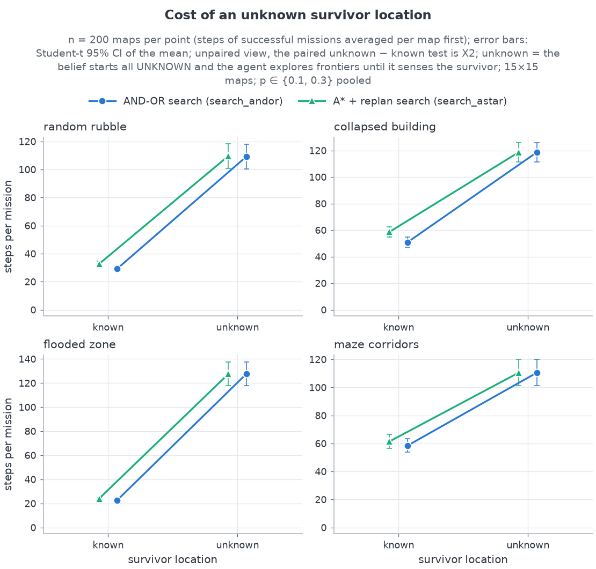
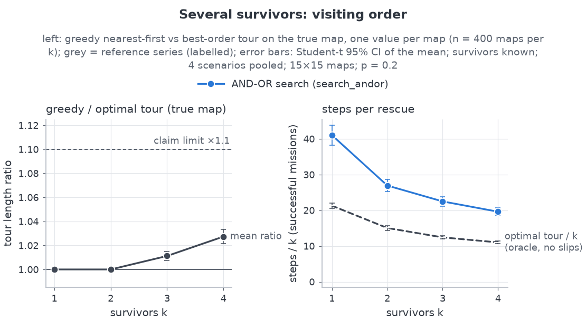
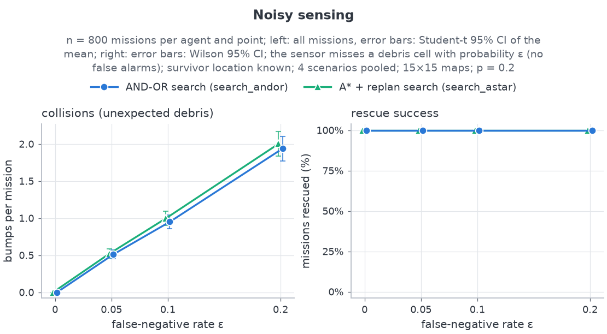

# Extensions: unknown survivor, several survivors, noisy sensing

This chapter covers the optional extensions of `docs/brief.md` §8 that were built after the core
system (§3–§6) was finished and measured. Brief §8 is a single list of five items; §8.1–§8.5
number them in order (LAO\*/value iteration, terrain-aware cost, noisy sensing, unknown survivor
location, multiple survivors), as `docs/plan.md` does:

* **§8.4 Unknown survivor location.** The robot does not know where the survivor is and finds
  it by frontier exploration.
* **§8.5 Multiple survivors.** The robot rescues k survivors in a greedy nearest-first order.
  The order is re-evaluated after every rescue and compared with the brute-force optimal tour.
* **§8.3 Noisy sensing.** The debris sensor misses debris (false negatives), and the robot
  keeps a Bayesian per-cell debris belief.

§1 says what each extension does and why. §2 gives the algorithms. §3 describes the hooks into
the core and the rule that the core results must not move. §4 is the experiment design, §5 the
results claim by claim, §6 honest notes, and §7 the limitations and future work. The interface
contract is `docs/plan.md` §3.14. The core results are in `docs/results.md`, whose conventions
this chapter follows.

Every number comes from one of four places:

* `results/ext/summary.csv`, which holds per-condition means with 95 % CIs;
* `results/ext/EXTENSIONS.md`, which holds the claim verdicts (X1–X5) and the paired tests;
* `results/ext/run_meta.json`, which describes the run;
* a reproducible computation on `results/ext/raw.csv` (once also on the core
  `results/raw.csv`).

Numbers of the last kind come with the one-line Python (standard library only) that produced
them, in an HTML comment beside them. Run it from the repository root. Design constants (the
prior, the threshold, the claim thresholds) are quoted from `src/rescue/config.py` by name.

> **Key findings**
>
> 1. **Frontier search always found the survivor.** `search_andor` rescued an unknown survivor
>    in 1600 of 1600 missions, with 0 bumps and 0 unplanned states (X1).
> 2. **Not knowing the location costs about 2.9 times the steps:** +76.27 steps
>    [+71.61, +80.93] per mission for `search_andor` (X2). Almost the whole mission is
>    exploration. With sensor radius 1 the survivor can only be seen from a neighbouring cell.
> 3. **In unknown-location search the planner hardly matters.** `search_andor` and
>    `search_astar` took exactly the same number of steps in 1525 of 1600 paired missions.
>    Following the nearest frontier dominates. AND-OR still costs about 271 times as much
>    planning time per mission (§6.1).
> 4. **Greedy nearest-first is close to the optimal visiting order:** 2.7 % longer on average
>    at k = 4 (×1.027 [1.022, 1.033]) and never more than ×1.444 on any map (X3).
> 5. **Noisy sensing makes collisions possible but not fatal.** There were 2719 bumps in 2400
>    `search_andor` runs at ε > 0 and still 100 % success. AND-OR is not measurably worse at
>    avoiding them than A\* + replan (−0.04 bumps per mission [−0.11, +0.03], X4, X5).

---

## 1. What was added and why

### 1.1 Unknown survivor location (§8.4): frontier exploration

The core robot knows where the survivor is and only has to find a way there through unknown
debris. In a real disaster the location is usually unknown. In this extension the belief starts
with **every cell UNKNOWN**, and the robot only knows *how many* survivors there are (a radio
count; §7 discusses dropping it). Until it senses a survivor, the robot explores.

Exploration is **frontier-based**. A *frontier cell* is a known, believed-passable cell with at
least one UNKNOWN 4-neighbour. The robot drives to the nearest frontier cell. Its sensor then
reveals the cells around it, which pushes the frontier outwards. Frontier exploration was
chosen because it fits the core loop without new machinery. A frontier cell is just another
goal for the core planners, so the AND-OR planner, its strong-cyclic guarantee and the
replanning triggers all carry over unchanged. And because the sensor has no false positives
(§2.2), it terminates.

### 1.2 Multiple survivors (§8.5): greedy order, re-evaluated after each rescue

With k survivors the robot must also choose an **order**. Finding the best order is a
travelling-salesman-type problem. The robot uses the simplest reasonable rule: go to the
**nearest** known unrescued survivor (BFS distance on its current belief), and choose again
after each rescue. Distances change as the robot learns the map, so re-evaluating keeps the
rule honest about what it knows. The rule's quality is measured against an oracle: the
**optimal tour**, found by brute force over all k! visiting orders on the true map
(k ≤ `EXT_MAX_BRUTE_FORCE_K` = 6).

### 1.3 Noisy sensing (§8.3): false negatives and a Bayesian belief

The core sensor is perfect. Here, the sensor reports a true DEBRIS cell as OPEN with
probability ε (a **false negative**: dust or smoke hides the rubble). It never reports debris
where there is none, and it never hides a survivor. Missed debris can now surprise the robot, so
**collisions (bumps, D6) become possible**. Under the core's perfect sensor with r ≥ 1 they are
impossible. A bump reveals the debris by touch.

The belief becomes a per-cell debris probability, `ProbBelief`, updated by Bayes' rule under
this sensor model (§2.4). A cell is treated as impassable once its probability reaches a
threshold.

---

## 2. Algorithms

### 2.1 The search agent and its target

`ext/agents.py` defines one agent class, `SearchAgent`, with two planners:

| Agent | Planner | Follows | Replans on |
|---|---|---|---|
| `search_andor` | AND-OR strong-cyclic plan to the current target (the core `andor`, with a moving goal) | the policy branch that matches each outcome | target change, contradiction (eager), unplanned state, no policy entry for the current cell |
| `search_astar` | A\* path to the current target (the core `astar_replan`, with a moving goal) | the path | target change, contradiction (eager), any deviation from the path, next path cell known debris |

The **target** is chosen at t = 0 and re-evaluated **only** when one of the following happens:

1. a survivor has just been rescued;
2. a survivor has been seen for the first time;
3. the current target is no longer a valid target. A rescue target must still be a known,
   unrescued survivor. An explore target must still be a frontier cell. Either kind must still
   be reachable on the optimistic belief and must not be the robot's own cell.

Re-evaluation then picks, in this order:

1. **rescue mode:** the nearest known, unrescued, reachable survivor by BFS distance on the
   agent's optimistic passability (unknown cells count as open; ties row-major). This is the
   greedy nearest-first order.
2. **explore mode:** otherwise, the nearest reachable frontier cell (ties row-major).
3. otherwise the agent aborts with `unreachable`. This never happened in the run (§5.1).

Only cells the belief holds as SURVIVOR are ever rescue targets. An unknown cell is never
assumed to hide a survivor. Between re-evaluations the target is fixed, so the agent does not
dither between equally near frontier cells.

### 2.2 Why exploration terminates

The argument is informal. It is written out in full in the `SearchAgent` docstring.

* **Between target changes.** The agent follows a strong-cyclic plan (or a replanned A\* path)
  to a fixed, reachable target. Under fair nondeterminism it gets there with probability 1,
  unless the belief changes first.
* **Each cause of a target change can happen only finitely often.**
  1. *The target stopped being a frontier cell.* With sensor radius r ≥ 1 this happens at the
     latest on arrival: standing on the target, the robot senses all of the target's
     4-neighbours, so at least one UNKNOWN cell becomes known. There are finitely many cells.
  2. *The target became impassable or unreachable.* Some cell became debris in the belief. That
     happens at most once per cell, because debris is never "un-seen": the sensor has no false
     positives, and in `ProbBelief` a probability of 1 stays 1 (§2.4).
  3. *A survivor was seen or rescued.* This happens at most twice per survivor.
* **Exploration cannot run out of frontier while a survivor is still hidden** (on a solvable
  map). Take a true path from the robot to an unfound survivor. Its cells are truly passable,
  so they are believed passable (no false positives). The survivor cell itself is still
  UNKNOWN. So the last known cell before the first UNKNOWN cell on that path is a reachable
  frontier cell.

So after finitely many target changes every survivor is rescued, with probability 1. The
argument relies on the sensor having no false positives and on unknown cells being optimistic
(prior below the threshold). For this reason `ExtMission` rejects `prior_debris ≥ threshold`,
and it rejects the categorical `BeliefMap` when ε > 0, because a noisy OPEN reading would
overwrite known debris there. The step budget is `4·R·C·k` (the core D15 budget times k).

### 2.3 Greedy order and the oracle tours

The agent applies the greedy rule on its **belief** while it moves. For the evaluation, each
mission also records two oracle tour lengths, both computed on the **initial true map** with
BFS distances:

* `greedy_tour`: the length of the nearest-first visiting order from the start (ties
  row-major);
* `optimal_tour`: the length of the shortest of all k! orders.

X3 compares these two. They measure the rule itself, not the agent's realised route, which also
pays for slips and for discovering debris. The realised route shows up as steps per rescue
(§5.3). For k ≤ 2 greedy is optimal by construction. Both orders share the survivor-to-survivor
leg, and greedy takes the shorter first leg. So only k ≥ 3 can test the rule.

Extra survivors come from `ext/scenarios.py`. `multi_survivor_grid` takes the core scenario map
(same start, same primary survivor, same debris) and adds k − 1 survivors on reachable, open,
non-mud cells. The cells are visited in one seeded permutation and must be pairwise
`EXT_MIN_SURVIVOR_SPACING` = 3 apart in Manhattan distance (relaxed one step at a time if no
cell qualifies; this never happened in the run: all 400 k = 4 maps keep spacing 3). Survivor i depends only on
survivors 1…i−1, so the survivors for k are a prefix of those for k + 1.

### 2.4 Noisy sensor and Bayes update

**Sensor (`NoisySensor`).** Each true DEBRIS cell in the percept is reported OPEN with
probability ε. OPEN and SURVIVOR cells are never changed. The cell a bump has just touched is
exempt, because touch is reliable. The sensor has its own stream,
`SeedSequence([seed, NOISE_STREAM_KEY])`, independent of the world's outcome and aftershock
streams.

**Belief (`ProbBelief`).** Let P be a cell's debris probability and e = ε. Every cell starts at
the prior P₀ = `EXT_PRIOR_DEBRIS`. On each observation:

| Observation | Update |
|---|---|
| reads OPEN | P ← e·P / (e·P + (1 − P)) |
| reads DEBRIS, or touched by a bump | P ← 1 |
| reads SURVIVOR | P ← 0, and the cell is a known survivor |

The OPEN rule is Bayes' rule with likelihoods P(OPEN | debris) = e and P(OPEN | free) = 1. An
OPEN reading never raises P, and P = 1 stays 1. A cell is **passable** while
P < `EXT_DEBRIS_THRESHOLD`. A *contradiction*, which triggers a replan, is a cell that goes from
passable to impassable.

**Prior and threshold.**

* `EXT_PRIOR_DEBRIS` = `DEFAULT_RUBBLE_DENSITY` = 0.25. This is the density of
  `random_rubble`, the one scenario whose debris is i.i.d., so the prior matches the base rate
  the robot would expect on unseen rubble.
* `EXT_DEBRIS_THRESHOLD` = 0.5, so a cell counts as debris once debris is at least as likely as not.
* Because the prior is below the threshold, unknown cells stay passable. This is the core's
  "unknown means open" assumption.
* Worked example at ε = 0.1: one OPEN reading takes a never-seen cell from 0.25 to
  0.1·0.25 / (0.025 + 0.75) ≈ 0.032. A second OPEN reading takes it to about 0.0033.

With ε = 0 an OPEN reading sets P to 0, and `ProbBelief` makes exactly the same passability
decisions as the core `BeliefMap`. In the experiments, ε = 0 runs use the `BeliefMap` itself,
and ε > 0 runs use `ProbBelief`.

**Noise pairing.** Every sensor call draws **one uniform per grid cell** (a fixed `rows × cols`
block, whatever the percept contains). Cell (r, c) uses the draw at index `r·cols + c` and is
missed when that draw is below ε. So the noise at a given (step, cell) is the same in every
mission on a map: for both agents, whatever path led there, and at every ε. Because "missed"
means u < ε, the misses are also **nested** across noise levels. A cell missed at ε = 0.05 at
step t is also missed at ε = 0.1 and ε = 0.2 at step t.

---

## 3. Core hooks and rule zero

**Rule zero: the core results must not move.** With default arguments every core module
behaves bit-identically to the pre-extension commit `c709053`. Two checks confirm it, run before
and after the change (`docs/plan.md` §3.14):

* `python -m rescue.demo` prints byte-identical output;
* `python -m rescue.experiments --quick` writes a `raw.csv` that is identical apart from the
  timing columns.

The extensions live in `src/rescue/ext/`. No core module imports them. They use the core only
through these backward-compatible hooks:

| Module | Hook | Default behaviour |
|---|---|---|
| `grid.py` | `TrueGrid.extra_survivors` (default `()`), `survivors`, `from_ascii` / `load(multi=True)` | one survivor, as before |
| `belief.py` | `BeliefMap(rows, cols, None)` (nothing pre-marked), `survivors_seen()` | survivor pre-marked, as before |
| `model.py` | `ProblemModel.from_belief` raises `ValueError` when the belief has no survivor | unchanged |
| `world.py` | aftershocks keep **every** survivor reachable and debris-free; `World.on_survivor` | single-survivor maps: same calls, same draws, same result |

`tests/test_ext_core_hooks.py` covers the hooks. `tests/test_ext.py` and
`tests/test_ext_experiments.py` cover the package.

The full run also gives an end-to-end check. The ext run uses the core harness's task seeds
with the same base seed (2026), so its known-location `search` missions replay core slip-sweep
missions: same 15×15 maps, same p, same outcome stream. With the survivor location known and
k = 1, `search_andor` reproduced the core `andor` run exactly (steps, cells explored, replans,
slips and skids) in **1600 of 1600** missions. `search_astar` reproduced `astar_replan` in
1600 of 1600.
<!-- python -c "import csv;C=[r for r in csv.DictReader(open('results/raw.csv')) if r['experiment']=='slip_sweep'];E=[r for r in csv.DictReader(open('results/ext/raw.csv')) if r['experiment']=='search' and r['survivors_known']=='True'];k=lambda r:(r['scenario'],r['rows'],r['slip_p'],r['replicate'],r['seed']);f=lambda r:(r['steps'],r['cells_explored'],r['replans'],r['slips'],r['skids']);[print(a,b,sum(f(r)==f(M[k(r)]) for r in E if r['agent']==b),sum(r['agent']==b for r in E)) for a,b in (('andor','search_andor'),('astar_replan','search_astar')) for M in [{k(r):r for r in C if r['agent']==a}]]" -->
So the search agents are the core agents with a target-selection layer on top. Any difference
in §5 comes from the extension, not from a re-implementation.

---

## 4. Experiment design

### 4.1 What was run

`python -m rescue.ext.experiments` ran `experiments/ext.yaml`. It has three blocks, all on
15×15 maps of the four generated scenarios (random_rubble, collapsed_building, flooded_zone,
maze_corridors), with sensor radius r = 1, eager replanning and no aftershocks.

| Block | Brief | Slip p | Factor | Survivor locations | Agents | Maps per cell | Tasks | Runs |
|---|---|---|---|---|---|---|---|---|
| `search` | §8.4 | 0.1, 0.3 | location known vs unknown, k = 1 | known / unknown | `search_andor`, `search_astar` | 200 | 3,200 | 6,400 |
| `multi` | §8.5 | 0.2 | k ∈ {1, 2, 3, 4} | known | `search_andor` | 100 | 1,600 | 1,600 |
| `noisy` | §8.3 | 0.2 | false-negative rate ε ∈ {0, 0.05, 0.1, 0.2}, k = 1 | known | `search_andor`, `search_astar` | 200 | 3,200 | 6,400 |

<!-- python -c "import csv,collections as c;print(sorted(c.Counter((r['experiment'],r['agent']) for r in csv.DictReader(open('results/ext/raw.csv'))).items()))" -->

From `results/ext/run_meta.json`:

| Item | Value |
|---|---|
| Config | `ext` (`experiments/ext.yaml`) |
| Base seed | 2026 |
| Tasks / runs | 8,000 / 14,400 |
| Workers | 18 processes |
| Wall time | 277.1 s (started 2026-10-07 19:43:18 +05:30, finished 19:47:55) |
| Git commit of the code | `762a944` |
| Python / platform | 3.11.9 / Windows-10-10.0.26200-SP0 (Windows 11) |

### 4.2 Seeding and pairing

A task's seed is the core harness's `task_seed(base_seed, scenario, rows, cols, replicate)`.
The seed is the map seed, the World seed (outcome stream) and the `NoisySensor` seed. The
condition (known or unknown location, k, ε, agent) is **not** part of the seed. So:

* known and unknown location replay the same map and outcome stream;
* every k uses the same base map, and the survivors for k are a prefix of those for k + 1;
* every ε and both agents see the same outcome draws and the same per-(step, cell) noise draws
  (§2.4).

Comparisons are therefore **paired**. A map appears at several p values (X2) or several ε
(X5), and its differences there are correlated. So pooled paired tests use **the map as the
unit**: a map's differences are averaged first, and n = number of maps, not pairs.

### 4.3 Statistical methods and claim rules

The methods are those of the core harness (`docs/results.md` §1.3):

* success rates use Wilson 95 % intervals;
* means use Student-t 95 % intervals;
* paired differences use the mean of per-map differences with a Student-t CI, a paired t-test
  and a Wilcoxon signed-rank test;
* X3 uses one tour ratio per map with a Student-t CI of the mean.

Steps are averaged over successful missions. Every mission succeeded, so this makes no
difference here.

| # | Claim | ✅ supported if | ❌ refuted if |
|---|---|---|---|
| X1 | `search_andor` rescues an unknown survivor in ≥ 95 % of missions | rate ≥ `EXT_CLAIM_SUCCESS_TARGET` (0.95), the rule of the core H1 | the Wilson upper bound is < 0.95 |
| X2 | an unknown location costs extra steps (paired unknown − known) | the CI of the mean difference is > 0 | the CI is < 0 |
| X3 | greedy order within 10 % of the optimal tour | the CI upper bound of the mean ratio is ≤ `EXT_CLAIM_TOUR_RATIO_MAX` (1.10) for every k | some CI lower bound is > 1.10 |
| X4 | noise makes bumps possible, yet success stays ≥ 95 % at ε = `EXT_CLAIM_NOISE` (0.1) | bumps at ε > 0, none at ε = 0, and success ≥ 0.95 | no bumps at ε > 0, any bump at ε = 0 (a core invariant broken), or Wilson upper bound < 0.95 |
| X5 | non-inferiority: `search_andor` has at most 0.1 more bumps per mission than `search_astar` | every CI upper bound (pooled and per ε) is ≤ `EXT_CLAIM_BUMP_MARGIN` (0.1) | any CI lies above 0 |

Anything else is ⚠️ inconclusive. The thresholds are constants in `config.py`. They were fixed
before the full run, in commit `762a944`, which the run used, and the `EXT_*` constants in
`config.py` have not changed since. §6.4 says which of them were chosen with quick-run data in view.

### 4.4 Reproducing

```bash
python -m rescue.ext.experiments            # full run: experiments/ext.yaml → results/ext/
python -m rescue.ext.experiments --quick    # experiments/ext_quick.yaml → results/ext/quick/ (git-ignored)
python -m rescue.ext.demo --mode search     # one mission, printed (also: multi, noisy)
```

The full run writes `raw.csv`, `summary.csv`, `EXTENSIONS.md`, `run_meta.json` and
`plots/*.png`. Two runs of one config give identical `raw.csv` files except for the timing
columns (`planning_ms`, `elapsed_ms`). The quick run uses the same factors on 10×10 maps with 10
maps per cell. Its output is not committed, so this chapter reports no quick-run numbers.

---

## 5. Results

### 5.1 Verdicts

The table below copies `results/ext/EXTENSIONS.md`. Its verdict symbols are written out as
words.

| # | Claim | Verdict | Measured |
|---|---|---|---|
| X1 | frontier search finds and rescues an unknown survivor in ≥ 95 % of missions (`search_andor`) | **supported** | 100.0% [99.8%, 100.0%] (1600/1600); Σ bumps = 0, Σ unplanned states = 0 |
| X2 | not knowing the survivor's location costs extra steps (paired unknown − known) | **supported** | `search_andor` +76.27 steps [+71.61, +80.93] over 800 maps, ×2.89; `search_astar` +72.47 [+67.79, +77.15], ×2.64 |
| X3 | the greedy nearest-first order is within 10 % of the optimal tour | **supported** | k = 3: ×1.011 [1.008, 1.015]; k = 4: ×1.027 [1.022, 1.033] (k ≤ 2: ×1.000 by construction) |
| X4 | with noisy sensing collisions become possible but success stays ≥ 95 % at ε = 0.1 | **supported** | Σ bumps = 2719 in 2400 runs at ε > 0 vs 0 in 800 runs at ε = 0; success at ε = 0.1: 100.0% [99.5%, 100.0%] (800/800) |
| X5 | under noise `search_andor` has at most 0.1 more collisions per mission than `search_astar` | **supported** (non-inferiority) | pooled −0.04 bumps per mission [−0.11, +0.03] over 800 maps; largest per-ε upper bound +0.06 at ε = 0.2 |

All 14,400 missions of the run succeeded. The longest used 36 % of its step budget (320 of 900
steps: `search_andor`, unknown location, random_rubble, p = 0.3). So the budget never bound,
and no agent ever aborted.
<!-- python -c "import csv;R=list(csv.DictReader(open('results/ext/raw.csv')));f=lambda r:int(r['steps'])/(4*int(r['rows'])*int(r['cols'])*int(r['k']));m=max(R,key=f);print(len(R),sum(r['success']=='True' for r in R),round(f(m),3),m['experiment'],m['agent'],m['scenario'],m['slip_p'],m['k'],m['survivors_known'],m['steps'])" -->

### 5.2 X1 and X2: the cost of an unknown location

**X1.** `search_andor` rescued the unknown survivor in all 1600 missions (Wilson
[99.8 %, 100 %]): every scenario, both p. It had Σ bumps = 0 and Σ unplanned states = 0. So the
core invariants (r ≥ 1) survive exploration. `search_astar` also succeeded in all 1600
(`EXTENSIONS.md`, X1 table). As with the core H1, success does not separate the agents.

**X2.** Not knowing the location costs `search_andor` **+76.27 steps** [+71.61, +80.93] per
mission (800 maps, paired t p = 4.7e-146). Mean steps rise by ×2.89. The cost depends on the
scenario:

| Scenario | `search_andor` unknown − known (95 % CI) | ratio |
|---|---|---|
| random_rubble | +80.06 [+71.29, +88.83] | ×3.74 |
| collapsed_building | +67.78 [+60.23, +75.32] | ×2.33 |
| flooded_zone | +105.13 [+95.27, +114.99] | ×5.64 |
| maze_corridors | +52.10 [+42.54, +61.67] | ×1.89 |

Each row covers 200 maps (`EXTENSIONS.md`, X2). The ratio is largest where the known-location
mission is short. flooded_zone has the shortest known-location missions (the plot below), so
the same exploration effort multiplies its steps the most. maze_corridors, where the
known-location route is already long and winding, has the smallest ratio. The cost also grows
with slip: +67.19 [+63.04, +71.35] at p = 0.1 against +85.34 [+80.08, +90.60] at p = 0.3.



*Unpaired view, 200 maps per point, steps averaged per map first. The paired test is X2. In
every scenario the two agents' unknown-location points nearly coincide. The known-location
points are further apart: `search_astar` is higher, most clearly in collapsed_building (the core
H3/H7 tie-break effect).*

**Almost the whole unknown-location mission is search.** In both agents' unknown-location
missions, 98.9 % of all steps come before the survivor is first sensed. Only 1.33
(`search_andor`) and 1.32 (`search_astar`) steps per mission come after it. With r = 1 the
survivor can only be sensed from a neighbouring cell, so once it is seen it is one step away
(the extra third of a step is slips). Exploration also roughly doubles the map the robot has to look at: 136.9 cells explored
per mission (of 225) against 68.2 with the location known (`search_andor`).
<!-- python -c "import csv,statistics as s;R=[r for r in csv.DictReader(open('results/ext/raw.csv')) if r['experiment']=='search'];[print(a,z,round(s.mean(int(r['cells_explored']) for r in X),1),round(s.mean(int(r['replans']) for r in X),1),round(s.mean(float(r['planning_ms']) for r in X),1),round(s.mean(int(r['unplanned_states']) for r in X),2),round(s.mean(int(r['steps'])-float(r['first_detection_step']) for r in X),2),round(sum(float(r['first_detection_step']) for r in X)/sum(int(r['steps']) for r in X),3)) for a in ('search_andor','search_astar') for z in ('True','False') for X in [[r for r in R if r['agent']==a and r['survivors_known']==z]]]" -->

### 5.3 X3: greedy versus optimal visiting order

| k | maps | greedy / optimal (95 % CI) | max ratio | greedy is optimal | `search_andor` steps per rescue |
|---|---|---|---|---|---|
| 1 | 400 | 1.000 [1.000, 1.000] | 1.000 | 100.0% | 41.02 [38.24, 43.81] |
| 2 | 400 | 1.000 [1.000, 1.000] | 1.000 | 100.0% | 26.93 [25.24, 28.62] |
| 3 | 400 | 1.011 [1.008, 1.015] | 1.250 | 88.2% | 22.49 [21.20, 23.78] |
| 4 | 400 | 1.027 [1.022, 1.033] | 1.444 | 72.5% | 19.61 [18.60, 20.63] |

(`EXTENSIONS.md`, X3.) The greedy order was optimal on 88.2 % of maps at k = 3 and 72.5 % at
k = 4. On average it was 1.1 % and 2.7 % longer than the optimal tour. That is far inside the
10 % limit, so X3 is supported. The average hides a tail, though. Excess tour length averaged
0.45 cells at k = 3 and 1.25 cells at k = 4, but reached 12 and 17 cells on the worst maps
(ratios up to ×1.250 and ×1.444). The gap grows with k, as expected for a greedy tour.
<!-- python -c "import csv,statistics as s;R=[r for r in csv.DictReader(open('results/ext/raw.csv')) if r['experiment']=='multi'];[print(k,len(X),round(s.mean(int(r['steps'])/float(r['optimal_tour']) for r in X),2),round(s.mean(float(r['greedy_tour'])-float(r['optimal_tour']) for r in X),2),max(float(r['greedy_tour'])-float(r['optimal_tour']) for r in X),round(s.mean(float(r['planning_ms']) for r in X),1),sum(int(r['unplanned_states'])+int(r['bumps']) for r in X)) for k in '1234' for X in [[r for r in R if r['k']==k]]]" -->

The order is not where most of the steps go. `search_andor` rescued all k survivors in every
mission (400/400 per k). Its actual mission took 1.84 (k = 1) and 1.71–1.73 (k = 2–4) times the
optimal oracle tour. Those factors come mostly from slips at p = 0.2 and from detours around debris
discovered on the way. The order accounts for at most a few percent (X3); this split was not
measured directly. Steps per rescue fall with k (41.02 → 19.61), plausibly
because later survivors are reached from nearby cells rather than from the start. There were no bumps and no
unplanned states in any `multi` mission (same one-liner).



*Left: one value per map, 400 maps per k. The dashed line is the claim limit ×1.1. Right: the
grey dashed series is the oracle optimal tour divided by k (true map, no slips). The gap to the
blue series is mostly the price of slips and of an initially unknown map; the order adds at most
a few percent (left).*

### 5.4 X4: noisy sensing makes collisions possible, not fatal

| ε | `search_andor` success | Σ bumps | missions bumped | bumps per mission | steps | Σ unplanned |
|---|---|---|---|---|---|---|
| 0 | 100.0% (800/800) | 0 | 0 | 0.00 | 39.48 [37.60, 41.36] | 0 |
| 0.05 | 100.0% (800/800) | 409 | 269 | 0.51 [0.45, 0.57] | 40.33 [38.37, 42.28] | 0 |
| 0.1 | 100.0% (800/800) | 760 | 385 | 0.95 [0.86, 1.04] | 40.88 [38.89, 42.86] | 0 |
| 0.2 | 100.0% (800/800) | 1550 | 500 | 1.94 [1.77, 2.10] | 42.07 [39.98, 44.15] | 0 |

(`EXTENSIONS.md`, X4.) Both parts of X4 hold:

* **Collisions.** There are no bumps at ε = 0, the core invariant. At ε > 0 there are 2719
  bumps in 2400 runs. The bump rate grows roughly in proportion to ε (0.51 → 0.95 → 1.94 per
  mission).
* **Success.** It stays at 100 % (Wilson [99.5 %, 100 %] at ε = 0.1). So does `search_astar`'s.

A bump costs little. The robot stays where it is, the touched cell becomes certain debris, and
the agent replans. Steps rise by 2.59 per mission from ε = 0 to ε = 0.2. Steps minus bumps rise
by only 0.65 (39.48 → 40.13). So about three quarters of the extra steps are the bumped moves
themselves, and the rest are detours.
<!-- python -c "import csv,statistics as s;R=[r for r in csv.DictReader(open('results/ext/raw.csv')) if r['experiment']=='noisy'];[print(a,e,round(s.mean(int(r['steps']) for r in X),2),round(s.mean(int(r['bumps']) for r in X),2),round(s.mean(int(r['steps'])-int(r['bumps']) for r in X),2),round(s.mean(int(r['replans']) for r in X),2)) for a in ('search_andor','search_astar') for e in ('0.0','0.05','0.1','0.2') for X in [[r for r in R if r['agent']==a and r['false_negative']==e]]]" -->

`search_andor` still has **0 unplanned states** under noise. A bump leaves the robot in place,
and "stay in place" (the slip outcome) is in every AND-OR `Results(s, a)` set (with p > 0, as
here, p = 0.2), so a bump is
never an outcome the plan did not cover. It is a bump by D6 (debris the agent did not believe
was there), but not a surprise for the plan. `search_astar`'s unplanned states rise from 7355
(ε = 0) to 9350 (ε = 0.2) in 800 runs, because for a path follower a bump is one more
deviation.



*Left: all missions, Student-t 95 % CIs. Right: Wilson 95 % CIs. 800 missions per agent and
point. The two agents' bump lines overlap at every ε.*

### 5.5 X5: AND-OR is not worse at avoiding collisions

| ε | `search_andor` − `search_astar` bumps per mission (95 % CI) | Σ bumps andor / astar |
|---|---|---|
| 0.05 | −0.01 [−0.07, +0.05] | 409 / 417 |
| 0.1 | −0.05 [−0.13, +0.04] | 760 / 797 |
| 0.2 | −0.07 [−0.19, +0.06] | 1550 / 1602 |
| pooled (800 maps) | −0.04 [−0.11, +0.03], paired t p = 0.28, Wilcoxon p = 0.32 | 2719 / 2816 |

(`EXTENSIONS.md`, X5.) Every CI upper bound is at most +0.06, below the 0.1 margin, so the
non-inferiority claim is supported. ✅ here means "not worse by more than 0.1 bumps per
mission". It does **not** mean "fewer collisions". Every CI contains 0, and the point estimates
are small. Both agents face the same noise draws at a given (step, cell), and neither planner
uses the debris probabilities to avoid uncertain cells, so neither has a way to avoid debris it
believes is open. The beliefs themselves differ, because the agents walk different paths and
sense different cells (equal step counts in only 224–282 of 800 pairs per ε). The tendency
towards slightly fewer bumps for `search_andor` is not significant.

---

## 6. Honest notes

### 6.1 In unknown-location search the two planners behave almost identically

`search_andor` and `search_astar` took exactly the same number of steps in **1525 of 1600**
paired unknown-location missions. In 1514 of these they also explored the same cells. The
mean difference is −0.06 steps. With the location known, only 564 of 1600 pairs tie, and
`search_andor` is 3.85 steps shorter on average.
<!-- python -c "import csv,statistics as s;R=[r for r in csv.DictReader(open('results/ext/raw.csv')) if r['experiment']=='search'];k=lambda r:(r['scenario'],r['slip_p'],r['replicate'],r['survivors_known']);A={k(r):r for r in R if r['agent']=='search_andor'};B={k(r):r for r in R if r['agent']=='search_astar'};[print(z,len(Q),sum(A[q]['steps']==B[q]['steps'] for q in Q),sum(A[q]['steps']==B[q]['steps'] and A[q]['cells_explored']==B[q]['cells_explored'] for q in Q),sum(int(A[q]['steps'])<int(B[q]['steps']) for q in Q),sum(int(A[q]['steps'])>int(B[q]['steps']) for q in Q),round(s.mean(int(A[q]['steps'])-int(B[q]['steps']) for q in Q),2)) for z in ('True','False') for Q in [[q for q in A if q[3]==z]]]" -->

The reason is that **following the frontier dominates**. With r = 1 the robot always knows its
4-neighbours, and they usually border unknown cells, so the nearest frontier cell is usually
adjacent. A one-step target has a single shortest move, so both planners usually choose the same
action. The tie-break difference that gives the core
`andor` its known-location step advantage (core H3/H7, `docs/results.md` §2.4) has no room to
act. The same fact explains why X2's ratio is larger for `search_andor` (×2.89) than for
`search_astar` (×2.64). The unknown-location missions are about equally long, but
`search_andor`'s known-location baseline is shorter.

The AND-OR agent still pays its planning cost. In unknown-location search it used
1117.1 ms of planning time per mission against 4.12 ms for `search_astar`, **about 271 times as
much**. It made fewer replanning calls (74.4 against 100.6 per mission) and had no unplanned
states (A\*: 26.92 per mission). Neither bought a single step.
<!-- python -c "import csv,statistics as s;R=[r for r in csv.DictReader(open('results/ext/raw.csv')) if r['experiment']=='search' and r['survivors_known']=='False'];a,b=[s.mean(float(r['planning_ms']) for r in R if r['agent']==x) for x in ('search_andor','search_astar')];print(round(a,1),round(b,2),round(a/b))" -->
With the location known, on the same maps and slip probabilities, the ratio is about 65 times
(267.1 ms against 4.12 ms, same one-liner with `'True'`). It grows to 271 times because an A\*
call becomes cheaper when its target is adjacent, while an AND-OR call does not. Per planning call, `search_andor` needed 14.66 ms with the location
known and 14.81 ms with it unknown. `search_astar` went from 0.141 ms to 0.041 ms.
<!-- python -c "import csv;R=[r for r in csv.DictReader(open('results/ext/raw.csv')) if r['experiment']=='search'];[print(a,z,round(sum(float(r['planning_ms']) for r in X)/sum(int(r['plans_made']) for r in X),3)) for a in ('search_andor','search_astar') for z in ('True','False') for X in [[r for r in R if r['agent']==a and r['survivors_known']==z]]]" --> Timings are wall-clock times of a pure-Python implementation on one machine
with 18 worker processes. The ratio is more reliable than the absolute values.

### 6.2 The success claims do not discriminate

X1 and part (b) of X4 are supported with 100 % success, but every mission of both agents
succeeded in every block. The maps are solvable, sensing has no false positives, and the budget
is generous. As in the core H1, these claims show that the extensions are reliable. They do not
show that AND-OR is needed for reliability.

### 6.3 X4(a) is close to true by construction

Bumps at ε > 0 are possible by design. Part (a) of X4 mainly checks the ε = 0 side: that the
harness, the noisy sensor and the `BeliefMap` path do not break the core's zero-bump invariant.
The measured content of X4 is the size of the bump rate and the fact that success holds.

### 6.4 Which thresholds saw data first

All four claim thresholds were fixed in `config.py` before the full run, and the `EXT_*`
constants in `config.py` have not changed since the commit the run used (`762a944`). They are still **not pre-registered in the
strict sense**, because the quick run was executed during development:

* **X5's margin** (0.1 bumps per mission, absolute) was chosen with the quick run's
  `search_astar` bump rates in view. The rationale in `config.py` quotes them to justify an
  absolute rather than a relative margin. With the full run's CIs this wide, a margin chosen
  differently could change the verdict. A margin of 0.05 would make it ⚠️, because the pooled
  upper bound is +0.03 but the ε = 0.2 upper bound is +0.06.
* **X1 and X4** reuse the deck's 95 % success target (core H1).
* **X3's 10 % limit** is a round number. Its CIs end far below it.

No experiment, seed or threshold was changed after the full run.

### 6.5 Replans do not grow with noise

`search_andor` made 17.11 replanning calls per mission at ε = 0 and 17.17 at ε = 0.2. Bumps rise
from 0 to 1.94 per mission over the same range. A plausible reading: a missed debris cell does
not add a contradiction, it delays it. The cell is believed open after the false reading, and
the contradiction (and its replan) comes later, when the cell is read again or touched. The run
does not measure this directly (same one-liner as §5.4).

### 6.6 The Bayes belief makes the same decisions as a "sticky debris" rule

With one-sided noise an OPEN reading only lowers P, and a DEBRIS reading or a touch sets it to 1.
With P₀ = 0.25 < 0.5, a cell is therefore impassable exactly when it has ever been read as
DEBRIS or touched. The probabilities themselves never change a decision of these agents. They
would matter for a planner that uses them, such as an expected-cost planner that avoids
uncertain cells, or for a sensor with false positives (§7). The `ProbBelief` is the right
foundation for that work, but in this run its decisions match a simpler rule.

---

## 7. Limitations and future work

* **False positives.** The sensor never reports debris that is not there. With false positives,
  one DEBRIS reading would no longer be final, P could fall below the threshold again, and the
  termination argument (cause 2 in §2.2) would no longer hold. That needs a two-sided update and
  a rule against flip-flopping, such as hysteresis or a minimum number of readings.
* **Planning in belief space (POMDP).** The planners still see a thresholded, deterministic
  passability map. Neither uses P to prefer certainly-open cells, and neither plans actions
  that gather information, such as looking before committing to a corridor. A POMDP or
  belief-space planner, or simply an expected-cost planner over `p_debris` in the style of
  `vi_expected`, is the natural next step.
* **Unknown survivor count.** The agent knows how many survivors there are, and that is how it
  knows when to stop. Without the count it would have to explore until no frontier is left (full
  coverage), or use a stopping rule based on the probability that a survivor is still hidden.
* **Smarter exploration.** Frontier choice is nearest-first with a row-major tie-break. Heuristics
  based on information gain, priors over where survivors are likely (rooms, not corridors), or
  coverage were not implemented or compared.
* **Tours.** The optimal tour is brute-forced only up to k = 6 (`EXT_MAX_BRUTE_FORCE_K`). X3
  evaluates the greedy rule on the true map, not the order the agent actually followed on its
  belief. Local improvement (2-opt) or re-ordering with travel-time estimates was not tried.
* **Combinations and conditions not run.** Each block varies one extension. The code supports
  unknown location, several survivors and noise together, but the run does not test them
  together. The ext run used only 15×15 maps, r = 1, eager replanning and no aftershocks.
* **UI support.** The simulator, comparison and replay apps do not run extension missions.
  They do not show multi-survivor maps, the frontier or the `ProbBelief` probabilities.
  `python -m rescue.ext.demo` prints its missions as text only.
* **The rest of brief §8.** LAO\* and terrain-aware AND-OR costs (§8.1, §8.2) were not built.
  The value-iteration stretch agent `vi_expected` of the core covers part of §8.1.

---

## 8. Summary

* **§8.4 unknown location:** frontier exploration with the core planners rescued the survivor in
  every mission (X1, 1600/1600). It needs about 2.9 times the steps of the known-location
  mission (X2, +76.27 [+71.61, +80.93]), almost all of it spent searching. The choice of planner
  hardly matters here (1525/1600 identical pairs), but AND-OR costs about 271 times the planning
  time.
* **§8.5 several survivors:** the greedy nearest-first order is optimal on most maps and 1.1 %
  (k = 3) to 2.7 % (k = 4) longer on average (X3), with a tail of up to ×1.444. Mostly slips and an
  unknown map, with the order adding at most a few percent, make the realised route about 1.7
  times the optimal tour.
* **§8.3 noisy sensing:** missing debris with probability ε causes about one bump per mission
  per 0.1 of ε (X4). Success stays at 100 %, AND-OR keeps zero unplanned states, and it collides
  no more often than A\* + replan (X5, non-inferior within 0.1 bumps per mission).
* **Rule zero:** the core is unchanged. With the location known, the search agents replay the
  core `andor` and `astar_replan` missions exactly (1600/1600 each).
