# Results

This chapter reports the full Monte Carlo run of the rescue-robot simulation suite and checks
each claim of the proposal deck against it. Every number comes from one of five places:

* `results/summary.csv`, which holds per-condition means with 95 % CIs;
* `results/HYPOTHESES.md`, which holds the claim verdicts and paired tests;
* `results/run_meta.json`, which describes the run;
* `docs/algorithm.md` §7.3, the planning-time table of the `scaling` block, which carries its
  own one-liner;
* a reproducible computation on `results/raw.csv`.

Numbers of the last kind come with the one-line Python (standard library plus `scipy`, no
pandas) that produced them, in an HTML comment beside them. Run it from the repository root.
Coordinates and agent names follow `docs/plan.md`; the algorithm is described in
`docs/algorithm.md`. Terms and decision codes (D3, D10, …) are explained in §1.5.

> **Key findings**
>
> 1. **Reliability does not separate the agents.** `andor` rescued the survivor in every run
>    (H1), but so did every other replanning agent; only the never-replanning `astar_fixed` fails.
> 2. **Zero unplanned states (H2) and fewer replans (H5) are one design property, not two
>    measured benefits.** AND-OR's plan already contains every slip and skid, so it never meets
>    an unplanned state and never replans because of one; A\* + replan replans once per slip or
>    skid by definition. The extra A\* replans are almost exactly those deviations (§2.3, §2.6).
>    Lazy replanning shrinks the gap by about two thirds or more (§3.8).
> 3. **The "fewer wasted moves" claim (H3) does not come from contingency planning.** With
>    matched tie-breaking the advantage disappears (H7, §2.4).
> 4. **AND-OR costs far more planning time:** about 62 times as much per mission as A\* + replan
>    in the slip sweep (§2.6).
> 5. **The expected-steps planner (H6) does not beat the default `andor`**, but this is
>    confounded with tie-breaking; against `andor` with the same plain tie-break it needs fewer
>    steps on three of four scenarios (§2.7, post hoc).

---

## 1. Setup

### 1.1 What was run

`python -m rescue.experiments --config experiments/main.yaml` ran 6 blocks (one block is one
experiment). A **task** is one seeded map plus one condition. Every agent listed for a block
runs once on every task.

| Block | Scenarios | Grid sizes | Slip p | Other factor | Agents | Maps per cell | Tasks | Missions |
|---|---|---|---|---|---|---|---|---|
| `slip_sweep` | random_rubble, collapsed_building, flooded_zone, maze_corridors | 10, 15, 20 | 0, 0.1, 0.2, 0.3, 0.4 | none | all 5 | 200 | 12,000 | 60,000 |
| `aftershocks` | random_rubble, collapsed_building | 15 | 0.2 | aftershock q ∈ {0, 0.05, 0.1, 0.2}, k = 2 | all 5 | 200 | 1,600 | 8,000 |
| `sensor_range` | random_rubble, maze_corridors | 15 | 0.2 | sensor radius r ∈ {1, 2} | all 5 | 200 | 800 | 4,000 |
| `replan_mode` | random_rubble, collapsed_building | 15 | 0.2 | eager vs lazy | andor, astar_replan, dstar_lite | 200 | 800 | 2,400 |
| `scaling` | random_rubble | 10, 15, 20, 25, 30 | 0.2 | none | andor, astar_replan, dstar_lite, vi_expected | 50 | 250 | 1,000 |
| `tiebreak_ablation` | as `slip_sweep` | 10, 15, 20 | as `slip_sweep` | swapped tie-breaks (AND-OR `fixed`, A\* `diagonal`) | andor, astar_replan | 200 | 12,000 | 24,000 |

The five agents are:

* `andor`: AND-OR contingency planning;
* `astar_fixed`: A\* that plans once and never replans;
* `astar_replan`: A\* that replans;
* `dstar_lite`: D\* Lite (stretch agent);
* `vi_expected`: value iteration that minimises expected steps (stretch agent).

Sizes are square (R = C). Unless a block varies it, the sensor radius is r = 1, replanning is
eager and there are no aftershocks. The step budget is `4·R·C` (D15). High-slip `~` cells keep
their own slip parameter, 0.4, at every block p. Only `flooded_zone` maps contain them.

From `results/run_meta.json`:

| Item | Value |
|---|---|
| Config | `main` (`experiments/main.yaml`) |
| Base seed | 2026 |
| Tasks / missions | 27,450 / 99,400 |
| Workers | 18 processes |
| Wall time | 873.9 s (started 2026-10-06 11:28:13 +05:30, finished 11:42:47) |
| Git commit of the code | `a6d6484` |
| Python / platform | 3.11.9 / Windows-10-10.0.26200-SP0 (Windows 11) |

Blocks share task seeds (§1.2), so some default-condition runs replay missions of other blocks
exactly. Deduplicated, the 27,450 `andor` runs are 26,100 unique missions (`HYPOTHESES.md`,
H2).

### 1.2 Common random numbers and pairing

A task's seed depends only on `(base seed, scenario, size, replicate)`. So the **same map and
the same outcome stream** are reused:

* by every agent;
* at every slip p;
* at every sensor radius, replan mode and aftershock q;
* in both tie-break settings.

The world consumes exactly one outcome uniform and one `(u, permutation)` aftershock draw per
step, whatever the agent does (D3, D9). Agent comparisons are therefore **paired** on
identical tasks. Each map is reused at several p values, so its differences at those p values
are correlated. The pooled paired tests therefore use **the map as the unit of analysis**: a
map's differences are averaged first, so n = number of maps, not number of pairs.

### 1.3 Statistical methods

| Quantity | Method |
|---|---|
| Success rate | Wilson score 95 % interval |
| Means (steps, wasted moves, replans, cells, ms, …) | Student-t 95 % CI of the mean |
| Paired difference between two agents | mean of per-map differences with Student-t CI, paired t-test, Wilcoxon signed-rank test (Pratt zero handling) |
| `astar_fixed` drop with p (H4) | exact two-sided sign test over maps |
| Tie-break equivalence (H7) | ±0.5-move margin (`EQUIVALENCE_MARGIN_MOVES`), TOST-style; fixed before this run, but after an earlier full run had shown H3's p = 0 gap (§5) |

**Steps** and **wasted moves** are averaged over successful missions only. Wasted moves =
steps − the shortest path on the true map (D16). All other means include every mission. The
verdict thresholds come from the deck. No experiment was tuned toward a verdict.

### 1.4 Reproducing

```bash
pip install -e ".[dev]"
python -m rescue.experiments --config experiments/main.yaml   # writes results/
```

This writes `results/raw.csv`, `results/summary.csv`, `results/HYPOTHESES.md`,
`results/run_meta.json` and `results/plots/*.png`. The harness is designed to be
deterministic: every random draw comes from the task seed. The full run was executed once,
so this chapter has no second full run to compare against. The test
`test_run_experiments_is_deterministic_across_worker_counts` (`tests/test_experiments.py`)
checks the property on a small config: two runs, with 1 and 2 worker processes, produce
identical rows apart from the two timing columns (`planning_ms`, `elapsed_ms`).
`python -m rescue.experiments --quick` runs a reduced version (1,130 tasks, 4,280 runs, set by
`experiments/quick.yaml`) and finishes well under the 60 s limit. Its output goes to
`results/quick/`, which is git-ignored, so this chapter reports no quick-run timings or results.

### 1.5 Terms used in this chapter

| Term | Meaning |
|---|---|
| Task / run / mission | A task is one seeded map plus one condition. A run is one agent on one task (one row of `raw.csv`). Identical runs repeated in several blocks are counted once as a *unique mission* (§1.1). |
| Optimistic-unknown assumption | Every planner treats cells it has not sensed yet as open. |
| Contradiction (D8) | The sensor shows debris where the belief had *unknown* or *open*. |
| Unplanned state (D10) | After action `a` from `s`, the robot lands on a cell that its current plan did not expect for `(s, a)`. For AND-OR the plan expects every possible outcome; for the A\* agents it expects only the next path cell, so every slip or skid is one unplanned state. |
| Bump (D6) / blocked move | A bump is an attempt to enter debris the agent did not know about. A move into *known* debris or a wall is a *blocked* move: the robot stays put and the planner expected it. |
| Replan (D12) | A planning call after the initial one. |
| Eager / lazy replanning | Eager: replan on every contradiction. Lazy: only if the contradicted cell is in the plan's *envelope* (every cell that appears anywhere in the AND-OR plan) or on A\*'s remaining path. |
| Strong-cyclic plan | A plan in which every reachable state can still reach the goal, so retries (loops) are allowed. AND-OR search with loops produces one. |
| Tie-break (D13) | The rule that picks among equally short moves. AND-OR's default, `diagonal`, prefers cells near the straight line to the survivor; `fixed` drops that key and uses `N, E, S, W` order. A\*'s default prefers larger `g`, then first-in-first-out. |
| Wasted moves (D16) | Steps minus the shortest path on the true map, for successful missions. |
| Wilson interval | A confidence interval for a proportion that behaves well near 0 % and 100 %. |
| Wilcoxon signed-rank, Pratt | A rank test of whether paired differences are shifted from 0. Pratt's variant keeps zero differences in the ranking. |
| TOST-style equivalence | Two one-sided tests: a difference counts as "practically 0" if its whole CI lies inside a margin (here ±0.5 moves). |

Decision codes refer to `docs/plan.md` §2: D3 (one outcome draw per step, the basis of common
random numbers), D9 (aftershocks fall outside the robot's sensor footprint), D15 (step budget
`4·R·C`), D18 (map generators), D19 (stretch agents), D20 (what "same outcome stream" means
when trajectories differ) and D21 (the tie-break ablation), plus those in the table.

---

## 2. Claims from the proposal deck

### 2.1 Verdicts

The table below copies `results/HYPOTHESES.md`. Its verdict symbols are written out as
words: **supported** (✅), **refuted** (❌), **inconclusive** (⚠️).

| # | Claim | Verdict | Measured |
|---|---|---|---|
| H1 | `andor` rescues the survivor in ≥ 95.0% of missions at p = 0.3 | **supported** | 100.0% [99.8%, 100.0%] (2400/2400); Wilson lower bound 99.8% ≥ 95.0% |
| H2 | `andor` never reaches an unplanned state (and never bumps into debris) | **supported** | Σ unplanned states = 0, Σ bumps = 0 over 27450 `andor` runs (26100 unique missions) |
| H3 | `andor` wastes fewer moves than `astar_replan` | **supported** (but see H7) | −3.09 moves [−3.81, −2.37] over 2400 maps (9600 pairs), paired t p = 8.6e-17, Wilcoxon p = 4e-45; per scenario 4 supported / 0 inconclusive / 0 refuted |
| H4 | `astar_fixed` fails the first time an action misbehaves (slip or skid) | **supported** | success 4.6% [3.8%, 5.5%] (110/2400) at p = 0 vs 0.6% (61/9600 runs on 2400 maps) at p ≥ 0.1; map-paired sign test p = 3.1e-33; 6141/6141 runs with a slip or skid failed |
| H5 | `andor` replans less often than `astar_replan` | **supported** | −14.14 replans [−14.73, −13.56] over 2400 maps (9600 pairs), paired t p = 0, Wilcoxon p = 0; per scenario 4 / 0 / 0 |
| H6 | Reference: `vi_expected` (expected-steps optimal policy) needs fewer steps than `andor` | **refuted** | +1.31 steps [+0.59, +2.04] over 2400 maps (9600 pairs), paired t p = 0.00039, Wilcoxon p = 0.76; per scenario 1 supported / 2 inconclusive / 1 refuted |
| H7 | `andor`'s wasted-move advantage over `astar_replan` survives matched tie-breaking | **refuted** | matched diagonal +0.11 [−0.12, +0.35]; matched plain +0.56 [+0.20, +0.91]; single-factor effects: `andor` diagonal − fixed −3.64 [−4.40, −2.89], A\* diagonal − larger-g −3.20 [−3.91, −2.49]; unmatched (H3) −3.09 [−3.81, −2.37] |

H1 to H5 are the deck's claims. H6 is a reference check that uses the stretch planner. H7 was
added to test whether H3's effect is really caused by contingency planning (D21). It was
added after an earlier full run had shown H3's p = 0 gap (§5). The subsections below read the
claims together. The short version:

* **H1 holds but does not separate the agents.** Every replanning agent succeeded every time.
* **H2 and H4 hold by construction.** They verify the implementation, not an empirical effect.
* **H5 holds as measured, but it reflects the replanning trigger rules.** A\* + replan's extra
  replans are its slip and skid deviations, which by design it answers with a replan (§2.6).
* **H3 holds as measured, but H7 shows that the effect does not come from contingency
  planning.**
* **H6 fails, but the comparison is confounded with tie-breaking (§2.7).**

### 2.2 H1: success ≥ 95 % at p = 0.3 (supported, but does not discriminate)

At p = 0.3, `andor` rescued the survivor in 2,400 of 2,400 missions (Wilson [99.8 %, 100 %]).
Every scenario and every size scored 100 % (`HYPOTHESES.md` H1). The claim holds.

However, success does **not** separate `andor` from the other replanning agents. Across all
blocks, every `andor`, `astar_replan`, `dstar_lite` and `vi_expected` mission succeeded:
27,450 / 27,450 / 15,450 / 14,650 missions. Only `astar_fixed` failed (171 successes in
14,400 runs).
<!-- python -c "import csv,collections as c;print(sorted(c.Counter((r['agent'],r['success']) for r in csv.DictReader(open('results/raw.csv'))).items()))" -->
No mission of any agent ran out of budget. The longest successful missions used 33 % of their
`4·R·C` budget (133 of 400 steps). Six runs tie there, all on the same map and outcome stream
(collapsed_building 10×10, p = 0.4, replicate 126): `andor`, `astar_replan`, `dstar_lite` and
`vi_expected` in the slip sweep, and both agents of the tie-break ablation.
<!-- python -c "import csv;R=[r for r in csv.DictReader(open('results/raw.csv')) if r['success']=='True'];m=max(int(r['steps'])/(4*int(r['rows'])*int(r['cols'])) for r in R);print(m,sorted((r['experiment'],r['agent'],r['scenario'],r['rows'],r['slip_p'],r['replicate'],r['steps']) for r in R if int(r['steps'])/(4*int(r['rows'])*int(r['cols']))==m))" -->

So in these environments (survivor always reachable, generous budget), replanning alone
already rescues the survivor every time. H1 shows that the contingency agent is reliable. It
does **not** show that contingency planning is needed for reliability.

### 2.3 H2: no unplanned states, no bumps (supported, by design)

Σ unplanned states = 0 and Σ bumps = 0 over all 27,450 `andor` runs, in every block and at
both sensor radii (§4). This is what Proposition 4.8 (`docs/algorithm.md` §4.4) proves for
r ≥ 1, so the run **verifies the implementation**; it is not an independent empirical finding.

For contrast, `astar_replan` reaches 13.35 unplanned states per mission at p > 0. Under D10,
every slip or skid of a path follower counts as one. The data confirm this exactly: in all
12,000 slip-sweep runs of `astar_replan` (and of `dstar_lite`), unplanned states equal
slips + skids.
<!-- python -c "import csv,statistics as s;R=[r for r in csv.DictReader(open('results/raw.csv')) if r['experiment']=='slip_sweep' and r['slip_p']!='0.0'];[print(a,round(s.mean(int(r['unplanned_states']) for r in R if r['agent']==a),2),round(s.mean(int(r['replans']) for r in R if r['agent']==a),2)) for a in ('andor','astar_replan','dstar_lite','vi_expected')]" -->
<!-- python -c "import csv;R=[r for r in csv.DictReader(open('results/raw.csv')) if r['experiment']=='slip_sweep'];[print(a,sum(int(r['unplanned_states'])==int(r['slips'])+int(r['skids']) for r in R if r['agent']==a),sum(r['agent']==a for r in R)) for a in ('astar_replan','dstar_lite')]" -->
So the contrast is a property of the two plan types, not a measured effect. A contingency plan
has an action for every outcome of every action, so the robot is never surprised by its own
actions. A single path expects one outcome, so every deviation is a surprise. The run shows
that the implementation behaves as designed. It does not measure what being "surprised" costs:
bumps are 0 for every agent (§4), and every replanning agent succeeded in every run (§2.2). The
only cost that follows is the replan that A\* + replan makes after each deviation. That replan
is H5 (§2.6), so H2's contrast and H5 are the same design consequence, not two separate
benefits.

### 2.4 H3 with H7: fewer wasted moves, but from path choice, not contingency planning

**H3 as measured.** `andor` wastes 3.09 fewer moves than `astar_replan` [−3.81, −2.37]
(2,400 maps, p > 0). The difference is significant in every scenario and every size, but it
is uneven. At 10×10 it is only −0.99 [−1.64, −0.35], against −4.20 at 15×15 and −4.08 at
20×20. By scenario it ranges from −1.25 (flooded_zone) to −5.58 (collapsed_building). On 739
of the 2,400 maps the per-map mean difference is exactly 0 (`HYPOTHESES.md` H3: 1,661/2,400
maps with a non-zero difference). It grows with p, from −2.38 at p = 0.1 to −4.10 at p = 0.4. The
steps and wasted-moves plots of §3.2 show only 15×15, one of the two sizes where the effect is
large.

**The p = 0 rows already show that something else is going on.** At p = 0 nothing slips
except on `~` terrain, and only `flooded_zone` has such terrain. In the slip sweep, 510 of
600 `andor` runs on flooded_zone slipped or skidded at p = 0, and 0 runs on any other
scenario did.
<!-- python -c "import csv,collections as c;print(sorted(c.Counter((r['scenario'],int(r['slips'])+int(r['skids'])>0) for r in csv.DictReader(open('results/raw.csv')) if r['experiment']=='slip_sweep' and r['agent']=='andor' and r['slip_p']=='0.0').items()))" -->
On those other three scenarios `andor` has no contingency to plan for. It reduces to greedy
shortest-route search on the optimistic belief. Yet it still wastes 2.74 fewer moves
[−3.48, −2.00] (1,800 maps, flooded_zone excluded; `HYPOTHESES.md` H3). A difference with
nothing to plan for cannot come from contingency planning.

**H7 isolates the cause.** Under the optimistic-unknown assumption many routes are equally
short. Which one an agent takes is decided by its **tie-break**, and that decides how often it
walks into debris it has not yet seen:

* AND-OR's default tie-break (D13) prefers moves that stay near the straight line to the
  survivor;
* A\*'s default tie-break prefers larger g.

The `tiebreak_ablation` block replays every slip-sweep mission with the two tie-breaks
swapped. The results (p > 0, 2,400 maps, `HYPOTHESES.md` H7):

| Comparison | Δ wasted moves [95 % CI] | Reading |
|---|---|---|
| (a) both diagonal: `andor` − `astar_replan` | +0.11 [−0.12, +0.35] | no advantage; the CI lies inside ±0.5 |
| (b) both plain: `andor` fixed − `astar_replan` larger-g | +0.56 [+0.20, +0.91] | plain `N, E, S, W` ordering vs A\*'s larger-g ordering; numerically identical to D\* Lite − A\* (see below) |
| (c) `andor`: diagonal − fixed | −3.64 [−4.40, −2.89] | the tie-break alone |
| (d) `astar_replan`: diagonal − larger-g | −3.20 [−3.91, −2.49] | the tie-break alone |
| (H3) unmatched | −3.09 [−3.81, −2.37] | the H3 gap |

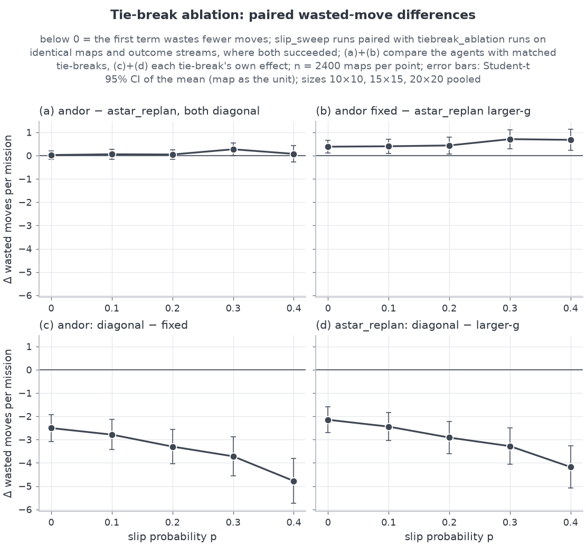

The plot shows the same thing at every p. Panels (a) and (b) are flat near 0, and (b) sits
slightly above 0. Panels (c) and (d) fall from about −2 to about −4 to −5 moves as p rises.
So **H3's growth with p is also a tie-break effect**: slips and skids create more chances for
the tie-break to choose a route.

The match is only approximate (D13). Still, a manipulation check supports it. With matched
tie-breaks, 92.1 % (a) and 87.9 % (b) of paired runs had identical steps and cells explored.
Unmatched (H3), only 25.6 % did.

A second check is stronger. D\* Lite extracts its path by a greedy descent on its distance
values, with ties in `N, E, S, W` order (`planners/dstar_lite.py`). That is the same ordering
as AND-OR with the `fixed` tie-break (BFS distance, then `N, E, S, W`). In the data, `dstar_lite`
(slip sweep) and `andor` with `tie_break=fixed` (ablation) had identical steps, cells explored
and wasted moves on **all 12,000 of 12,000** tasks, at every p. They differ only in how often
they call the planner. So with the same action order, the contingency planner made exactly the
same moves as an incremental path replanner in every mission. It follows that comparison (b) is
numerically the D\* Lite − A\* difference of §3.9. It measures the plain `N, E, S, W` ordering
against A\*'s larger-g ordering, not anything specific to AND-OR.
<!-- python -c "import csv;R=list(csv.DictReader(open('results/raw.csv')));k=lambda r:(r['scenario'],r['rows'],r['replicate'],r['slip_p']);A={k(r):r for r in R if r['experiment']=='tiebreak_ablation' and r['agent']=='andor'};B={k(r):r for r in R if r['experiment']=='slip_sweep' and r['agent']=='dstar_lite'};print(sum(A[q]['steps']==B[q]['steps'] and A[q]['cells_explored']==B[q]['cells_explored'] and A[q]['wasted_moves']==B[q]['wasted_moves'] for q in A),len(A))" -->

**Conclusion.** H3's "win" is a **path-choice (tie-break) effect under the optimistic-unknown
assumption**. A\* + replan with the same diagonal tie-break wastes as few moves as AND-OR
(comparison (a)). The proposal's claim that contingency planning wastes fewer moves than
A\* + replan is **not supported once tie-breaking is controlled**. H3 stays "supported" in
`HYPOTHESES.md` only because that is literally what the default agents did.

What, then, does contingency planning change in this run? One thing, seen from two sides: the
plan already covers every slip and skid. That gives zero unplanned states (H2) and means
AND-OR never replans because of a deviation, so it makes far fewer replanning calls (H5, which
survives matched tie-breaking; see §2.6). Both hold by construction, and the run confirms the
implementation. The run does not show that avoiding these replans improves any mission outcome:
success and bumps are the same, and once tie-breaks are matched AND-OR wastes no fewer moves. With lazy
replanning, A\* + replan closes most of the replan gap (§3.8). The price is planning time: per
call, AND-OR costs 39× (10×10) to 268× (30×30) as much as A\* + replan (§2.6, §3.5).

### 2.5 H4: `astar_fixed` fails on the first misbehaving action (supported, by construction)

Every one of the 6,141 `astar_fixed` runs that had a slip or skid failed. Success falls from
4.6 % at p = 0 to 0.6 % at p ≥ 0.1. In a map-paired sign test, 109 maps are worse at
p ≥ 0.1 and 0 are better (p = 3.1e-33).

Like H2, the 6,141/6,141 count holds by design. Brief §5 defines `astar_fixed` to abort the
first time the actual state differs from the expected one, so a run can survive a slip or skid
only if the deviation itself lands on the survivor (`HYPOTHESES.md` H4). The run verifies the
implementation. The informative part is how often the agent aborts for a different reason: it
senses debris on its next path cell.

At low p, `astar_fixed` mostly fails **before** any action misbehaves. At p = 0, 1,948 of
2,400 runs aborted at debris ahead (342 after a slip or skid on `~` terrain), and at p = 0.1
it was 1,370 against 988. From p = 0.2 on, most failures follow a slip or skid. Over p > 0,
5,799 failures came after a slip or skid and 3,740 at debris ahead (`HYPOTHESES.md` H4 table).
A plan made once on an optimistic map is broken by the map itself as well as by the dynamics.
The verdict covers only the slip/skid part of the claim.
<!-- python -c "import csv,collections as c;F=[r for r in csv.DictReader(open('results/raw.csv')) if r['experiment']=='slip_sweep' and r['agent']=='astar_fixed' and r['success']=='False' and r['slip_p']!='0.0'];print(c.Counter(int(r['slips'])+int(r['skids'])>0 for r in F))" -->

### 2.6 H5: `andor` replans less often (supported; follows from the trigger rules)

`andor` makes 14.14 fewer replanning calls per mission than `astar_replan` [−14.73, −13.56].
The difference holds in every scenario and size, and grows from −5.51 at p = 0.1 to −24.75 at
p = 0.4. Unlike H3, it survives matched tie-breaking: with both agents on the diagonal
tie-break, the difference is −12.20 replans [−12.61, −11.78] (p > 0, 2,400 maps).
<!-- python -c "import csv,statistics as s;from scipy.stats import t;from collections import defaultdict as D;R=list(csv.DictReader(open('results/raw.csv')));k=lambda r:(r['scenario'],r['rows'],r['replicate'],r['slip_p']);A={k(r):r for r in R if r['experiment']=='slip_sweep' and r['agent']=='andor' and r['slip_p']!='0.0'};B={k(r):r for r in R if r['experiment']=='tiebreak_ablation' and r['agent']=='astar_replan' and r['slip_p']!='0.0'};M=D(list);[M[q[:3]].append(int(A[q]['replans'])-int(B[q]['replans'])) for q in A];x=[s.mean(v) for v in M.values()];m=s.mean(x);h=t.ppf(.975,len(x)-1)*s.stdev(x)/len(x)**.5;print(len(x),round(m,2),round(m-h,2),round(m+h,2))" -->

The reason is structural, and it is fixed by the agents' definitions (brief §5). AND-OR
replans only when the map contradicts its belief, because slips and skids are already in the
plan. Its replan count is therefore **flat in p**: 18.57 replans per mission at p = 0 and 18.71
at p = 0.4. `astar_replan` also replans after every deviation, so its count rises from 20.41
to 43.46.
<!-- python -c "import csv,statistics as s;R=[r for r in csv.DictReader(open('results/raw.csv')) if r['experiment']=='slip_sweep'];[print(a,p,round(s.mean(int(r['steps']) for r in X),2),round(s.mean(float(r['wasted_moves']) for r in X),2),round(s.mean(int(r['replans']) for r in X),2)) for a in ('andor','astar_replan','dstar_lite','vi_expected') for p in ('0.0','0.1','0.2','0.3','0.4') for X in [[r for r in R if r['agent']==a and r['slip_p']==p]]]" -->

The decomposition makes this exact. For `astar_replan`, unplanned states equal slips + skids in
every run (§2.3). Removing them from its replan count leaves 19.61, 19.50, 19.47, 19.43 and
19.37 replans per mission at p = 0 to 0.4. That remainder is flat, and close to `andor`'s
18.5–18.8. Over p > 0, `astar_replan` makes 32.79 replans per mission, of which 13.35 follow a
deviation and 19.44 do not; `andor` makes 18.64. So about 13.35 of the 14.14-replan gap (H5)
between the means (94 %) are A\*'s replans after deviations, which its trigger rule requires.
The remaining 0.80 is A\* meeting slightly more contradictions on its own routes. H5 is
therefore the same design consequence as H2's contrast (§2.3), not an independent finding.
<!-- python -c "import csv,statistics as s;R=[r for r in csv.DictReader(open('results/raw.csv')) if r['experiment']=='slip_sweep'];[print(a,p,round(s.mean(int(r['replans']) for r in X),3),round(s.mean(int(r['unplanned_states']) for r in X),3),round(s.mean(int(r['replans'])-int(r['unplanned_states']) for r in X),3)) for a in ('andor','astar_replan') for p in ('0.0','0.1','0.2','0.3','0.4','>0') for X in [[r for r in R if r['agent']==a and (r['slip_p']==p or (p=='>0' and r['slip_p']!='0.0'))]]]" -->

**Fewer replans does not mean less computation.** Across the slip sweep, one AND-OR call took
14.7 ms on average against 0.148 ms for A\* (total planning time ÷ total calls). Per mission,
`andor` spent 289 ms planning against 4.64 ms for `astar_replan`, about 62 times as much.
<!-- python -c "import csv,math,statistics as s;R=[r for r in csv.DictReader(open('results/raw.csv')) if r['experiment']=='slip_sweep' and r['agent'] in('andor','astar_replan')];[print(a,round(s.mean(float(r['planning_ms']) for r in X),2),round(sum(float(r['planning_ms']) for r in X)/sum(int(r['plans_made']) for r in X),3),round(s.mean(int(r['plans_made']) for r in X),2)) for a in ('andor','astar_replan') for X in [[r for r in R if r['agent']==a]]]" -->
AND-OR moves the work from reacting to deviations to planning for them in advance. Whether
fewer planning calls are worth something in their own right, for example fewer pauses on a
real robot, was not measured: in the simulation, planning time costs no steps.

### 2.7 H6: `vi_expected` does **not** need fewer steps than `andor` (refuted)

`vi_expected` computes the policy that minimises expected steps under the true outcome
probabilities. It would be expected to beat AND-OR, which plans with outcome **sets**. In the
field it takes **more** steps: +1.31 [+0.59, +2.04] (p > 0, 2,400 maps).

The effect is uneven:

* The Wilcoxon test finds no consistent shift (p = 0.76), although 1,479 of 2,400 maps differ
  (`HYPOTHESES.md` H6). The per-map differences are spread on both sides of 0, and the positive
  mean is driven by collapsed_building (+6.00 [+3.88, +8.12]).
* random_rubble and maze_corridors are inconclusive.
* flooded_zone favours VI: −0.54 [−0.70, −0.38].

Possible reasons why the "optimal" planner does not win:

1. **It is optimal only for the map it believes in.** Both planners plan on the optimistic
   belief, with unknown cells assumed open. VI's policy minimises expected steps *on that
   map*. Steps caused by debris discovered along the way are outside what it optimises. This
   explains why VI *need not* win. It does not explain why it should lose, because AND-OR plans
   on the same belief.
2. **Its tie-break is the plain one.** Among equally good actions, VI picks the first in
   `N, E, S, W` order (`planners/value_iteration.py`). It has no diagonal key, and §2.4 shows
   that the diagonal key alone is worth about 3.6 moves to AND-OR. Two post-hoc checks (not
   pre-registered claims) support this.
   * At p = 0 on the three scenarios without `~` terrain, nothing slips, so VI's values are
     plain distances. There, `vi_expected` and `andor` with the plain `fixed` tie-break had
     identical steps and cells explored on **1,800 of 1,800** tasks. The two plain orderings
     coincide exactly, while default `andor` differs.
     <!-- python -c "import csv;R=list(csv.DictReader(open('results/raw.csv')));k=lambda r:(r['scenario'],r['rows'],r['replicate'],r['slip_p']);V={k(r):r for r in R if r['experiment']=='slip_sweep' and r['agent']=='vi_expected'};F={k(r):r for r in R if r['experiment']=='tiebreak_ablation' and r['agent']=='andor'};same=lambda q:V[q]['steps']==F[q]['steps'] and V[q]['cells_explored']==F[q]['cells_explored'];print([(z,sum(same(q) for q in V if (q[3]=='0.0')==(z=='p0') and q[0]!='flooded_zone'),sum(1 for q in V if (q[3]=='0.0')==(z=='p0') and q[0]!='flooded_zone')) for z in ('p0','p>0')])" -->
   * Against `andor` with the `fixed` tie-break (the ablation runs), `vi_expected` needs
     **fewer** steps: −2.33 [−3.13, −1.54] (p > 0, 2,400 maps).
   <!-- python -c "import csv,statistics as s;from scipy.stats import t;from collections import defaultdict as D;R=list(csv.DictReader(open('results/raw.csv')));k=lambda r:(r['scenario'],r['rows'],r['replicate'],r['slip_p']);A={k(r):r for r in R if r['experiment']=='slip_sweep' and r['agent']=='vi_expected' and r['slip_p']!='0.0'};B={k(r):r for r in R if r['experiment']=='tiebreak_ablation' and r['agent']=='andor' and r['slip_p']!='0.0'};M=D(list);[M[q[:3]].append(int(A[q]['steps'])-int(B[q]['steps'])) for q in A];x=[s.mean(v) for v in M.values()];m=s.mean(x);h=t.ppf(.975,len(x)-1)*s.stdev(x)/len(x)**.5;print(len(x),len(A),round(m,2),round(m-h,2),round(m+h,2))" -->
     By scenario: random_rubble −2.87 [−3.69, −2.04], flooded_zone −1.79 [−2.04, −1.55],
     maze_corridors −3.94 [−5.96, −1.92], and collapsed_building −0.73 [−3.03, +1.57]
     (inconclusive).
   <!-- python -c "import csv,statistics as s;from scipy.stats import t;from collections import defaultdict as D;R=list(csv.DictReader(open('results/raw.csv')));k=lambda r:(r['scenario'],r['rows'],r['replicate'],r['slip_p']);A={k(r):r for r in R if r['experiment']=='slip_sweep' and r['agent']=='vi_expected' and r['slip_p']!='0.0'};B={k(r):r for r in R if r['experiment']=='tiebreak_ablation' and r['agent']=='andor' and r['slip_p']!='0.0'};[print(sc,len(x),round(m,2),round(m-h,2),round(m+h,2)) for sc in ('random_rubble','collapsed_building','flooded_zone','maze_corridors') for M in [D(list)] for _ in [[M[q[:3]].append(int(A[q]['steps'])-int(B[q]['steps'])) for q in A if q[0]==sc]] for x in [[s.mean(v) for v in M.values()]] for m in [s.mean(x)] for h in [t.ppf(.975,len(x)-1)*s.stdev(x)/len(x)**.5]]" -->
     At p > 0 the two plain orderings no longer coincide: VI's values now include slip and
     skid outcomes, and only 2,024 of 7,200 such tasks (no `~` terrain) keep identical
     trajectories. So this second check mixes two things: VI's use of probabilities and the
     remaining difference in tie keys (Q-values vs BFS distance). It is consistent with the
     tie-break explanation, not a proof of it.

**What this says about sets vs probabilities.** Against default `andor`, VI wins only on
flooded_zone, the only scenario where slip varies from cell to cell. That comparison is
confounded with the tie-break, though. Against `fixed` AND-OR, VI needs fewer steps on three of
four scenarios, including the uniform-p random_rubble (−2.87) and maze_corridors (−3.94), by
more than on flooded_zone (−1.79). So probabilities may help even when p is uniform, for
example by preferring moves whose skids land in better cells. This run cannot separate that
from the tie-break difference, so it does **not** identify the cost of planning with sets
instead of probabilities.

The direct evidence of mud avoidance is on flooded_zone at p = 0, where only `~` cells slip.
There, `vi_expected` had 1.44 slips + skids per mission, against 3.85 for `andor`, 3.20 for
`fixed` `andor` and 3.21 for `astar_replan`. AND-OR orders actions by distance only and ignores
how likely a slip is (at p > 0 a 0.4-slip `~` cell and a 0.2-slip cell even have the same
outcome set), so it does not avoid mud. VI does.
<!-- python -c "import csv,statistics as s;R=[r for r in csv.DictReader(open('results/raw.csv')) if r['slip_p']=='0.0' and r['scenario']=='flooded_zone'];[print(e,a,round(s.mean(int(r['slips'])+int(r['skids']) for r in R if r['agent']==a and r['experiment']==e),2)) for e,a in (('slip_sweep','andor'),('slip_sweep','vi_expected'),('slip_sweep','astar_replan'),('tiebreak_ablation','andor'))]" -->

---

## 3. Results by experiment

### 3.1 Success vs slip probability

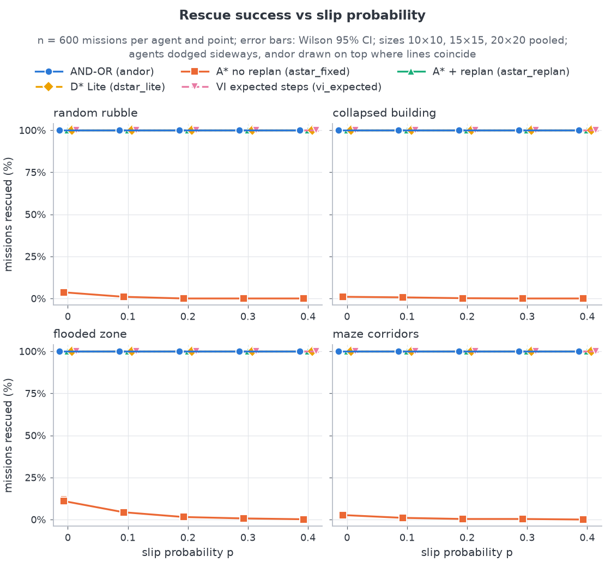

`andor`, `astar_replan`, `dstar_lite` and `vi_expected` rescued the survivor in 100 % of the
600 missions at every point in every scenario. Their lines sit on top of each other at 100 %
(§2.2). `astar_fixed` is the only agent that fails, and it starts low:

* 4.6 % at p = 0, falling to 0.0 % (1/2,400) at p = 0.4 (`HYPOTHESES.md` H4);
* highest on flooded_zone at p = 0 (66/600 = 11.0 %), against 22, 16 and 6 of 600 on
  random_rubble, maze_corridors and collapsed_building.
  <!-- python -c "import csv,collections as c;print(sorted(c.Counter((r['scenario'],r['success']) for r in csv.DictReader(open('results/raw.csv')) if r['experiment']=='slip_sweep' and r['agent']=='astar_fixed' and r['slip_p']=='0.0').items()))" -->

The other scenarios have more unseen debris on the planned path. With the r = 1 sensor, the
optimistic map is wrong too often for a plan made once.

### 3.2 Steps and wasted moves

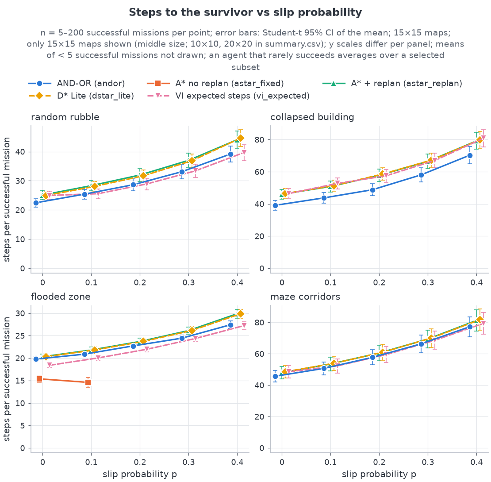
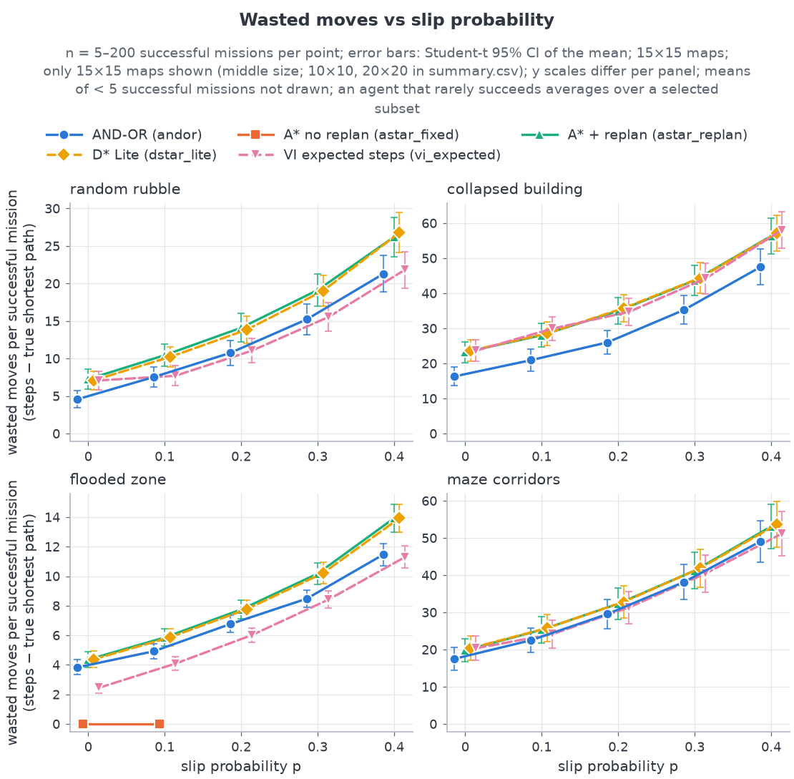
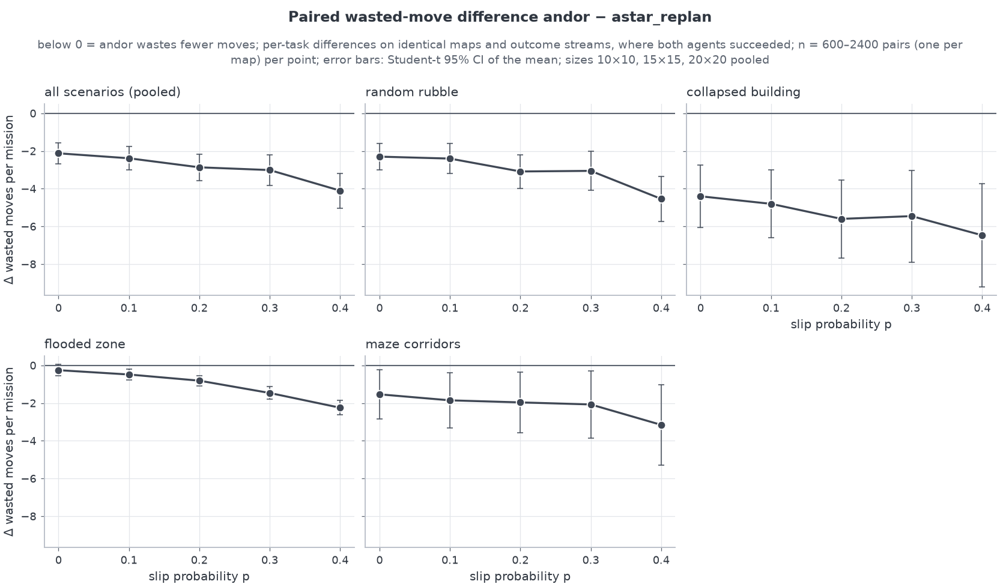

Pooled over all scenarios and sizes, `andor` takes 33.64 steps at p = 0 and 55.92 at p = 0.4.
`astar_replan` takes 35.76 and 60.02. Wasted moves rise from 12.12 to 34.40 for `andor` and
from 14.24 to 38.50 for `astar_replan` (one-liner in §2.6, rows `andor` and `astar_replan`).
Most of the increase with p is unavoidable: a slip is a step that does not move the robot.

The table splits the mean wasted moves per mission into slips (each one a step that does not
move the robot), skids (a sideways step, usually but not always wasted) and the rest (detours
around debris found on the way, route choice, and detours after skids). Every run of these two
agents succeeded, so all columns are over the same 2,400 missions per p.

| p | `andor` wasted | slips | skids | rest | `astar_replan` wasted | slips | skids | rest |
|---|---|---|---|---|---|---|---|---|
| 0 | 12.12 | 0.73 | 0.23 | 11.15 | 14.24 | 0.60 | 0.20 | 13.44 |
| 0.1 | 15.63 | 3.33 | 1.09 | 11.21 | 18.01 | 3.41 | 1.12 | 13.47 |
| 0.2 | 20.20 | 6.62 | 2.20 | 11.38 | 23.06 | 7.01 | 2.32 | 13.73 |
| 0.3 | 26.40 | 10.92 | 3.66 | 11.81 | 29.40 | 11.57 | 3.86 | 13.98 |
| 0.4 | 34.40 | 16.86 | 5.59 | 11.95 | 38.50 | 18.10 | 5.99 | 14.41 |
<!-- python -c "import csv,statistics as s;R=[r for r in csv.DictReader(open('results/raw.csv')) if r['experiment']=='slip_sweep'];[print(a,p,round(w,2),round(sl,2),round(sk,2),round(w-sl-sk,2),round((sl+sk)/w,3)) for a in ('andor','astar_replan','vi_expected') for p in ('0.0','0.1','0.2','0.3','0.4','>0') for X in [[r for r in R if r['agent']==a and (r['slip_p']==p or (p=='>0' and r['slip_p']!='0.0'))]] for w,sl,sk in [(s.mean(float(r['wasted_moves']) for r in X),s.mean(int(r['slips']) for r in X),s.mean(int(r['skids']) for r in X))]]" -->

So debris and route choice dominate the wasted moves at low p, and slips and skids dominate at
high p. Over p > 0, slips + skids make up 52 % of `andor`'s wasted moves (9.43 + 3.14 of
24.15), 49 % of `astar_replan`'s and 50 % of `vi_expected`'s. The rest is nearly flat in p.
That remainder, about 11–12 moves for `andor` against 13–14 for `astar_replan`, is where the
agents differ, and it is decided by route choice (§2.4).

The 15×15 panels show that the `andor` advantage is largest on collapsed_building and that the
curves of all agents nearly coincide on maze_corridors. In the paired-difference plot every
point's mean lies below 0. The smallest gap is flooded_zone at p = 0: −0.25 moves, with a
95 % CI that crosses 0 ([−0.55, +0.05], 600 pairs). It is the only point of the plot that is
not significantly below 0.
<!-- python -c "import csv,statistics as s;from scipy.stats import t;R=list(csv.DictReader(open('results/raw.csv')));k=lambda r:(r['rows'],r['replicate']);X=[r for r in R if r['experiment']=='slip_sweep' and r['scenario']=='flooded_zone' and r['slip_p']=='0.0'];A={k(r):r for r in X if r['agent']=='andor'};B={k(r):r for r in X if r['agent']=='astar_replan'};x=[float(A[q]['wasted_moves'])-float(B[q]['wasted_moves']) for q in A];m=s.mean(x);h=t.ppf(.975,len(x)-1)*s.stdev(x)/len(x)**.5;print(len(x),round(m,2),round(m-h,2),round(m+h,2))" -->

As §2.4 shows, the gap disappears once tie-breaking is matched. The curves measure **route
choice under optimism**, not the value of the contingency plan. On the 15×15 panels,
`astar_fixed` appears only on flooded_zone at p ≤ 0.1, the only points where it has at least
5 successes (18 and 5; `summary.csv`). Its wasted moves are
0 there because it succeeds only when nothing goes wrong.

### 3.3 Replanning calls

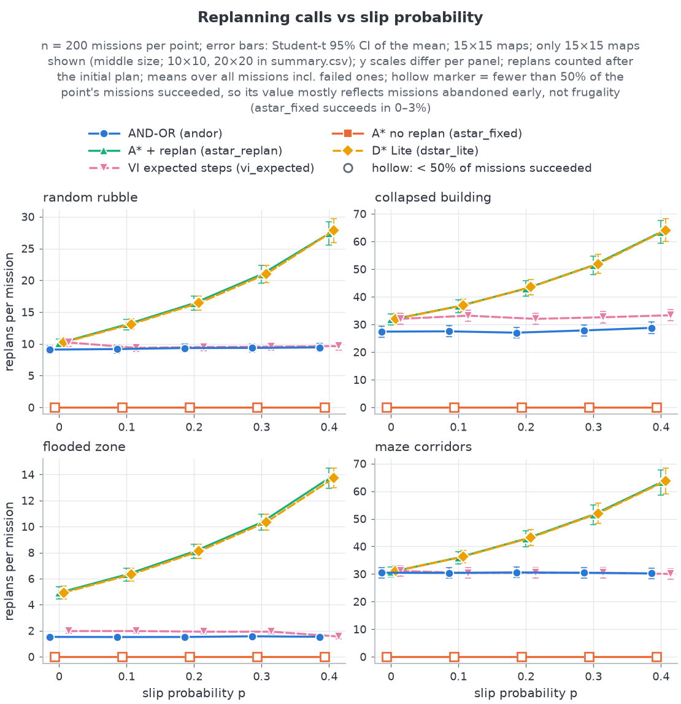
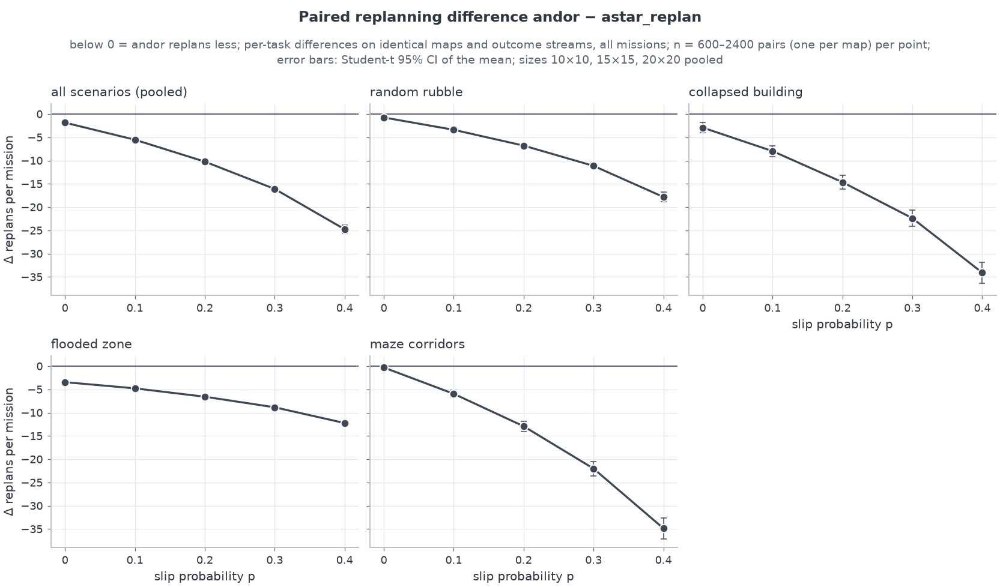

The plot shows the structural difference from §2.6:

* `andor` and `vi_expected` stay flat in p, because they replan only on map contradictions;
* `astar_replan` and `dstar_lite` climb steeply, because they also replan on every deviation.

On 15×15 maze_corridors at p = 0.4, for example, `andor` makes 30.21 replans per mission and
A\* + replan makes 63.20 (`summary.csv`). The paired difference is negative everywhere and grows
with p. It is largest on collapsed_building and maze_corridors (about −35 at p = 0.4). Those
maps have the most hidden structure, so both agents meet many contradictions and A\* also has
to answer every slip.

At p = 0 the two agents differ less (−1.85 [−2.18, −1.51], `HYPOTHESES.md` H5). Without
slips, both agents replan only when the map contradicts them, except on flooded_zone. There
the `~` cells still slip at p = 0 and A\* replans after each of those deviations, so flooded_zone
has the largest p = 0 gap (−3.44 [−3.72, −3.16]). The other scenarios range from −2.91
(collapsed_building) to −0.29 [−0.94, +0.35] (maze_corridors, the only point of the plot whose
CI crosses 0). `astar_fixed`'s 0 replans are drawn hollow because it rarely succeeds: it gives
up instead of replanning.
<!-- python -c "import csv,statistics as s;from scipy.stats import t;R=[r for r in csv.DictReader(open('results/raw.csv')) if r['experiment']=='slip_sweep' and r['slip_p']=='0.0'];k=lambda r:(r['scenario'],r['rows'],r['replicate']);A={k(r):r for r in R if r['agent']=='andor'};B={k(r):r for r in R if r['agent']=='astar_replan'};[print(sc,len(x),round(m,2),round(m-h,2),round(m+h,2)) for sc in ('random_rubble','collapsed_building','flooded_zone','maze_corridors') for x in [[int(A[q]['replans'])-int(B[q]['replans']) for q in A if q[0]==sc]] for m in [s.mean(x)] for h in [t.ppf(.975,len(x)-1)*s.stdev(x)/len(x)**.5]]" -->

### 3.4 Cells explored

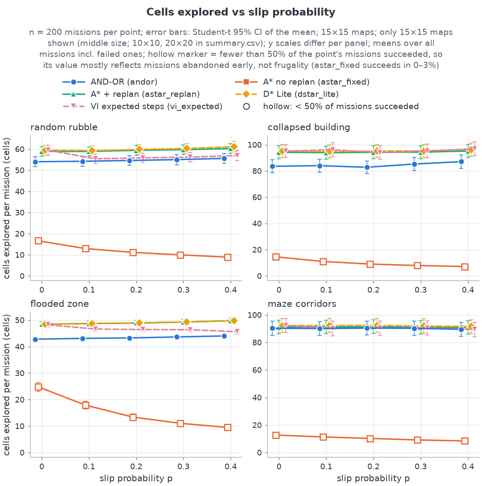

`andor` senses fewer distinct cells than `astar_replan`: −4.44 cells [−5.22, −3.66] (p > 0,
2,400 maps).
<!-- python -c "import csv,statistics as s;from scipy.stats import t;from collections import defaultdict as D;R=list(csv.DictReader(open('results/raw.csv')));k=lambda r:(r['scenario'],r['rows'],r['replicate'],r['slip_p']);A={k(r):r for r in R if r['experiment']=='slip_sweep' and r['agent']=='andor' and r['slip_p']!='0.0'};B={k(r):r for r in R if r['experiment']=='slip_sweep' and r['agent']=='astar_replan' and r['slip_p']!='0.0'};M=D(list);[M[q[:3]].append(int(A[q]['cells_explored'])-int(B[q]['cells_explored'])) for q in A];x=[s.mean(v) for v in M.values()];m=s.mean(x);h=t.ppf(.975,len(x)-1)*s.stdev(x)/len(x)**.5;print(len(x),round(m,2),round(m-h,2),round(m+h,2))" -->
This is also route choice. Against `astar_replan` with the same diagonal tie-break, `andor`
explores slightly **more** cells: +0.35 [+0.08, +0.62].
<!-- python -c "import csv,statistics as s;from scipy.stats import t;from collections import defaultdict as D;R=list(csv.DictReader(open('results/raw.csv')));k=lambda r:(r['scenario'],r['rows'],r['replicate'],r['slip_p']);A={k(r):r for r in R if r['experiment']=='slip_sweep' and r['agent']=='andor' and r['slip_p']!='0.0'};B={k(r):r for r in R if r['experiment']=='tiebreak_ablation' and r['agent']=='astar_replan' and r['slip_p']!='0.0'};M=D(list);[M[q[:3]].append(int(A[q]['cells_explored'])-int(B[q]['cells_explored'])) for q in A];x=[s.mean(v) for v in M.values()];m=s.mean(x);h=t.ppf(.975,len(x)-1)*s.stdev(x)/len(x)**.5;print(len(x),round(m,2),round(m-h,2),round(m+h,2))" -->
Cells explored barely depends on p for any agent. The robot walks roughly the same corridor;
slips add steps, not new cells. `astar_fixed`'s low and falling counts reflect missions
abandoned early (hollow markers), not efficient exploration.

### 3.5 Planning time vs grid size (scaling)

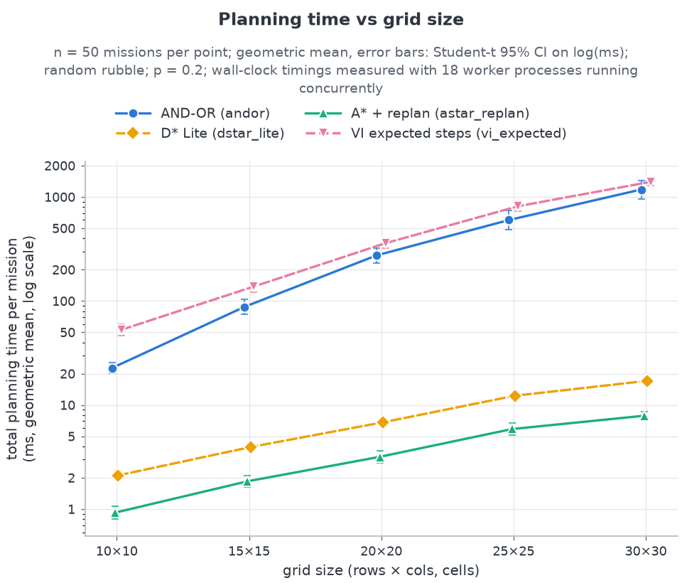

The plot shows geometric means on a log scale. Total planning time per mission grows with
size for every agent:

* `andor` and `vi_expected` sit in the same band, from tens of milliseconds at 10×10 (22.7 and
  52.9 ms) to about 1.2–1.4 s at 30×30 (1.18 and 1.40 s; the arithmetic means in
  `docs/algorithm.md` §7.3 are 1.56 and 1.45 s);
* `astar_replan` and `dstar_lite` stay between about 1 and 20 ms (0.93 to 7.9 ms and 2.1 to
  17.1 ms).
<!-- python -c "import csv,math,statistics as s;R=[r for r in csv.DictReader(open('results/raw.csv')) if r['experiment']=='scaling'];[print(a,n,round(math.exp(s.mean(math.log(float(r['planning_ms'])) for r in R if r['agent']==a and r['rows']==n)),2)) for a in ('andor','vi_expected','astar_replan','dstar_lite') for n in ('10','30')]" -->

The full table, with arithmetic means and 95 % CIs per call and per mission, is in
`docs/algorithm.md` §7.3. In short:

* One AND-OR call takes 3.76 ms at 10×10 and 81.9 ms at 30×30.
* Per call, AND-OR costs 39× (10×10) to 268× (30×30) as much as A\* + replan (geometric mean
  of the per-map ratios). Per mission the factor is 25× to 149×.
  <!-- python -c "import csv,math,statistics as s;R=[r for r in csv.DictReader(open('results/raw.csv')) if r['experiment']=='scaling'];d={};[d.setdefault((r['rows'],r['seed']),{}).__setitem__(r['agent'],r) for r in R];g=lambda f,n:round(math.exp(s.mean(math.log(f(v['andor'])/f(v['astar_replan'])) for k,v in d.items() if k[0]==n)),1);[print(n,g(lambda r:float(r['planning_ms']),n),g(lambda r:float(r['planning_ms'])/int(r['plans_made']),n)) for n in ('10','15','20','25','30')]" -->
* The gap widens with size, because an AND-OR call covers every outcome of every reachable
  state while A\* finds one path.
* No mission needed the fixpoint fallback.

At 30×30 an AND-OR call still takes well under a second, which is fast enough for a robot
that moves one cell per step. The proposal's planner has **a real computational price**,
though, and §3.3's lower replan count does not pay for it.

### 3.6 Aftershocks

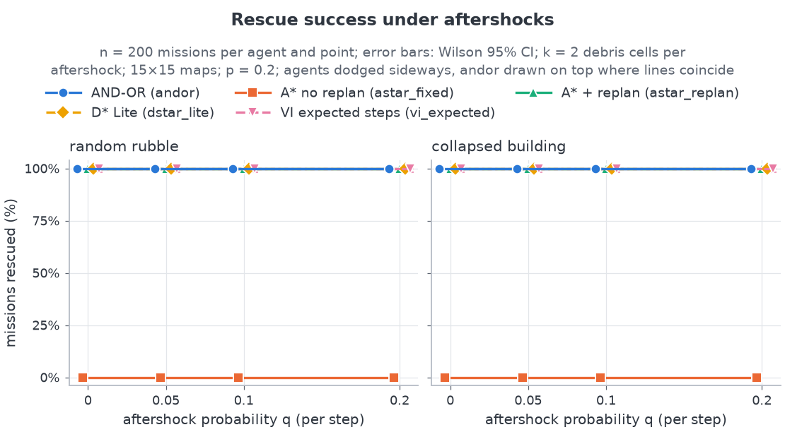

The `aftershocks` block drops k = 2 debris cells outside the robot's sensor footprint with
probability q per step, on 15×15 maps at p = 0.2. All four replanning agents rescued the
survivor in 200/200 missions at every q, in both scenarios. `astar_fixed` rescued none.

At q = 0.2, `andor` experienced 6.47 aftershock events per mission on random_rubble and 11.10
on collapsed_building (`summary.csv`, `aftershock_events_mean`). As q rises from 0 to 0.2, its
steps grow from 28.64 to 32.70 on random_rubble and from 48.84 to 55.68 on
collapsed_building. Its replans grow from 9.34 to 11.58 on random_rubble and stay near 27 on
collapsed_building.

Pooled over q > 0, `andor` needs fewer steps than `astar_replan`: −3.28 [−4.69, −1.88] on
random_rubble and −10.22 [−13.65, −6.78] on collapsed_building. It also needs fewer replans:
−7.56 and −16.47 per mission.
<!-- python -c "import csv,statistics as s;from scipy.stats import t;from collections import defaultdict as D;R=[r for r in csv.DictReader(open('results/raw.csv')) if r['experiment']=='aftershocks' and r['aftershock_q']!='0.0'];k=lambda r:(r['scenario'],r['replicate'],r['aftershock_q']);A={k(r):r for r in R if r['agent']=='andor'};B={k(r):r for r in R if r['agent']=='astar_replan'};[print(sc,c,len(x),round(m,2),round(m-h,2),round(m+h,2)) for sc in ('random_rubble','collapsed_building') for c in ('steps','replans') for M in [D(list)] for _ in [[M[q[:2]].append(int(A[q][c])-int(B[q][c])) for q in A if q[0]==sc]] for x in [[s.mean(v) for v in M.values()]] for m in [s.mean(x)] for h in [t.ppf(.975,len(x)-1)*s.stdev(x)/len(x)**.5]]" -->
The pooled gaps hide variation between q values. Per q (paired, 200 maps each), the step gap
is −3.34, −2.96, −3.33 and −3.54 on random_rubble at q = 0, 0.05, 0.1 and 0.2. On
collapsed_building it is −8.97, −13.18, −10.86 and −6.62, so it does not change monotonically
with q.
<!-- python -c "import csv,statistics as s;from scipy.stats import t;R=[r for r in csv.DictReader(open('results/raw.csv')) if r['experiment']=='aftershocks'];k=lambda r:(r['scenario'],r['aftershock_q'],r['replicate']);A={k(r):r for r in R if r['agent']=='andor'};B={k(r):r for r in R if r['agent']=='astar_replan'};[print(sc,q,len(x),round(m,2),round(m-h,2),round(m+h,2)) for sc in ('random_rubble','collapsed_building') for q in ('0.0','0.05','0.1','0.2') for x in [[int(A[z]['steps'])-int(B[z]['steps']) for z in A if z[:2]==(sc,q)]] for m in [s.mean(x)] for h in [t.ppf(.975,len(x)-1)*s.stdev(x)/len(x)**.5]]" -->
The pairing is also weaker here than in the other blocks. With q > 0 both agents receive the
same outcome and aftershock draws, but the debris lands outside *each* robot's own sensor
footprint (D9, D20). Once the two robots stand in different places, their true maps differ. The
comparison therefore pairs the random draws, not the realised maps. This block was run with the
default (unmatched) tie-breaks, so the step differences carry the same caveat as H3. Aftershocks do not change the picture. Both agents
absorb them by replanning. Σ unplanned states and Σ bumps stayed 0 for `andor` (§4), because
aftershocks never hit the cells the robot can see.

### 3.7 Sensor radius

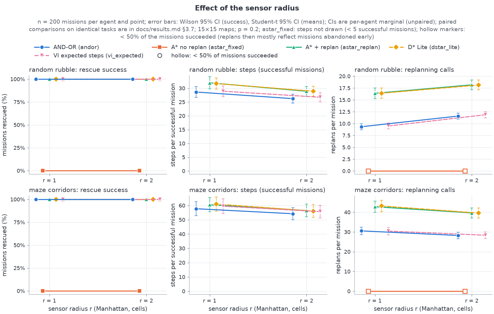

Raising the sensor radius from r = 1 to r = 2 (15×15, p = 0.2) shortens missions for every
replanning agent. (`astar_fixed` never succeeds in this block, so it has no step mean.)
`andor` goes from 28.64 to 26.24 steps on random_rubble and from 57.73 to 54.23 on
maze_corridors. Cells explored rise sharply: from 54.6 to 82.1 and from 90.4 to 117.9. These
are `summary.csv` means. The plot's error bars are unpaired (`HYPOTHESES.md` tests neither the
sensor radius nor the replan mode); the paired r = 2 − r = 1 differences (same map and outcome
stream, 200 maps each) are:

| Scenario | Agent | Δ steps [95 % CI] | Δ replans [95 % CI] |
|---|---|---|---|
| random_rubble | `andor` | −2.40 [−3.19, −1.62] | +2.25 [+1.91, +2.59] |
| random_rubble | `astar_replan` | −3.06 [−3.89, −2.23] | +1.78 [+1.36, +2.21] |
| random_rubble | `dstar_lite` | −2.79 [−3.75, −1.84] | +1.73 [+1.24, +2.22] |
| random_rubble | `vi_expected` | −2.17 [−3.11, −1.24] | +2.38 [+2.00, +2.75] |
| maze_corridors | `andor` | −3.50 [−5.11, −1.90] | −2.33 [−3.02, −1.65] |
| maze_corridors | `astar_replan` | −4.04 [−6.27, −1.82] | −3.12 [−4.30, −1.95] |
| maze_corridors | `dstar_lite` | −4.88 [−6.73, −3.04] | −3.60 [−4.64, −2.55] |
| maze_corridors | `vi_expected` | −3.77 [−5.40, −2.14] | −2.07 [−2.75, −1.39] |
<!-- python -c "import csv,statistics as s;from scipy.stats import t;R=[r for r in csv.DictReader(open('results/raw.csv')) if r['experiment']=='sensor_range'];G={(r['scenario'],r['agent'],r['replicate'],r['sensor_radius']):r for r in R};[print(sc,a,c,len(x),round(m,2),round(m-h,2),round(m+h,2)) for sc in ('random_rubble','maze_corridors') for a in ('andor','astar_replan','dstar_lite','vi_expected') for c in ('steps','replans') for x in [[int(G[(sc,a,i,'2')][c])-int(G[(sc,a,i,'1')][c]) for (s2,a2,i,rr) in G if (s2,a2,rr)==(sc,a,'1')]] for m in [s.mean(x)] for h in [t.ppf(.975,len(x)-1)*s.stdev(x)/len(x)**.5]]" -->

Every step CI lies below 0. The effect on replanning depends on the map:

* On random_rubble, every replanning agent replans **more** with r = 2 (`andor` 9.34 → 11.59).
  In eager mode it replans on every contradiction, and a wider sensor sees more of them.
* On maze_corridors every one replans less (`andor` 30.57 → 28.23).
* `astar_replan` follows the same pattern (16.40 → 18.18 and 42.79 → 39.67).

The invariants hold at r = 2 as well (0 unplanned, 0 bumps; `HYPOTHESES.md` H2). The means
are from `summary.csv`, `experiment == sensor_range`.

### 3.8 Eager vs lazy replanning

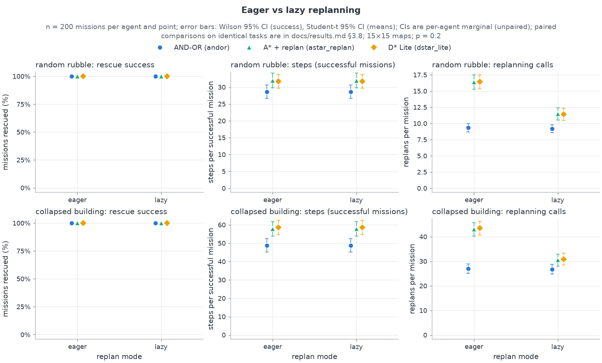

Lazy mode replans only if a contradicted cell lies in the current plan's envelope (AND-OR) or
on the remaining path (A\*). In all 400 paired missions of each agent, the lazy run had
exactly the same steps and cells explored as the eager run.
<!-- python -c "import csv;R=[r for r in csv.DictReader(open('results/raw.csv')) if r['experiment']=='replan_mode'];d={};[d.setdefault((r['agent'],r['scenario'],r['replicate']),{}).__setitem__(r['replan_mode'],r) for r in R];[print(a,sum(v['eager']['steps']==v['lazy']['steps'] and v['eager']['cells_explored']==v['lazy']['cells_explored'] for q,v in d.items() if q[0]==a),sum(q[0]==a for q in d)) for a in ('andor','astar_replan','dstar_lite')]" -->
So lazy mode only saved planning calls:

* `astar_replan`: 16.40 → 11.49 replans on random_rubble, 42.98 → 30.50 on
  collapsed_building;
* `dstar_lite`: about the same reduction;
* `andor`: almost nothing (9.34 → 9.20 and 27.02 → 26.76), because an AND-OR plan's envelope
  covers most cells near the route, so most contradictions are relevant to it.

Lazy mode therefore narrows the H5 gap. Paired on the same 200 maps, `andor` − `astar_replan`
is −2.29 [−3.02, −1.55] replans per mission on random_rubble and −3.73 [−6.06, −1.41] on
collapsed_building in lazy mode, against −7.05 [−7.84, −6.27] and −15.96 [−18.53, −13.39] in
eager mode. The gap shrinks by 68 % and 77 % (1 − 2.29/7.05 and 1 − 3.73/15.96).

Splitting A\*'s replans as in §2.6 shows why. Its replans that do not follow a deviation fall
from 9.87 (eager) to 4.96 (lazy) on random_rubble and from 31.31 to 18.83 on
collapsed_building, while `andor`'s stay at 9.34 → 9.20 and 27.02 → 26.76. In lazy mode,
`andor` makes **more** map-triggered replans than A\* + replan. What remains of the H5 gap is
A\*'s replans after slips and skids, which a contingency plan avoids by construction. Lazy
replanning is a free improvement for the A\* baselines that the deck did not consider.
<!-- python -c "import csv,statistics as s;from scipy.stats import t;R=[r for r in csv.DictReader(open('results/raw.csv')) if r['experiment']=='replan_mode'];G={(r['scenario'],r['replan_mode'],r['agent'],r['replicate']):r for r in R};[print(sc,md,round(s.mean(int(G[(sc,md,'astar_replan',i)]['replans'])-int(G[(sc,md,'astar_replan',i)]['unplanned_states']) for i in I),2),round(s.mean(int(G[(sc,md,'andor',i)]['replans']) for i in I),2),len(x),round(m,2),round(m-h,2),round(m+h,2)) for sc in ('random_rubble','collapsed_building') for md in ('eager','lazy') for I in [[q[3] for q in G if q[:3]==(sc,md,'andor')]] for x in [[int(G[(sc,md,'andor',i)]['replans'])-int(G[(sc,md,'astar_replan',i)]['replans']) for i in I]] for m in [s.mean(x)] for h in [t.ppf(.975,len(x)-1)*s.stdev(x)/len(x)**.5]]" -->

### 3.9 Stretch agents

**D\* Lite vs A\* + replan.** D\* Lite reuses its search between calls, but it plans the same
shortest paths. Over p > 0 (2,400 maps), 8,708 of 9,600 paired runs had identical step counts.
D\* Lite took slightly more steps (+0.56 [+0.20, +0.91]) and slightly more replans (+0.48
[+0.25, +0.71]). The cause is its tie-break. D\* Lite extracts its path greedily with ties in
`N, E, S, W` order, and its trajectories match those of AND-OR with the `fixed` tie-break on
all 12,000 slip-sweep tasks (§2.4). So this step difference is the same quantity as H7
comparison (b): plain `N, E, S, W` ordering against A\*'s larger-g ordering.
<!-- python -c "import csv,statistics as s;from scipy.stats import t;from collections import defaultdict as D;R=list(csv.DictReader(open('results/raw.csv')));k=lambda r:(r['scenario'],r['rows'],r['replicate'],r['slip_p']);A={k(r):r for r in R if r['experiment']=='slip_sweep' and r['agent']=='dstar_lite' and r['slip_p']!='0.0'};B={k(r):r for r in R if r['experiment']=='slip_sweep' and r['agent']=='astar_replan' and r['slip_p']!='0.0'};[print(c,len(x),round(m,2),round(m-h,2),round(m+h,2)) for c in ('steps','replans') for M in [D(list)] for _ in [[M[q[:3]].append(int(A[q][c])-int(B[q][c])) for q in A]] for x in [[s.mean(v) for v in M.values()]] for m in [s.mean(x)] for h in [t.ppf(.975,len(x)-1)*s.stdev(x)/len(x)**.5]];print('identical steps',sum(A[q]['steps']==B[q]['steps'] for q in A),len(A))" -->
The node counts of the two planners are in different units (D19): at 30×30 D\* Lite performs
11.2 vertex expansions per call and A\* 18.8 heap pops, so they cannot be compared directly.
Time per call is in the same unit. In this pure-Python implementation each D\* Lite call takes
about **twice as long** (0.494 vs 0.230 ms at 30×30; `docs/algorithm.md` §7.3). Incremental search pays off only when a from-scratch
search is expensive, and on grids up to 30×30 it is not.

**`vi_expected` vs `andor`: sets vs probabilities, confounded with tie-breaking.** Both
agents use the same triggers and anticipation, and both keep 0 unplanned states and 0 bumps.
Against default `andor`, VI saves steps only on flooded_zone, where slip varies by cell: 0.54
steps at p > 0 [−0.70, −0.38] (`HYPOTHESES.md` H6). At p = 0 on 15×15 flooded_zone maps it
wastes 2.45 moves against `andor`'s 3.84, and it slips or skids 1.45 times per mission against
3.68 (`summary.csv`). That is direct evidence that it routes around `~` mud, which AND-OR's
distance ordering ignores.

This does not show that probabilities help *only* where slip varies by cell. The comparison
with default `andor` is confounded with the diagonal tie-break. Against `andor` with the plain
tie-break, VI needs fewer steps on three of four scenarios, including the two uniform-p ones
where it wins most (§2.7, post hoc). This run cannot separate the effect of the probabilities
from the remaining tie-break difference.

VI's planning time is in the same band as AND-OR's, and paired by map it is higher at every
size. The geometric mean of the per-map ratio VI / `andor` of time per mission is 2.33
[2.07, 2.62] at 10×10, 1.57 at 15×15, 1.31 at 20×20, 1.36 at 25×25 and 1.18 [0.95, 1.47] at
30×30, where the CI includes 1. So VI is not cheaper either.
<!-- python -c "import csv,math,statistics as s;from scipy.stats import t;R=[r for r in csv.DictReader(open('results/raw.csv')) if r['experiment']=='scaling'];d={};[d.setdefault((r['rows'],r['seed']),{}).__setitem__(r['agent'],r) for r in R];[print(n,len(x),round(math.exp(m),2),round(math.exp(m-h),2),round(math.exp(m+h),2)) for n in ('10','15','20','25','30') for x in [[math.log(float(v['vi_expected']['planning_ms'])/float(v['andor']['planning_ms'])) for k,v in d.items() if k[0]==n]] for m in [s.mean(x)] for h in [t.ppf(.975,len(x)-1)*s.stdev(x)/len(x)**.5]]" -->

---

## 4. Invariants observed

Over all 99,400 missions of the run:
<!-- python -c "import csv,collections as c;T=c.defaultdict(lambda:[0,0,0,0,0]);[T[r['agent']].__setitem__(slice(None),[a+b for a,b in zip(T[r['agent']],[1,int(r['unplanned_states']),int(r['bumps']),int(r['planner_fallbacks']),r['failure_reason']=='budget'])]) for r in csv.DictReader(open('results/raw.csv'))];print(dict(T))" -->

| Agent | Missions | Σ unplanned states | Σ bumps | Σ planner fallbacks | Budget failures |
|---|---|---|---|---|---|
| `andor` | 27,450 | **0** | **0** | **0** | 0 |
| `vi_expected` | 14,650 | 0 | 0 | 0 | 0 |
| `astar_replan` | 27,450 | 285,067 | 0 | 0 | 0 |
| `dstar_lite` | 15,450 | 163,889 | 0 | 0 | 0 |
| `astar_fixed` | 14,400 | 7,415 | 0 | 0 | 0 |

* **Unplanned states = 0 and bumps = 0 for `andor`** in every block, including r = 2,
  aftershocks and lazy mode (`HYPOTHESES.md` H2, per-block table). This matches Proposition
  4.8. `vi_expected` shares the anticipation logic and the invariant.
* **Bumps = 0 for every agent.** With r ≥ 1, every agent senses its neighbours before acting,
  so no agent enters unseen debris. The A\* agents' unplanned states are deviations from their
  single expected cell (D10), not collisions.
* **Planner fallbacks = 0.** The fixpoint reference planner was never needed, as Proposition
  6.2 predicts for the default ordering. Rollbacks are not recorded by the harness
  (`docs/algorithm.md` §7.3).
* **Budget failures = 0.** No mission of any agent ran out of its `4·R·C` steps (§2.2).

---

## 5. Threats to validity and limitations

* **The optimistic-unknown assumption drives the step results.** Every agent plans as if
  unknown cells were open. Debris discovered on the way (and route choice) dominates the wasted
  moves at low p, and slips and skids dominate at high p: they make up about half of all wasted
  moves over p > 0 (§3.2). The part that differs between agents is the debris part, and route
  choice among equally short optimistic routes (tie-breaking) decides it. Tie-breaking therefore
  matters more than contingency planning for steps and wasted moves (H7). A different assumption,
  such as a debris prior or frontier-aware costs, could change the ranking. This run does not
  test one.
* **Map generators.** The four generators (`mapgen.py`) and their parameters set the debris
  density and structure. They guarantee solvability and a minimum start–survivor separation
  (D18). The results describe these generators, not real disaster sites.
  Only flooded_zone has terrain-dependent slip. It is the only scenario where VI beat the
  default `andor`, but against `andor` with the same plain tie-break VI also needed fewer steps
  on two uniform-p scenarios (§2.7), so these generators do not isolate where probabilities
  help.
* **Maze performance.** On maze_corridors every agent wastes many moves. At 15×15 and p = 0,
  `andor` wastes 17.52 and `astar_replan` 19.82 (`summary.csv`). The optimistic belief leads
  every agent into dead ends that a r = 1 sensor cannot see ahead. Contingency planning does
  nothing for this, because it is an exploration problem, not an action-uncertainty problem.
  H3's maze_corridors CI is also the closest to 0 ([−3.94, −0.58], paired t p = 0.0086), the
  weakest of the four scenario effects.
* **Budget 4·R·C.** The budget never bound (the longest successful mission used 33 % of it),
  so success rates cannot tell the replanning agents apart. A tighter budget, or survivors
  that can become unreachable, would make success informative. The proposal did not specify
  such conditions, and they were not run.
* **Single-machine timings.** Planning times are wall-clock measurements on one Windows 11
  machine with 18 worker processes running at once. Absolute milliseconds are inflated and
  noisy (the scaling plot's caption says so). Ratios between agents measured in the same run
  are more reliable than absolute values. All planners are pure Python, so the D\* Lite vs
  A\* timing comparison in particular may not hold in a compiled implementation.
* **Set-based planner vs probabilities.** AND-OR guarantees that every outcome is covered, but
  it ignores how likely each outcome is. It cannot prefer firm ground over mud, as the
  flooded_zone slip counts at p = 0 show (§2.7). That is a property of strong-cyclic planning,
  not a bug.
* **Statistical scope.** Verdicts rest on 95 % CIs with the map as the unit. Several claims
  are tested on the same data and no multiplicity correction was applied. Most p-values are
  far below any corrected threshold, but the borderline per-scenario rows should not be read
  individually. The post-hoc analyses were not planned before the run: the H6 comparisons
  against `andor`-fixed and the VI trajectory identity (§2.7), the D\* Lite identity (§2.4), the
  wasted-move decomposition (§3.2), the replan decomposition (§2.6, §3.8) and the paired
  sensor-radius tests (§3.7).
* **H7 was designed after seeing an earlier full run.** `docs/plan.md` D21 justifies H7 with
  numbers from an earlier full run (H3's p = 0 gap, 510/600 flooded_zone runs with a slip or
  skid at p = 0). H7 and its ±0.5-move margin were therefore fixed before *this* run but after
  that observation. The direction of the test does not favour `andor`, but it is not a
  pre-registered hypothesis.
* **Tie-break matching is approximate (D13).** With matched tie-breaks, 92.1 % and 87.9 % of
  pairs had identical steps and cells explored, not 100 %. The (b) difference (+0.56) is not
  a residue of that mismatch, though. It is exactly the D\* Lite − A\* difference (§2.4, §3.9):
  a real difference between two plain orderings, `N, E, S, W` distance descent and A\*'s
  larger-g ordering, in which AND-OR's contingency planning plays no part.

**What was not done:**

* no noisy sensing;
* no unknown survivor location;
* no multiple survivors;
* no LAO\* or terrain-aware AND-OR costs (the optional extensions of brief §8);
* no sensor radius r = 0 in the experiments (it is used only in tests);
* no matched-tie-break versions of the aftershock, sensor and replan-mode blocks;
* no measurement of AND-OR rollbacks in the harness;
* no maps larger than 30×30.

---

## 6. Summary

* **Reliability (H1, H2):** `andor` rescued the survivor in all 27,450 runs (26,100 unique
  missions; 2,400/2,400 at p = 0.3) with zero unplanned states, zero bumps and zero planner
  fallbacks. Zero unplanned states and bumps hold by construction (§2.3). A\* + replan,
  D\* Lite and value iteration were also 100 % successful, so success alone does not favour
  contingency planning here. Only the never-replanning `astar_fixed` fails (171 of 14,400
  runs succeeded).
* **Wasted moves (H3, H7):** the measured −3.09-move advantage of `andor` over A\* + replan is
  a **tie-break (route-choice) effect** under the optimistic-unknown assumption. With matched
  tie-breaks the difference is +0.11 [−0.12, +0.35] (diagonal) or +0.56 [+0.20, +0.91]
  (plain). The proposal's "fewer wasted moves" claim is therefore not attributable to
  contingency planning.
* **Replans (H5):** `andor` makes 14.14 fewer replanning calls per mission ([−14.73, −13.56];
  still −12.20 with matched tie-breaks), and its replan count is flat in p because slips are
  already in the plan. This follows from the trigger rules, and it is the same design property
  as zero unplanned states, not a second benefit. About 94 % of the gap is A\* + replan's replans
  after slips and skids, which its definition requires (§2.6). With lazy replanning the gap
  shrinks by 68–77 %, and lazy A\* then makes *fewer* map-triggered replans than `andor` (§3.8).
  The run does not show that fewer replans improve any mission outcome.
* **Cost:** each AND-OR call costs 39× to 268× an A\* call (10×10 to 30×30). Per mission,
  AND-OR used about 62 times as much planning time over the slip sweep. Fewer replans do not
  mean less computation.
* **Probabilities (H6):** the expected-steps optimal `vi_expected` took **more** steps than
  `andor` (+1.31 [+0.59, +2.04]). It beats the default `andor` only on flooded_zone (−0.54
  steps), where it demonstrably avoids mud (§2.7). Possible explanations for the overall loss
  are that VI is optimal only for the believed map and that it uses the plain tie-break.
  Against `andor` with the same plain tie-break, VI needs fewer steps on three of four
  scenarios, uniform-p ones included (post hoc). So the run does **not** measure the cost of
  planning with outcome sets instead of probabilities; that effect is confounded with
  tie-breaking.
